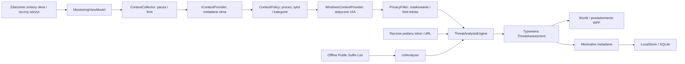

# Sentinel AI — architektura Etapów 1–2

## Komponenty

.NET 10 LTS, WPF, MVVM, Microsoft.Extensions.DependencyInjection i Microsoft.Data.Sqlite. Sentinel.Core nie zależy od Windows; Sentinel.Desktop dostarcza user32/UI Automation i interfejs. Modele, reguły i magazyn mogą zostać wykorzystane w przyszłym kliencie mobilnym i serwerze. Nie implementujemy jeszcze tych klientów.

- `MainViewModel`: ustawienia wspólne i historia; nie pozyskuje kontekstu.
- `MonitoringViewModel`: jawny start/pauza, obsługa zdarzeń, prezentacja oceny i zapis metadanych. Nie przechowuje w historii danych wejściowych. Pauza nie blokuje analizy świadomie wklejonego tekstu.
- `IContextProvider`: źródło metadanych i kontekstu. `IForegroundEventSource` jest oddzielnym, opcjonalnym źródłem zdarzeń.
- `ContextCollector`: pojedynczy odczyt, monotoniczny limit częstotliwości, polityka wykluczeń przed ekstrakcją i maskowanie na granicy źródła. Źródło nie powinno dostawać żądań ekstrakcji dla wykluczonych okien.
- `WindowsContextProvider`: user32 do aktywnego okna i procesu, UI Automation do statycznych etykiet. Odczyt jest na osobnym wątku MTA, nie na wątku UI. Sprawdza zgodność aktywnego okna i PID przed i po odczycie. Pomija poddrzewa haseł, Edit i ComboBox. Brak TextPattern, ValuePattern, keyboard hooków, screenshotów i dostępu do plików innych aplikacji.
- `ThreatAnalysisEngine`: reguły PL/EN, jawna agregacja, bounded pamięć 32 okien przez 2 min. Nie zawiera klienta HTTP ani wykonawcy poleceń. Niezaufana treść nie steruje przepływem programu.
- `UrlAnalyzer` / `DomainNames`: czysta analiza HTTP/HTTPS, IDN, PSL, granic domen, wybranych podobieństw marek i jawnych danych nawigacji. Nigdy nie rozwiązuje DNS ani nie pobiera stron.
- `LocalStore`: ustawienia, historia, retencja, eksport, backup i schemat FTS5. Ten ostatni nie stanowi jeszcze RAG.

## Zaufanie do źródeł

`NavigationSignal` wymaga jawnie podanego celu: obecnie może dostarczyć go użytkownik. W przyszłości dostarczy go obsługiwane rozszerzenie. Tekst linku i obserwowany cel przekierowania mają oddzielne pola. Sam napis URL w UIA nie ustanawia nawigacji. W bieżącym UI nie ma pola udającego obserwację przekierowania; porównanie potwierdzonych przekierowań istnieje w API i testach dla przyszłego źródła.

Korelacja czasowa łączy wyłącznie sygnały tego samego okna/PID i nie udaje potwierdzenia relacji między wiadomością a stroną. Przy zmianie okna opcjonalnie analizowany jest jego stan, nie wszystkie późniejsze zmiany treści. Bez rozszerzenia przeglądarki pełny ciąg wiadomość → link → logowanie nie jest wiarygodnie dostępny.

## Limity i agregacja

Domyślnie pauza; minimum 10 s między odczytami, konfigurowalne 3–300 s. Odczyt ręczny daje 3 s na przełączenie okna. UIA: 250 węzłów, głębokość 12, 16 000 znaków, 2 s budżetu i 3 s oczekiwania. Limit czasu nie może przerwać dowolnego wywołania COM; zablokowany dostawca zajmuje najwyżej jeden pracownik i kolejne odczyty zwracają Busy do jego zakończenia. Nie eskalujemy uprawnień.

| Sygnał | Punkty |
| --- | ---: |
| HTTP, IP, IDN, niestandardowy port, wybrany nietypowy TLD | po 1 |
| Userinfo, presja czasu, prośba o logowanie/przelew, prośba o instalację, zmiana domeny przez potwierdzone przekierowanie | po 2 |
| Niezgodność widocznego adresu z celem | 3 |
| Podobieństwo marki, ryzykowny skrypt, wyłączenie zabezpieczeń | po 4 |

Sygnały są deduplikowane po identyfikatorze. Wynik: 0 Informacja; 1–2 Niskie; 3–6 Umiarkowane; 7–11 Wysokie przy co najmniej 2 sygnałach; od 12 Krytyczne przy co najmniej 3. Jedyny silny sygnał daje najwyżej Umiarkowane. To heurystyka, nie skalibrowane prawdopodobieństwo. Wysoki poziom oznacza potrzebę ostrożności, nie potwierdzone oszustwo. Słownik marek i zamienników Unicode jest ograniczony. Brak reputacji online i uczenia na feedbacku.

## Dane i trwałość

SQLite v1 zawiera settings, events i pusty indeks knowledge FTS5. Zmiana struktury ustawień JSON zachowuje zgodność z Etapem 1; brakujące pola otrzymują bezpieczne wartości domyślne. Schemat tworzy się w transakcji; nieznane przyszłe wersje są odrzucane bez resetu. Przyszłe migracje modyfikujące dane wymagają kopii. Backup używa SQLite Backup API. Eksport i backup nie nadpisują istniejących plików. Retencja działa przy uruchomieniu, zapisie ustawień i zapisie ostrzeżenia; nie ma procesu działającego po zamknięciu aplikacji.

Utrwalane są wyłącznie czas, poziom, kategoria, nazwa procesu, statyczne opisy reguł, niepewności, zalecenia i status obsługi. Nie zapisujemy URL, tytułów okien, tekstu kontrolek, formularzy, zrzutów ani surowych wyjątków. Sam magazyn `AddAsync` nie jest granicą DLP: przyszłe źródła muszą korzystać z bezpiecznej projekcji oceny, a nie przesyłać dowolną treść do pól zdarzenia. Wyjście przyszłego AI wymaga dodatkowej walidacji i redakcji przed zapisem.

Wykluczenia kategorii są mapą znanych nazw procesów, nie klasyfikatorem poufności. Maskowanie jest heurystyczne i nie gwarantuje rozpoznania wszystkich sekretów w zwykłym tekście. Kontrolki wejściowe są pomijane przed odczytem nazw. Baza jest nieszyfrowana; użytkownik wybiera lokalny prywatny katalog z odpowiednimi ACL. Nie przechowujemy sekretów; DPAPI/Credential Manager należy dodać wraz z rzeczywistą funkcją wymagającą kluczy.

Asynchroniczne kontrakty nie zmieniają faktu, że SQLite ma synchroniczne I/O. Przy dużych bazach należy przenieść operacje magazynu na ograniczoną kolejkę roboczą. Interfejs pokazuje 500 rekordów, eksport obejmuje całą zachowaną historię. Aplikacja nie działa w tle po zamknięciu.

## Następne granice modułów

Etap 3: `IAIProvider` (typowany wynik, timeout, walidacja, narzędzia niedostępne, fallback), `IKnowledgeBaseProvider` (import, limitowana ekstrakcja, FTS5, cytowania) i oddzielny interfejs embeddingów. Model nie powinien być jedynym źródłem oceny, a treść dokumentów nie może stać się instrukcjami. Lokalny model nie wymaga klucza ani pobrania bez zgody; serwer wymaga jawnego wskazania przesyłanych danych, TLS i uwierzytelnienia. ONNX/GPU/NPU dopiero po weryfikacji konkretnego modelu i runtime.

Etap 4: obsługiwane rozszerzenie przeglądarki, jawny autostart, natywne powiadomienia, opcjonalne Windows Graphics Capture. Brak keyloggera, ukrytej usługi i automatycznego blokowania.

Etap 5: instalator, podpisywanie, aktualizacje i walidacja na Windows. Przyszły serwer firmowy: kontrolowane API, TLS, uwierzytelnianie i autoryzacja urządzeń/użytkowników, polityki, audyt, limity oraz działanie klienta przy rozłączeniu. Brak niezabezpieczonego serwera LAN.

## Weryfikacja

Testy Core używają syntetycznych danych, rzeczywistego SQLite i podstawianego źródła okien. Obejmują trwałość i zgodność ustawień, migracje, uszkodzoną bazę, retencję i kopie; PSL/wildcards/exception/private suffixes, IDN i IP; oszustwa/tekst legalny, injection, długie dane, maskowanie i korelację; pauzę, wykluczenia, częstotliwość, współbieżność i anulowanie. Test sieciowy weryfikuje działanie audytora na loopback bez kontekstu, następnie brak zarządzanych zdarzeń HTTP/DNS/socket podczas analizy. Nie jest to systemowy audyt całego procesu ani test przyszłego modelu AI.

Na Linux kompilujemy WPF z EnableWindowsTargeting. Nie możemy uruchomić user32/UIA ani okna; manualna procedura jest w docs/WINDOWS-VALIDATION.md. Nie przedstawiamy testu podstawionego źródła jako dowodu działania natywnych API Windows.
