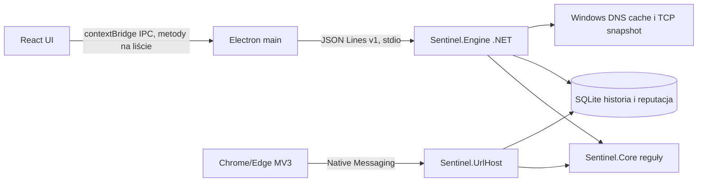

# Architektura Sentinel AI User 0.14

Electron uruchamia jeden proces silnika i zachowuje go po schowaniu okna w zasobniku. IPC nie wystawia portu HTTP; renderer ma tylko wymienione metody, izolowany kontekst i brak Node. Zamknięcie przez menu zasobnika kończy silnik. Rozszerzenie uruchamia osobny host przez Chromium, akceptujący tylko wpisany w manifeście origin i opcjonalny argument okna Windows. Serwer Enterprise pozostaje odrębny.

`Sentinel.Core` liczy reguły i reputację. `Sentinel.Engine` obsługuje lokalny IPC, odczyt cache DNS, widok TCP, ustawienia i historię. `Sentinel.UrlHost` analizuje URL przekazany przez rozszerzenie. `desktop/` zawiera React, Electron i markowe zasoby instalatora. `website/` jest statyczną witryną.

Reputacja CERT Polska: tylko aktywne domeny, normalizacja IDN, dokładne dopasowanie hosta, bez blokowania adresu IP współdzielonego przez inne usługi. Import ma limit rozmiaru, walidację, deduplikację i transakcję SQLite z kopią poprzedniego zestawu. Po 48 godzinach dane nie są używane do oznaczania domen jako znanego zagrożenia. Pobranie z jedynego dozwolonego adresu, bez automatycznych przekierowań i z timeoutem.

Cache DNS jest pobierany stałym poleceniem PowerShell `Get-DnsClientCache` co 15 sekund po włączeniu. To odczyt cache, nie monitor każdego zapytania. Wykryte domeny są oceniane względem lokalnej listy; ostrzeżenia mają deduplikację 10 minut. TCP to bieżąca lista połączeń na żądanie, bez przypisania do procesu. Żadna z tych warstw nie filtruje ruchu. Zaplanowane WFP wymaga osobnego projektu z uprawnieniami, badaniem ryzyka blokady i podpisywaniem, dlatego nie jest aktywne.

Treść ręcznej analizy nie jest zapisywana, a przeglądarka zapisuje tylko reguły i wynik. Cache DNS może powodować zapis domeny, jeśli pasuje do listy. Brak automatycznego wysyłania tych danych do chmury. AI Ollama ze starego WPF jest w `Sentinel.Core`, ale nowy klient go nie uruchamia. Zakres dalszych prac: [Known limitations](docs/KNOWN-LIMITATIONS.md).
