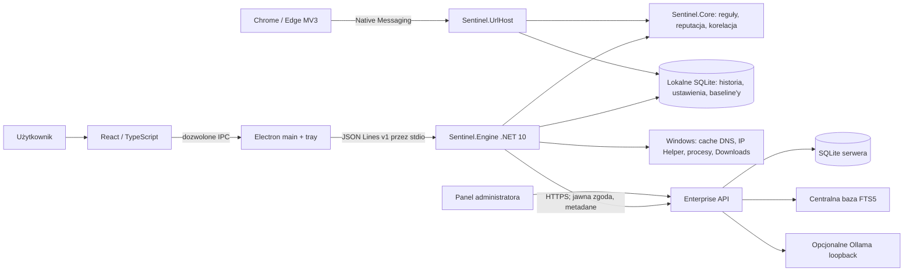

# Architektura Sentinel AI — stan źródeł 2026-10-21

Ten dokument opisuje aktywny produkt w repozytorium. Historyczny klient WPF znajduje się w `legacy/` i nie należy do bieżącego buildu. Pełny audyt luk, statusy funkcji oraz osobne plany prac są w [analizie luk](docs/IMPLEMENTATION_GAP_ANALYSIS.md), [postępie projektu](docs/PROJECT_PROGRESS.md) i `docs/implementation-plans/`.

## Komponenty i przepływ danych

Aktywny klient to UI React uruchamiane przez Electron (`desktop/`). Renderer działa z sandboxem, context isolation i wyłączonym Node integration; preload udostępnia jawnie dozwolone metody IPC. Electron utrzymuje proces silnika .NET (`src/Sentinel.Engine`) przez JSON Lines na odziedziczonym stdin/stdout. `Sentinel.Core` (`src/Sentinel.Core`) wykonuje lokalne reguły, operacje SQLite, reputację i wyszukiwanie lokalnej bazy wiedzy. Silnik nie udostępnia lokalnego portu HTTP.

Rozszerzenie Manifest V3 dla Chrome i Edge przekazuje główną nawigację HTTP/HTTPS do hosta Native Messaging (`src/Sentinel.UrlHost`). Host weryfikuje dozwolone rozszerzenie i kieruje dane do lokalnego silnika. Ostrzeżenie może pojawić się po rozpoczęciu nawigacji; integracja nie jest synchronicznym filtrem ani blokadą. Rozszerzenie nie jest publikowane w sklepach i wymaga ręcznego załadowania.

Klient Enterprise jest wariantem instalacyjnym tego samego klienta. Po sparowaniu przez HTTPS i osobnym włączeniu zgody silnik przechowuje token w DPAPI CurrentUser, stosuje wspieraną politykę lokalną i synchronizuje ograniczone metadane wykryć. Kolejka jest trwała w SQLite i obsługuje odroczenie nadmiaru, retry oraz idempotencję. Po 90 dniach aktywnej zgody klient etapowo odnawia token DPAPI przy kolejnym cyklu synchronizacji; panel pokazuje termin rotacji. Treść, pełne URL-e, nazwy aplikacji i wyjaśnienia nie trafiają do payloadu. Backend ASP.NET Core (`server/`) jest osobnym procesem z własnym SQLite, sesjami i rolami, zaproszeniami, politykami, audytem, panelem administratora, FTS5 oraz opcjonalnym Ollama loopback. Wdrożeniowy serwer i zaufany certyfikat nie są dostarczane automatycznie.

## Pokrycie źródeł Windows i sieci

| Zdarzenie | Aktualny mechanizm | Uprawnienia i granice | Status |
|---|---|---|---|
| Procesy | Snapshot `Process.GetProcesses()` przy `collect`, zwykle co około 1 s; zapis PID/nazwy, trwały baseline i ograniczenie do 10 000 PID oraz 100 zmian na próbkę. | Działa bez administratora. Brak ścieżki, podpisu, argumentów i strumienia start/stop; proces krótszy niż odstęp może zostać pominięty. ETW/WMI event stream na maszynie audytu zwrócił `Access denied`. | `PARTIALLY_IMPLEMENTED` |
| TCP | Natywne tabele Windows IP Helper IPv4/IPv6, do 800 wpisów w migawce; opt-in polling co około 1 s zapisuje nowe zewnętrzne połączenia `Established`/`SynSent`. | Metadane, stan i PID/nazwa, jeśli proces jest dostępny. Krótkie połączenia między próbkami mogą zniknąć; przy obciętej próbce alerty są wstrzymywane. Nie czyta treści pakietów ani nie blokuje połączeń. | `PARTIALLY_IMPLEMENTED` |
| UDP | Natywne tabele IP Helper IPv4/IPv6; opt-in obserwacja nowych lokalnych endpointów UDP, do 200 wpisów w migawce. | Tabela nie zawiera zdalnego celu ani dowodu wysłania datagramu. Nie jest to monitoring payloadu UDP. | `PARTIALLY_IMPLEMENTED` |
| DNS | `ipconfig /displaydns` i parser do 2 000 nazw, odczyt przy `collect` w ustawionym interwale (domyślnie 15 s, zakres 10–300 s); dokładne dopasowanie do lokalnego, świeżego feedu CERT. | Cache nie podaje procesu ani wiarygodnego czasu zapytania. DoH, DoT, VPN, cache i krótkotrwałe wpisy mogą omijać obserwację. Kanał `Microsoft-Windows-DNS-Client/Operational` jest wyłączony na maszynie audytu i nie był włączany. | `PARTIALLY_IMPLEMENTED` |
| HTTPS / ruch aplikacji | Połączenia TCP i obsługiwana nawigacja przeglądarkowa dają ograniczone metadane lub domenę. | TLS jest szyfrowany; aplikacja nie odczytuje treści żądań/odpowiedzi. Brak TLS MITM, sterownika WFP i filtracji. | `PARTIALLY_IMPLEMENTED` |
| Przeglądarka | Rozszerzenie MV3 dla Chrome/Edge obserwuje główną nawigację HTTP/HTTPS i korzysta z lokalnego Native Messaging. | Wspierane są wybrane przeglądarki. Ostrzeżenie może nadejść po rozpoczęciu ładowania; brak iframe, pełnego ruchu i gwarantowanego blokowania. Test E2E używał osobnych profili tymczasowych i lokalnego fixture `.test`. | `PARTIALLY_IMPLEMENTED` |
| Pobierane pliki | Opcjonalny, domyślnie wyłączony watcher bezpośrednich plików w Known Folder Downloads; lokalne SHA-256 porównywane z listą zaimportowaną przez użytkownika. | Nie skanuje podkatalogów ani poczty, nie wysyła plików/hashy i nie bada plików obecnych przed włączeniem. Limit baseline'u 100 000; dopasowanie zależy od niezależnie niezweryfikowanego feedu. | `PARTIALLY_IMPLEMENTED` |
| VPN | Brak dedykowanego adaptera lub inspekcji tunelu. | Widoczność zależy od tabel lokalnego stosu i implementacji VPN; nie ma gwarancji przypisania przepływu do aplikacji ani wglądu w ruch za tunelem. | `BLOCKED` dla pełnego pokrycia |

Obserwacja metadanych połączeń nie oznacza inspekcji całego ruchu. Produkt nie wyłącza Windows Defendera, zapory ani ustawień DNS; nie wykonuje ukrytego przechwytywania TLS i nie uruchamia działań naprawczych bez osobnej funkcji.

## Analiza, dane i AI

Ręcznie podany tekst i URL przechodzą przez deterministyczne reguły offline oraz lokalną listę Public Suffix List. Reguły są wersjonowane (`2026.10.2`), a wyniki wraz z kodami dowodów trafiają do historii bez zapisywania pełnej treści lub URL. Obecny zestaw 25 scenariuszy URL jest syntetycznym zestawem regresyjnym, nie miarą skuteczności na rzeczywistym phishingu. `confidence` nie jest kalibrowane.

SQLite klienta przechowuje historię, ustawienia, reputację i baseline'y monitorów. Aktualny schemat to v17; migracje, retencja, eksport i backup/restore mają testy. Baza nie jest szyfrowana. Dane baseline'u Downloads obejmują lokalne ścieżki, rozmiary i czasy modyfikacji. Wyszukiwanie wiedzy używa lokalnego FTS5 dla obsługiwanych formatów; wybrane trafienia można przekazać do Ollama dopiero po włączeniu AI. Nie jest to wyszukiwanie semantyczne, OCR ani gwarancja poprawności odpowiedzi. Rzeczywisty model Ollama nie był dostępny na maszynie audytu.

## Weryfikacja i ograniczenia wdrożenia

Ostatnia odnotowana pełna walidacja źródeł po zmianie atomowego cofania zgody przeszła `scripts/build-user.ps1 -Installer`: .NET 227/227 bez pominięć, Engine IPC, procesy, DNS/TCP/UDP, desktop 9/9, `npm audit` bez podatności, build UI i autotest instalatora. Windows CI `39663289184` również zakończył się sukcesem. Te testy nie są pełnym ręcznym cyklem instalacji, upgrade/rollback, autostartu po restarcie ani deinstalacji na czystym Windows; te scenariusze nadal są otwarte w PLAN-006/008. Osobne blokady to brak decyzji właściciela o licencji, brak certyfikatu podpisu dla zaufanych aktualizacji, brak autoryzowanego klucza/warunków dla rzeczywistego lookup MalwareBazaar oraz brak dostępu do źródeł ETW/DNS wymagających konfiguracji systemu.
