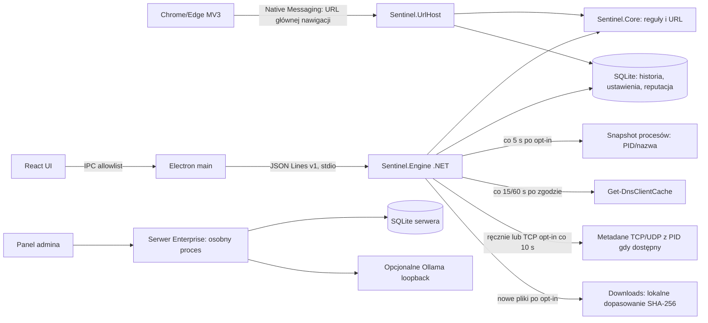

# Audyt luk i plan realizacji Sentinel AI

**Data audytu:** 2026-10-20
**Audytowany stan:** prerelease `0.15.23` opublikowane i zweryfikowane. Windows CI `39451059431`, Pages `39450039001`, installer build/self-test/release `39451070868` PASS. GitHub installer: 262535285 B, SHA-256 `7bec3d5ba09b2099441ae07149ab5f0a63f7c4372532716709ef108dd9980f50` oraz sidecar. Wydanie dodaje SQLite v9 z trwałym baseline'em Downloads, atomowym zapisem dopasowania i odzyskiwaniem zmian po restarcie.
**Zakres:** opublikowane prerelease `0.15.1`, `0.15.3`–`0.15.23`, nieopublikowany kandydat `0.15.2`, osobny katalog `server/`, rozszerzenie MV3, instalator, witryna i dostępne testy Windows.
**Wniosek:** projekt jest działającym prototypem ochrony lokalnej, nie produkcyjnym antywirusem ani monitorem całego ruchu. Nie wykrywa wszystkich zagrożeń, nie filtruje ani nie blokuje ruchu.

## A. Stan i architektura

Aktywny produkt Windows to React/TypeScript w Electronie (`desktop/`), osobny proces .NET 10 (`src/Sentinel.Engine`) i biblioteka reguł/SQLite (`src/Sentinel.Core`). Electron przekazuje ograniczony zestaw metod przez sandboxowany preload i JSON Lines v1 po odziedziczonym stdio. Host Native Messaging (`src/Sentinel.UrlHost`) obsługuje rozszerzenie Chrome/Edge MV3 (`browser-extension/`). Osobny ASP.NET Core/SQLite w `server/` jest backendem Enterprise; aktywny klient Electron nie jest jego agentem. Pozostały klient WPF jest w `legacy/` i nie należy do wspieranego buildu.

Przepływ rzeczywiście działający: użytkownik wkleja tekst/URL → lokalne reguły domeny i tekstu → opcjonalne dopasowanie do świeżej lokalnej listy CERT → zapis metadanych zdarzenia do SQLite → UI/historia. Drugi przepływ: jawne włączenie obserwacji → Electron wywołuje `collect` według ustawionego odstępu → silnik odczytuje do 2000 wpisów cache DNS → dokładne dopasowanie do lokalnej listy → deduplikacja i zapis ostrzeżenia. Błąd odczytu jest obecnie skracany do nazwy typu wyjątku w stanie DNS. Tabele TCP/UDP czyta natywne Windows IP Helper; domyślnie wyłączony observer co 10 s zapisuje przyrostowo metadane nowych zewnętrznych połączeń TCP `Established`/`SynSent` oraz lokalnych endpointów UDP. Migawka UDP nie pokazuje celu zdalnego ani nie potwierdza wysłania datagramu. Połączenia TCP krótsze niż interwał mogą zostać pominięte.

## B. Macierz funkcjonalności

| ID / funkcja | Status | Dowód i brak | Zależności | Priorytet / złożoność | Kryteria akceptacji |
|---|---|---|---|---|---|
| F01 Build klienta i UI | `DONE_AND_VERIFIED` | `scripts/build-user.ps1`; React/Vite; testy typów i build przeszły 2026-10-19 | .NET 10, Node 24, sieć przy restore | P1 / S | Czysty build i testy na Windows |
| F02 Instalator per-user | `PARTIALLY_IMPLEMENTED` (build i self-test zweryfikowane CI; pełny cykl GUI nadal nieweryfikowany) | `installer/Sentinel.Setup/Program.cs`; self-test v0.15.12 powtarzalnie odrzucał `chrome_100_percent.pak`; `Flush()` przed sprawdzeniem rozmiaru naprawił ekstrakcję. Wydanie v0.15.23 przeszło Windows validation `39451059431` i installer release/self-test `39451070868`; opublikowany instalator ma 262535285 B, SHA-256 `7bec3d5ba09b2099441ae07149ab5f0a63f7c4372532716709ef108dd9980f50`. Harness sprawdza izolowane ścieżki pod `%LOCALAPPDATA%\Programs` i `%LOCALAPPDATA%`. Pełny GUI/update/rollback/uninstall na czystej maszynie pozostają nieweryfikowane | Windows, icacls, interaktywne sesje | Pełny cykl na czystym Windows |
| F03 Ręczna analiza treści i URL | `DONE_AND_VERIFIED` | `ThreatAnalysisEngine`, `UrlAnalyzer`, `scripts/test-engine.cjs`; reguły deterministyczne, heurystyki ograniczone, bez sieciowego sprawdzania celu | lokalne reguły i PSL | P1 / M | Testy reguł, prywatności i URL; mierzone false positive/negative |
| F04 Feed CERT Polska | `DONE_AND_VERIFIED` | `DomainReputation`; import transakcyjny, IDN, duplikaty, rollback, 48 h; test Windows/network pobrał 125344 domeny | internet tylko po kliknięciu | P1 / M | Feed poprawny, atomowy, świeży; brak wysyłania analizowanego URL |
| F05 Cache DNS | `PARTIALLY_IMPLEMENTED` | `Sentinel.Engine/Program.cs`: okresowe `Get-DnsClientCache`, limit 2000, bez PID/czasu zapytania; pominięcia DoH/DoT/VPN/cache | Windows PowerShell, feed | P1 / L | Zmierzone opóźnienie/pominięcia, kontrolowane testowe domeny, degradacja widoczna |
| F06 TCP/UDP i przypisanie procesu | `PARTIALLY_IMPLEMENTED` | Natywny IP Helper snapshot do 800 TCP/200 UDP z PID/nazwą; opt-in poll co 10 s zapisuje przyrostowo metadane nowych zewnętrznych połączeń TCP i lokalnych endpointów UDP. UDP endpoint nie potwierdza transferu ani celu zdalnego. TCP baseline SQLite v7 i procesowy v8 przechowują stan między restartami; zmiany i zdarzenia są atomowe. Procesy uruchomione od poprzedniej próbki są widoczne po restarcie, pauza przesuwa baseline bez alertów. Pięciominutowy profil TCP z 60 próbkami, kontrolowanym połączeniem i zapisem historii PASS: CPU 0,056% łącznej mocy procesorów, working set 45,2–57 MiB, collect mediana 5,6 ms / max 675,9 ms. Korelacja PID z TCP nadal ogranicza się do 60 s i resetuje się po restarcie. Brak event stream, reputacji i obsługi połączeń krótkich | Windows IP Helper; ETW dla pełniejszych zdarzeń wymaga oceny | P1 / L | Stabilne snapshoty/zdarzenia i jawne ograniczenia; test restartu, atomowości, nie-loopback i pięciominutowy soak PASS |
| F07 Monitorowanie procesów/zdarzeń Windows | `PARTIALLY_IMPLEMENTED` | próbki `Process.GetProcesses()` co 5 s wykrywają PID/nazwę pojawiające się i znikające między próbkami; SQLite v8 utrwala baseline i atomowo zapisuje zmiany ze zdarzeniami, wznawia różnice po restarcie; pauza przesuwa baseline bez alertów, a wykluczone aplikacje nie są utrwalane. Limit 100 zdarzeń/próbkę. WMI `Win32_ProcessStartTrace` w bieżącym koncie zwróciło `Access denied`; brak ścieżki, podpisu, krótkich procesów i gwarantowanego event stream | Windows; WMI/ETW wymagają oceny uprawnień | P1 / L | Bezpieczny test procesu, PID, start/stop, restart, atomiczność, kontrola wydajności i jawna informacja o pominięciach |
| F08 Monitorowanie plików i reputacja | `PARTIALLY_IMPLEMENTED` | Na jawne żądanie UI wybiera plik ≤256 MiB; liczy SHA-256 i sprawdza Authenticode. Lokalna lista (≤20 MiB/250 000 hashy) jest walidowana i importowana transakcyjnie. Opcjonalny MalwareBazaar lookup po osobnym kliknięciu wysyła wyłącznie hash do stałego HTTPS endpointu; Auth-Key chroni DPAPI. Domyślnie wyłączony watcher Downloads sprawdza pliki względem lokalnego feedu; pauza zatrzymuje go i czyści baseline, sieci nie używa. Windows Known Folder resolver i reconciliacja po overflow działają w aktywnej sesji; SQLite v9 zachowuje ścieżki/rozmiary/czasy modyfikacji, wykrywa zmiany podczas restartu, zapis zdarzenia i fingerprintu jest atomowy; limit 100 000 ścieżek. Brak dopasowania nie oznacza bezpieczeństwa. Testy restartu, pauzy, usuwania i migracji v8→v9, Engine IPC, Windows CI i installer self-test PASS dla v0.15.23 (`39451059431`, `39451070868`). Real API nie zweryfikowano z kluczem | zgoda opt-in; klucz i zgodność z warunkami MalwareBazaar do konfiguracji | P2 / M | test real API, test realnie przekierowanego Known Folder |
| F09 Browser URL | `PARTIALLY_IMPLEMENTED` | rozszerzenie `onBeforeNavigate` dla głównej nawigacji Chrome/Edge, Native Messaging i reguły; warning może pojawić się po rozpoczęciu ładowania; ręczna instalacja; test prawdziwej przeglądarki nie wykonany | Chrome/Edge, rozszerzenie ręczne | P1 / M | test kart na czystym profilu, wyłącznie domeny `.test`, brak claim blokowania |
| F10 Lokalne AI Ollama | `PARTIALLY_IMPLEMENTED` | `AIProviders.cs` jest podłączony do silnika i aktywnej analizy; UI pozwala pobrać listę modeli localhost oraz jawnie włączyć provider; brak weryfikacji z rzeczywistym serwerem/modelami na tej maszynie | Ollama zainstalowane, model zgodny | P2 / M | jawne opt-in, lista/test modelu, mock HTTP i test bez Ollama/fallback |
| F11 Baza wiedzy/RAG | `PARTIALLY_IMPLEMENTED` | `LocalKnowledgeBase`: FTS5, TXT/MD/DOCX; plik do 10 MB, ekstrakcja do 2 mln znaków na dokument, 100 dokumentów i 20 mln znaków łącznie. Import nadmiarowy jest odrzucany bez kasowania poprzednich danych; testy limitów i UI przechodzą. Brak embeddingów i użycia indeksu w analizie AI, więc brak semantycznego RAG | SQLite, jawny import plików | P2 / M | UI import/search/delete z cytowaniem; brak twierdzeń o semantycznym RAG |
| F12 Historia i wspólny model zdarzeń | `PARTIALLY_IMPLEMENTED` | lokalny model v1 zapisuje schemaVersion, GUID, źródło, wersję reguł oraz opcjonalny PID/nazwę procesu; confidence pozostaje null bez kalibracji. Migracja SQLite v6 zachowuje stare wpisy, odczyt/eksport przenosi pola, UI pokazuje pochodzenie i może oznaczyć false positive; API Enterprise nadal ma osobny kontrakt, korelacja nie istnieje | migracja SQLite i kontraktu API | P1 / M | wersjonowany kontrakt, migracja bez utraty danych, deduplikacja i test retencji |
| F13 Tray/autostart/ustawienia | `DONE_AND_VERIFIED` (kod/test smoke) | Electron ma tray, autostart, ukrywanie okna i jawne zakończenie; diagnostyka pokazuje working set, pamięć prywatną i skumulowany CPU silnika; realny restart Windows/autostart nie testowany | Windows shell | P1 / M | test po restartach na czystym profilu |
| F14 Ustawienia zdarzeń, eksport, status obsługi | `DONE_AND_VERIFIED` | Aktywne UI/IPC udostępnia redagowany eksport JSON/CSV, statusy i oznaczanie fałszywych alarmów oraz pakiet diagnostyczny dla pomocy technicznej. CSV ma quoting, UTF-8 BOM i neutralizację formuł; diagnostyka zawiera tylko wersje środowiska, stany monitorów, wybrane ustawienia oraz metryki rozmiaru/liczby rekordów. Testy potwierdzają brak historii, URL-i, ścieżek, nazw procesów i endpointu AI w pakiecie | IPC i UI | P2 / M | eksporty i bezpieczny pakiet diagnostyczny testowane w .NET/IPC |
| F15 Lokalna baza danych | `PARTIALLY_IMPLEMENTED` | SQLite v9; migracje, retencja, backup/restore historii z v6–v9 i wiedzy z walidacją integralności oraz zachowaniem profilu i aktywnych baseline'ów monitorów; 32 równoległe zapisy. Diagnostyka rozmiaru DB/WAL/SHM, stron i rekordów. Limit historii 512 MiB, limity bazy wiedzy 100 dokumentów/20 mln znaków, trwałe baseline'y sieci, procesów i Downloads (lokalne nieszyfrowane ścieżki/rozmiary/czasy modyfikacji); symulowany `SQLITE_FULL`, atomowość zdarzeń/baseline'ów, retry monitorów i fail-closed ACL testowane. Brakuje fizycznego disk-full na oddzielnym wolumenie, ACL rzeczywistej ścieżki po instalacji i długiego testu obciążeniowego | SQLite, polityka retencji historii | P1 / M | kopie walidowane i możliwe do przywrócenia bez zmiany tożsamości instalacji, jawne limity i test awarii |
| F16 Enterprise API/panel | `DONE_AND_VERIFIED` (testy API i jednostkowe) | osobny backend ma HTTPS guard, RBAC, sesje, polityki, zaproszenia, wydarzenia, FTS5 i consent gate; klient aktywny nie łączy się z nim | serwer, certyfikat dla LAN | P2 / L | testy 19/19 + HTTP smoke; odrębna walidacja TLS/usługi Windows |
| F17 Agent Enterprise w aktywnym kliencie | `PARTIALLY_IMPLEMENTED` | Aktywny Electron/IPC udostępnia HTTPS invite pairing, jawny consent gate i jego odwołanie, token DPAPI CurrentUser, heartbeat, lokalne polityki (tryb local; odstęp 10–300 s), kolejkę offline ograniczoną do 10 000 rekordów i idempotentny batch. Po wyłączeniu zgody cała komunikacja z serwerem zostaje zatrzymana, kolejka jest kasowana, a przy odmowie klient nie wysyła kolejki przywróconej z backupu. Testy: mock klienta, zgoda wymagana przez IPC, profile gate/kolejka w SQLite, limit bez utraty oczekujących wpisów; DPAPI test przeszedł poza sandboxem w interaktywnej sesji. Brak live TLS E2E, obsługi zatwierdzenia/revoke/rotacji w UI, signed updates i bardziej złożonych polityk | certyfikat CA, serwer Enterprise, sesja Windows z profilem użytkownika | P1 / L | test end-to-end z zaproszeniem i serwerem TLS, test restart/offline/revoke, GUI admina |
| F18 Aktualizacje/naprawa | `MISSING` | release workflow buduje prerelease po tagu; klient nie ma autoupdate, podpisu ani naprawy instalacji | certyfikat podpisu, release pipeline | P1 / L | podpisane artefakty, hash, rollback i test przerwania |
| F19 Witryna publiczna | `IMPLEMENTED_UNVERIFIED` dla v0.15.23 | statyczna witryna; test lokalny potwierdza install/hash/release link dla v0.15.23. Pages run `39450039001` PASS; live HTTP URL pozostaje niezweryfikowany z tego środowiska. | GitHub Pages/release | sprawdzać live linki przy każdym wydaniu; zewnętrzne legalne/produktowe roszczenia nadal audytować |
| F20 Licencja i redystrybucja | `BLOCKED` | brak pliku LICENSE; ustalenie właściciela jest decyzją prawną, nie bezpieczną zmianą kodu | decyzja właściciela | P1 / S | licencja źródeł i sprawdzone licencje zależności |

`S/M/L` oznacza względną pracochłonność, nie obietnicę terminu. `DONE_AND_VERIFIED` odnosi się do wymienionych testów; nie rozszerza zakresu ponad nie.

## C. Macierz pokrycia monitorowania

| Źródło / ruch | Metoda teraz | Ciągłość | Uprawnienia | Ograniczenia i wynik | Status |
|---|---|---|---|---|---|
| TCP | Windows IP Helper `GetExtendedTcpTable`, do 800 wierszy; ręczny snapshot plus opcjonalny observer co 10 s | polling przyrostów (domyślnie wyłączony) | zwykłe konto; PID/nazwa mogą być niedostępne | nowe zewnętrzne połączenia `Established`/`SynSent`; krótkie połączenia mogą umknąć; brak reputacji; payload nie jest czytany | `PARTIALLY_IMPLEMENTED` |
| UDP | Windows IP Helper, do 200 punktów końcowych; snapshot ręczny i przyrostowy opt-in co 10 s | zapis pojawienia się lokalnego endpointu UDP; bez zdalnego endpointu | odczyt w bieżącym koncie; PID/nazwa mogą być niedostępne | endpoint nie potwierdza datagramu; nie śledzi jego zawartości; brak reputacji | `PARTIALLY_IMPLEMENTED` |
| DNS cache | PowerShell `Get-DnsClientCache`, maks. 2000 wpisów | próbkowanie co 15/60 s po opt-in | zwykły użytkownik w przetestowanej sesji | nie jest strumieniem zapytań; cache, DoH/DoT, VPN, IP i krótki TTL pominięte; bez PID | `PARTIALLY_IMPLEMENTED` |
| DNS ETW / zdarzenia | kanał `Microsoft-Windows-DNS-Client/Operational` wyłączony na maszynie audytu | brak dostępnych zdarzeń do weryfikacji | włączenie kanału to zmiana konfiguracji Windows; wymaga testu na kontrolowanej maszynie | Microsoft opisuje Query Completed (3008); kanał nie został włączony ani nie zmieniano ustawień systemu; DoH/obcy resolver nadal ogranicza widoczność ([Microsoft WEF profile](https://learn.microsoft.com/en-au/windows/security/threat-protection/use-windows-event-forwarding-to-assist-intrusion-detection)) | `BLOCKED` dla weryfikacji w obecnym środowisku |
| HTTPS/TLS | brak przechwytywania payloadu | n/d | MITM wymaga oddzielnej zgody/architektury i zaufania CA | aplikacja nie zna treści request/response | `NOT_APPLICABLE` w obecnym, prywatnościowym modelu |
| Browser | MV3 `webNavigation.onBeforeNavigate` + lokalny host | zdarzenie głównej nawigacji | instalacja hosta per-user i ręczne rozszerzenie | nie obejmuje całego systemu/iframe/pobierania; warning nie jest twardą blokadą; brak testu real browser | `PARTIALLY_IMPLEMENTED` |
| Procesy | próbka `Process.GetProcesses()` co 5 s; zdarzenia pojawienia/zniknięcia PID w SQLite | polling, nie event-driven; może pominąć proces krótkotrwały | zwykłe konto dla widocznych procesów; WMI trace odmówiło dostępu w bieżącym koncie | brak ścieżki/podpisu; PID nie jest jeszcze korelowany z TCP/UDP event history | `PARTIALLY_IMPLEMENTED` |
| Pliki | wybrany plik → SHA-256 + status Authenticode; opt-in watcher Downloads sprawdza nowe/zmienione pliki względem lokalnego feedu | watcher ze settle debounce, bounded queue i rescan po overflow oraz restarcie; baseline w SQLite v9 | dostęp użytkownika do pliku; Windows PowerShell Security | pauza/wyłączenie świadomie czyści baseline i pomija wtedy zmiany; brak monitoringu podkatalogów; podpis/hash nie oznacza bezpieczeństwa | `PARTIALLY_IMPLEMENTED` |
| VPN | brak punktu przechwytywania/rozpoznania | n/d | zależne od adaptera i endpointu | widoczność ograniczona do tego, co wystawi lokalny stos; zewnętrzny tunel ukrywa przepływy | `BLOCKED` dla pełnego pokrycia |

Nie należy reklamować „monitorowania całego ruchu”. Nie wdrożono ukrytego TLS MITM, przechwytywania sekretów, sterownika WFP ani automatycznego blokowania. Pełna widoczność zależy od źródła zdarzeń, wersji Windows, VPN, resolvera i procesu.

## D. Zależności i kolejność

Wspólny model zdarzeń i źródła danych poprzedzają korelację oraz centralną synchronizację. Najpierw należy ustabilizować jawne ograniczenia, schemat, retencję i diagnostykę; następnie dodać procesy i zdarzenia sieciowe w ograniczonym zakresie, bez bloku ruchu. Reputacja plików wymaga audytowanego źródła i zasad licencyjnych. Integracja lokalnego AI może być równoległa dopiero po podłączeniu istniejącego providera do aktywnego IPC/UI i zabezpieczeniu importu wiedzy. Enterprise wymaga aktywnego agenta, DPAPI, jawnej polityki i testów offline. Autoupdate wymaga decyzji o podpisywaniu kodu.

## E. Plany wdrożenia

| Plan | Zakres | Status 2026-10-20 |
|---|---|---|
| [PLAN-001: monitoring TCP/procesów](implementation-plans/PLAN-001-network-and-process-monitoring.md) | zdarzenia TCP/UDP i bezpieczna korelacja PID | `IN_PROGRESS` — przyrostowe opt-in poll TCP/UDP, baseline i zdarzenia SQLite atomowe przez restart, test nie-loopback i pięciominutowy soak TCP PASS; krótkie zdarzenia, event stream i pełna korelacja pozostają |
| [PLAN-002: DNS i reputacja](implementation-plans/PLAN-002-dns-and-threat-intelligence.md) | źródła DNS, freshness, diagnostyka i feed | `IN_PROGRESS` — polling działa; pusty feed nie jest świeży; event log Windows jest wyłączony, IP feeds i testy kontrolowanego Windows pozostają |
| [PLAN-003: pliki](implementation-plans/PLAN-003-file-monitoring.md) | weryfikacja i reputacja plików | `IN_PROGRESS` — skan SHA-256/Authenticode, lokalny feed, hash-only MalwareBazaar, opt-in watcher, reconciliacja overflow/restartu i limit baseline'u wdrożone; Windows CI/self-test v0.15.23 PASS. Prawdziwy lookup wymaga klucza, a rzeczywiście przekierowany Known Folder wymaga testu |
| [PLAN-004: detection/event schema](implementation-plans/PLAN-004-event-schema-and-detection.md) | model, korelacja, confidence, false-positive workflow | `IN_PROGRESS` — migracja v6, process metadata, provenance i false-positive UI; adapter Enterprise i korelacja pozostają |
| [PLAN-005: AI/RAG](implementation-plans/PLAN-005-local-ai-and-knowledge.md) | aktywne UI/IPC dla obecnego providera i FTS5 | `IN_PROGRESS` — FTS5 i jawne Ollama opt-in dostępne w UI; rzeczywisty model i UI tests pozostają |
| [PLAN-006: klient Windows](implementation-plans/PLAN-006-windows-client-and-background.md) | niezawodność tray, diagnostyka, UI i start | `IN_PROGRESS` — tray/autostart w kodzie; czysty Windows wymagany |
| [PLAN-007: baza i prywatność](implementation-plans/PLAN-007-database-and-privacy.md) | limity, backup, szyfrowanie/ACL, retencja | `IN_PROGRESS` — limit historii 512 MiB, symulowany `SQLITE_FULL`, retry monitorów, test ACL fail-closed, kopie/restore i limity KB zweryfikowane; brak fizycznego disk-full, ACL zainstalowanej lokalizacji danych i długiego obciążenia |
| [PLAN-008: instalator i aktualizacje](implementation-plans/PLAN-008-installer-updater.md) | naprawa, signed update, rollback i realne czyste Windows | `IN_PROGRESS` — build/self-test działa; test pełnego cyklu nie wykonany |
| [PLAN-009: publiczna witryna/dokumentacja](implementation-plans/PLAN-009-website-and-release.md) | zgodność claimów, live hosting, wersjonowanie i licencja | `IN_PROGRESS` — release v0.15.23 i Pages deployment PASS; test/lint/build PASS; bezpośredni live-check ograniczony środowiskiem; licencja i czysty Windows pozostają |
| [PLAN-010: Enterprise](implementation-plans/PLAN-010-enterprise-client-and-server.md) | aktywny agent, serwer i testy operacyjne | `IN_PROGRESS` — klient Electron paruje, przechowuje DPAPI token, stosuje ograniczoną politykę i synchronizuje metadane po zgodzie; live TLS/revoke/restart pozostają |

## F. Ograniczenia i decyzje

- **Rozwiązywalne w kodzie:** wspólny schemat zdarzeń, PID/monitoring ograniczony do dostępnych API, diagnostyka i retencja, aktywne podłączenie AI/KB, eksport, agent Enterprise, aktualizator.
- **Windows/sprzęt:** rzeczywiste testy instalacji, startu po restarcie, zachowania Chrome/Edge, ETW i długotrwałych zasobów na czystych Windows. Obecny komputer potwierdził build/self-test, DNS, TCP/UDP, PID oraz polling start/stop procesu w bieżącym koncie.
- **Szyfrowanie:** zawartość HTTPS nie jest dostępna bez odrębnej, jawnej i ryzykownej architektury TLS; nie wolno wdrożyć po cichu.
- **Uprawnienia:** cache DNS oraz snapshot TCP/UDP i procesów testowano w koncie użytkownika. Próba `Win32_ProcessStartTrace` zakończyła się `Access denied`; ETW i pełna telemetria wymagają osobnej oceny. WFP/automatyczne blokowanie nie jest planowane bez rollbacku i podpisywania.
- **Zewnętrzne:** feed CERT wymaga Internetu tylko przy ręcznym pobraniu; Ollama/model wymagają osobnej instalacji; Enterprise zdalny wymaga certyfikatu CA; update wymaga certyfikatu podpisu.
- **Zależności npm:** `npm audit --omit=dev` zwraca 0 podatności runtime; pełny `npm audit` potwierdza 8 umiarkowanych alertów build-time przez `electron-builder` → `sprintf-js@1.1.3` (CVE-2026-97058). [GitHub Advisory](https://github.com/advisories/GHSA-hp3w-g68c-fv3c); proponowany downgrade buildera z `^26.15.3` do 26.5.0 zwiększył raport do 8 high i 1 critical przez `tar`, więc przywrócono 26.15.3.
- **Właściciel:** brak licencji i warunków redystrybucji wymaga decyzji właściciela; nie dopisuję licencji prawnej w jego imieniu.
- **Testy z audytu:** wydanie v0.15.23 ma 183/183 testów .NET PASS, w tym migrację v8→v9, restart Downloads, reset przy pauzie/wyłączeniu i cleanup usuniętych plików. Pełny `scripts/build-user.ps1 -Installer` PASS lokalnie: Engine IPC, desktop build, Windows installer i installer self-test. GitHub Windows CI `39451059431`, installer release/self-test `39451070868` i Pages `39450039001` PASS. Release asset: 262535285 B, SHA-256 `7bec3d5ba09b2099441ae07149ab5f0a63f7c4372532716709ef108dd9980f50` i sidecar. Lokalny self-testowany instalator: 279335801 B, SHA-256 `DB38738EC079110CBD091D79014AE3DCD6AA9068626D032161973DA49315857A`. Desktop lint/build, website test/lint/build i `check-product.cjs` PASS. Wcześniej zweryfikowane dla v0.15.22: Windows CI `39446717025`, Pages `39446717099` i installer release/self-test `39446715416`; installer 262526581 B, SHA-256 `70fdfef27512e6f1279d470e58a62b0ed039ad0554fb75489da8ecc9b4931bdd`. Testy bazowe obejmują lokalną reputację SHA-256 i mock MalwareBazaar hash-only API, UDP z zastrzeżeniem braku dowodu datagramu, trwałe baseline'y sieci/procesów, atomowy zapis zdarzeń/baseline'ów, procesy wykluczone, zachowanie zmian przez restart/pauzę, 32 równoległe zapisy SQLite, ACL fail-closed, zalew 10 500 PID, dropped-event accounting, awarię/odzyskanie źródła, profile/consent gate, restore baz, limity KB, świeżość pustego feedu, symulowany `SQLITE_FULL`, retry monitora i czasową korelację PID procesu z TCP; Windows DPAPI round-trip sprawdzony w interaktywnej sesji. Pozostałe testy pokrywają CSV quoting i formuły, prywatność JSON diagnostics, Authenticode trusted/tampered fixtures, limity skanu, Downloads opt-in/local-only/match, backup/restore, AI loopback, FTS5, proces potomny, Enterprise consent gate i kontrolowany live test TCP. Live HTTP, realny lookup MalwareBazaar, Chrome/Edge przepływ z zarejestrowanym hostem i pełny GUI/update/uninstall na czystym Windows pozostają niewykonane.

