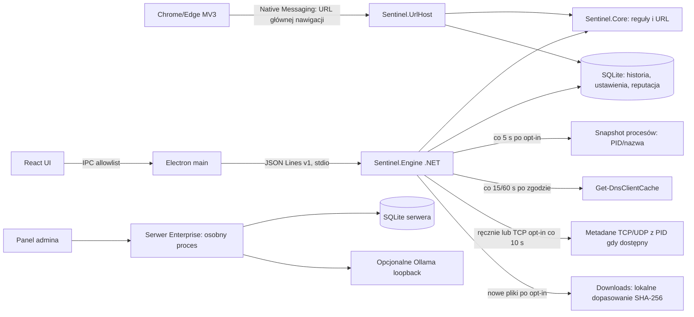

# Audyt luk i plan realizacji Sentinel AI

**Data audytu:** 2026-10-21
**Audytowany stan:** prerelease `0.15.38` pozostaje ostatnim wydaniem. Ostatni funkcjonalny commit `c1b82dc` rozszerza izolowany self-test instalatora o deinstalację. Lokalny `npm run package` i self-test PASS: artefakt testowy 281218937 B, SHA-256 `36BD25EFA75A9259A0D95B023E017052D8C69A90664FFCFA96AB52E8A02FA493`; nie został opublikowany. Windows CI `39507101421` PASS dla build/test aplikacji i API; workflow nie buduje instalatora. Commit `79668a4`: Windows CI `39505227855` i Pages `39505227865` PASS. Cytaty FTS5 w `185c62f`: Windows CI `39503611778` PASS. Opublikowany instalator v0.15.38 ma 262559349 B, SHA-256 `bb34834eb654e450728f95093d500715b5f6ef5ab9f7825c32d146b9fb2c4cd8` oraz sidecar. Chrome 155 i Edge 155 E2E PASS na osobnych profilach z fixture `.test`; profile, manifest, wpis HKCU i dane testowe posprzątano. Rzeczywisty Ollama nadal nieweryfikowany, bo nie jest dostępny lokalnie.
**Zakres:** opublikowane prerelease `0.15.1`, `0.15.3`–`0.15.38`, nieopublikowane kandydaty `0.15.2` i `0.15.29`, osobny katalog `server/`, rozszerzenie MV3, instalator, witryna i dostępne testy Windows.
**Wniosek:** projekt jest działającym prototypem ochrony lokalnej, nie produkcyjnym antywirusem ani monitorem całego ruchu. Nie wykrywa wszystkich zagrożeń, nie filtruje ani nie blokuje ruchu.

## A. Stan i architektura

Aktywny produkt Windows to React/TypeScript w Electronie (`desktop/`), osobny proces .NET 10 (`src/Sentinel.Engine`) i biblioteka reguł/SQLite (`src/Sentinel.Core`). Electron przekazuje ograniczony zestaw metod przez sandboxowany preload i JSON Lines v1 po odziedziczonym stdio. Host Native Messaging (`src/Sentinel.UrlHost`) obsługuje rozszerzenie Chrome/Edge MV3 (`browser-extension/`). Osobny ASP.NET Core/SQLite w `server/` jest backendem Enterprise; aktywny klient Electron nie jest jego agentem. Pozostały klient WPF jest w `legacy/` i nie należy do wspieranego buildu.

Przepływ rzeczywiście działający: użytkownik wkleja tekst/URL → lokalne reguły domeny i tekstu → opcjonalne dopasowanie do świeżej lokalnej listy CERT → zapis metadanych zdarzenia do SQLite → UI/historia. Drugi przepływ: jawne włączenie obserwacji → Electron wywołuje `collect` według ustawionego odstępu → silnik odczytuje do 2000 wpisów cache DNS → dokładne dopasowanie do lokalnej listy → deduplikacja i zapis ostrzeżenia. Błąd odczytu jest obecnie skracany do nazwy typu wyjątku w stanie DNS. Proces .NET jest uruchamiany przez Electron; po błędzie uruchomienia, wyjściu procesu, błędzie stdin, niepoprawnej odpowiedzi lub timeout żądania (45 s) supervisor odrzuca oczekujące IPC, kończy zawieszony proces i ponawia start z ograniczonym wykładniczym opóźnieniem. Surowe stderr nie jest logowane. Tabele TCP/UDP czyta natywne Windows IP Helper; domyślnie wyłączony observer co 10 s zapisuje przyrostowo metadane nowych zewnętrznych połączeń TCP `Established`/`SynSent` oraz lokalnych endpointów UDP. Migawka UDP nie pokazuje celu zdalnego ani nie potwierdza wysłania datagramu. Połączenia TCP krótsze niż interwał mogą zostać pominięte.

## B. Macierz funkcjonalności

| ID / funkcja | Status | Dowód i brak | Zależności | Priorytet / złożoność | Kryteria akceptacji |
|---|---|---|---|---|---|
| F01 Build klienta i UI | `DONE_AND_VERIFIED` | `scripts/build-user.ps1`; React/Vite; testy typów i build przeszły 2026-10-19 | .NET 10, Node 24, sieć przy restore | P1 / S | Czysty build i testy na Windows |
| F02 Instalator per-user | `PARTIALLY_IMPLEMENTED` (transactional update/rollback self-test zweryfikowany lokalnie; pełny cykl GUI nadal nieweryfikowany) | `installer/Sentinel.Setup/Program.cs`; self-test v0.15.12 powtarzalnie odrzucał `chrome_100_percent.pak`; `Flush()` przed sprawdzeniem rozmiaru naprawił ekstrakcję. Wydanie v0.15.38 przeszło installer release/self-test `39489181456`; opublikowany instalator ma 262559349 B, SHA-256 `bb34834eb654e450728f95093d500715b5f6ef5ab9f7825c32d146b9fb2c4cd8` i sidecar `.sha256`. Pełny lokalny build zawierający aktualny Engine/Native Host/UI utworzył instalator 279362937 B, SHA-256 `7c45576c474ce835c4e2072351cb5976eeb29279a19120a1285a0dababf9bad3`; self-test potwierdził wybór zarejestrowanej ścieżki w profilu użytkownika, odrzucenie ścieżki systemowej, update, zachowanie pliku spoza payloadu, rollback po anulowaniu oraz smoke test aplikacji i SQLite. Artefakt nie został opublikowany. Izolowany self-test usuwa teraz wszystkie pliki payloadu i zachowuje plik użytkownika oraz obie bazy; test omija rejestr, skróty i Native Messaging. Windows CI `39507101421` PASS dla aplikacji/API; nie uruchamia testu instalatora. Ręczna interakcja GUI, skróty/autostart, rejestracja hosta i pełny uninstall na czystym Windows pozostają nieweryfikowane | Windows, icacls, interaktywne sesje | Pełny cykl GUI i integracji na czystym Windows |
| F03 Ręczna analiza treści i URL | `DONE_AND_VERIFIED` | `ThreatAnalysisEngine`, `UrlAnalyzer`, `scripts/test-engine.cjs`; reguły deterministyczne, heurystyki ograniczone, bez sieciowego sprawdzania celu | lokalne reguły i PSL | P1 / M | Testy reguł, prywatności i URL; mierzone false positive/negative |
| F04 Feed CERT Polska | `DONE_AND_VERIFIED` | `DomainReputation`; import transakcyjny, IDN, duplikaty, rollback, 48 h; test Windows/network pobrał 125344 domeny | internet tylko po kliknięciu | P1 / M | Feed poprawny, atomowy, świeży; brak wysyłania analizowanego URL |
| F05 Cache DNS | `PARTIALLY_IMPLEMENTED` | `Sentinel.Engine/Program.cs`: okresowe `Get-DnsClientCache`, limit 2000, bez PID/czasu zapytania; pominięcia DoH/DoT/VPN/cache | Windows PowerShell, feed | P1 / L | Zmierzone opóźnienie/pominięcia, kontrolowane testowe domeny, degradacja widoczna |
| F06 TCP/UDP i przypisanie procesu | `PARTIALLY_IMPLEMENTED` | Natywny IP Helper snapshot do 800 TCP/200 UDP z PID/nazwą; opt-in poll co 10 s zapisuje przyrostowo metadane nowych zewnętrznych połączeń TCP i lokalnych endpointów UDP. UDP endpoint nie potwierdza transferu ani celu zdalnego. TCP baseline SQLite v7 i procesowy v8 przechowują stan między restartami; zmiany i zdarzenia są atomowe. Wydanie v0.15.34 zapisuje wspólny correlationId dla startu procesu i jego TCP/UDP zdarzenia, gdy PID i nazwa procesu są zgodne w oknie 60 s; correlationId jest trwały, lecz mapa startów resetuje się po restarcie silnika. Pauza czyści mapę. Pięciominutowy profil TCP z 60 próbkami, kontrolowanym połączeniem i zapisem historii PASS: CPU 0,056% łącznej mocy procesorów, working set 45,2–57 MiB, collect mediana 5,6 ms / max 675,9 ms. To korelacja czasowa, nie dowód przyczynowości. Brak event stream, reputacji i obsługi krótkich połączeń; próba sesji ETW kernel process wymaga jawnego dostępu systemowego, niedostępnego na maszynie audytu | Windows IP Helper; dostęp do sesji i providera ETW | P1 / L | Stabilne snapshoty/zdarzenia i jawne ograniczenia; test restartu, atomowości, nie-loopback i pięciominutowy soak PASS |
| F07 Monitorowanie procesów/zdarzeń Windows | `PARTIALLY_IMPLEMENTED` | próbki `Process.GetProcesses()` co 5 s wykrywają PID/nazwę pojawiające się i znikające między próbkami; SQLite v8 utrwala baseline i atomowo zapisuje zmiany ze zdarzeniami, wznawia różnice po restarcie; pauza przesuwa baseline bez alertów, a wykluczone aplikacje nie są utrwalane. Wydanie v0.15.34 przypisuje correlationId do startu procesu oraz zdarzeń sieciowych tego samego PID i nazwy w ciągu 60 s; ponowne użycie PID z inną nazwą nie koreluje. Limit 100 zdarzeń/próbkę. WMI `Win32_ProcessStartTrace` i próba `logman create trace` providera `Microsoft-Windows-Kernel-Process` zwróciły `Access denied`, mimo członkostwa konta audytu w `Performance Log Users`; brak ścieżki, podpisu, krótkich procesów i gwarantowanego event stream | Windows; kernel ETW wymaga dostępu do sesji/providera przyznanego jawnie | P1 / L | Bezpieczny test procesu, PID, start/stop, restart, atomiczność, kontrola wydajności i jawna informacja o pominięciach |
| F08 Monitorowanie plików i reputacja | `PARTIALLY_IMPLEMENTED` | Na jawne żądanie UI wybiera plik ≤256 MiB; liczy SHA-256 i sprawdza Authenticode. Lokalna lista (≤20 MiB/250 000 hashy) jest walidowana i importowana transakcyjnie. Opcjonalny MalwareBazaar lookup po osobnym kliknięciu wysyła wyłącznie hash do stałego HTTPS endpointu; Auth-Key chroni DPAPI. Domyślnie wyłączony watcher Downloads sprawdza pliki względem lokalnego feedu; pauza zatrzymuje go i czyści baseline, sieci nie używa. Windows Known Folder resolver i reconciliacja po overflow działają w aktywnej sesji; SQLite v9 zachowuje ścieżki/rozmiary/czasy modyfikacji, wykrywa zmiany podczas restartu, zapis zdarzenia i fingerprintu jest atomowy; limit 100 000 ścieżek. Odzyskiwanie po błędzie DB automatycznie ponawia się przy kolejnym collect; regresje tej ścieżki mieszczą się w 190/190 testach .NET, Windows validation `39472685283` i installer workflow `39472689007` PASS. Brak dopasowania nie oznacza bezpieczeństwa. Real API nie zweryfikowano z kluczem | zgoda opt-in; klucz i zgodność z warunkami MalwareBazaar do konfiguracji | P2 / M | test real API, test realnie przekierowanego Known Folder |
| F09 Browser URL | `PARTIALLY_IMPLEMENTED` | rozszerzenie `onBeforeNavigate` dla głównej nawigacji Chrome/Edge, Native Messaging i reguły; warning może pojawić się po rozpoczęciu ładowania; ręczna instalacja. Wydanie v0.15.36 używa `chrome.storage.session`, by zachować stan ostrzeżenia po restarcie service workera; token jest ważny 10 minut, a wpis jest usuwany po akcji/zamknięciu karty. Desktop test symuluje restart workera i odzyskanie danych. Chrome 155 i Edge 155 E2E PASS na osobnych profilach: CDP załadował rozszerzenie, lokalny fixture `.test` dotarł przez host Native Messaging, a ostrzeżenie UI zawierało HTTPS/port/brand indicators i wersję reguł `2026.10.1`; ruch zewnętrzny blokował proxy. Ręczna instalacja, zwykły profil użytkownika i zachowanie poza kontrolowanym fixture pozostają do sprawdzenia | Chrome/Edge 102+, rozszerzenie ręczne | P1 / M | ręczny cykl instalacji oraz nawigacja `.test`, brak claim blokowania |
| F10 Lokalne AI Ollama | `PARTIALLY_IMPLEMENTED` | `AIProviders.cs` jest podłączony do silnika i aktywnej analizy; UI pozwala pobrać listę modeli localhost oraz jawnie włączyć provider; audyt 2026-10-21: `ollama` nie występuje w `PATH`, a GET do `127.0.0.1:11434/api/tags` nie powiódł się (`HttpRequestException`); brak weryfikacji z rzeczywistym serwerem/modelami | Ollama zainstalowane, model zgodny | P2 / M | jawne opt-in, lista/test modelu, mock HTTP i test bez Ollama/fallback |
| F11 Baza wiedzy/RAG | `PARTIALLY_IMPLEMENTED` | `LocalKnowledgeBase` indeksuje FTS5 (TXT/MD/DOCX oraz tekstowy PDF do 10 MB i 500 stron; 2 mln znaków na dokument, 100 dokumentów i 20 mln znaków łącznie). PDF ekstrakcja nie wykonuje OCR; skan bez warstwy tekstowej jest odrzucany. Import nadmiarowy jest odrzucany bez kasowania poprzednich danych. UI ma import, ręczne wyszukiwanie, listę i usuwanie; aktywny `AnalysisOrchestrator` pobiera do 5 trafień leksykalnych dla jawnie włączonej Ollama i dołącza je do promptu jako niezaufane źródła. Wskaźniki modelu mogą pokazywać nazwę dokumentu, numer fragmentu i tekst z aktualnego kontekstu; nie dowodzi to, że źródło uzasadnia wskaźnik. Testy sprawdzają poprawny cytat i odrzucenie indeksu spoza listy. Brak embeddingów, semantycznego rankingu i ewaluacji trafności; nie jest to semantyczny RAG | SQLite, jawny import plików, osobne opt-in Ollama | UI import/search/delete; ocena trafności; brak twierdzeń o wyszukiwaniu semantycznym |
| F12 Historia i wspólny model zdarzeń | `PARTIALLY_IMPLEMENTED` | lokalny model zdarzenia zapisuje schemaVersion, EventId, source, ruleVersion, evidenceCodes, opcjonalne PID/nazwę procesu oraz correlationId; confidence pozostaje null bez kalibracji. Wydanie v0.15.35 ogranicza kody do 32 unikalnych wartości ASCII o długości do 64 znaków. Wydanie v0.15.34 koreluje czasowo start procesu z TCP/UDP tego samego PID/nazwy w 60 s; v0.15.35 zapisuje kody dowodowe źródła widoczne w historii, JSON/CSV i kopii; UI wyjaśnia, że grupa nie dowodzi przyczynowości. W v0.15.34 SQLite v11, JSON/CSV i backup/restore v6–v11 zachowują correlationId. Wydanie v0.15.35 migruje SQLite do v12, zapisuje kody dowodowe w JSON/CSV i kopiach oraz odtwarza kopie v6–v12; starsze wpisy dostają pustą listę. Wydanie v0.15.33 wprowadziło wspólny `Sentinel.Contracts` między klientem i serwerem; testy .NET 198/198 PASS dla v0.15.35. Wydanie v0.15.37 dodaje czasową korelację DNS, przeglądarki i ręcznego URL po rejestrowalnej domenie; pozostaje korelacja plików, deduplikacja różnych detekcji, skalibrowane confidence i mapowania kategorii bez heurystyk | migracja SQLite i kontraktu API | P1 / M | wersjonowany kontrakt, migracja bez utraty danych, deduplikacja między źródłami i test retencji |
| F13 Tray/autostart/ustawienia | `PARTIALLY_IMPLEMENTED` | Electron ma tray, autostart, ukrywanie okna i jawne zakończenie. Supervisor silnika ponawia uruchomienie po błędzie procesu i timeout; cztery testy Node pokrywają retry/IPC/shutdown/hang oraz prywatność stderr. Diagnostyka v0.15.28 pokazuje stan, ograniczony kod zakończenia i fakt wystąpienia stderr bez ujawnienia treści; Windows validation `39472685283` i installer self-test `39472689007` PASS. Realny restart Windows/autostart nadal nieprzetestowany | Windows shell, zainstalowany klient | P1 / M | test crash/restart GUI i autostartu na czystym profilu |
| F14 Ustawienia zdarzeń, eksport, status obsługi | `DONE_AND_VERIFIED` | Aktywne UI/IPC udostępnia redagowany eksport JSON/CSV, statusy i oznaczanie fałszywych alarmów oraz pakiet diagnostyczny dla pomocy technicznej. CSV ma quoting, UTF-8 BOM i neutralizację formuł; diagnostyka zawiera tylko wersje środowiska, stany monitorów, wybrane ustawienia oraz metryki rozmiaru/liczby rekordów. Testy potwierdzają brak historii, URL-i, ścieżek, nazw procesów i endpointu AI w pakiecie | IPC i UI | P2 / M | eksporty i bezpieczny pakiet diagnostyczny testowane w .NET/IPC |
| F15 Lokalna baza danych | `PARTIALLY_IMPLEMENTED` | SQLite v12 w wydaniu v0.15.35; wydanie v0.15.37 migruje do v13 z ulotną mapą korelacji przechowującą hash domeny; v0.15.34 używa SQLite v11; migracje, retencja, backup/restore historii v6–v13 i wiedzy z walidacją integralności oraz zachowaniem profilu i aktywnych baseline'ów monitorów; 32 równoległe zapisy. Migracja v9→v10 dodaje pochodzenie do kolejki Enterprise, v10→v11 correlationId, a v11→v12 walidowane evidence codes do zdarzeń; stare wpisy dostają pustą listę. Diagnostyka rozmiaru DB/WAL/SHM, stron i rekordów. Limit historii 512 MiB, limity bazy wiedzy 100 dokumentów/20 mln znaków, trwałe baseline'y sieci, procesów i Downloads (lokalne nieszyfrowane ścieżki/rozmiary/czasy modyfikacji); symulowany `SQLITE_FULL`, atomowość zdarzeń/baseline'ów, retry monitorów i fail-closed ACL testowane. Brakuje fizycznego disk-full na oddzielnym wolumenie, ACL rzeczywistej ścieżki po instalacji i długiego testu obciążeniowego | SQLite, polityka retencji historii | P1 / M | kopie walidowane i możliwe do przywrócenia bez zmiany tożsamości instalacji, jawne limity i test awarii |
| F16 Enterprise API/panel | `DONE_AND_VERIFIED` (testy API, jednostkowe i live TLS E2E) | osobny backend ma HTTPS guard, RBAC, sesje, polityki, zaproszenia, wydarzenia, FTS5 i consent gate. Panel `wwwroot/admin/app.js` ma zatwierdzenie/odrzucenie i unieważnienie urządzenia. Test live TLS uruchamia syntetyczny serwer na loopback z przypiętym certyfikatem tymczasowym | certyfikat dla wdrożenia LAN | testy serwera 21/21, live API smoke i klient TLS E2E PASS; certyfikat zaufany/publiczny i Windows Service pozostają niezweryfikowane |
| F17 Agent Enterprise w aktywnym kliencie | `PARTIALLY_IMPLEMENTED` | Aktywny Electron/IPC udostępnia HTTPS invite pairing, jawny consent gate i jego odwołanie, token DPAPI CurrentUser, heartbeat, lokalne polityki (tryb local; odstęp 10–300 s), kolejkę offline ograniczoną do 10 000 rekordów i idempotentny batch. Payload v1 zawiera tylko ID/czas/kategorię/ryzyko/kod reguły/schemaVersion/allowlistowane źródło/bezpieczną wersję reguły; treść, URL, nazwa aplikacji i wyjaśnienie są wykluczone. Po wyłączeniu zgody cała komunikacja z serwerem zostaje zatrzymana, kolejka jest kasowana, a przy odmowie klient nie wysyła kolejki przywróconej z backupu. Ustawienia udostępniają potwierdzaną przez użytkownika rotację tokenu; Engine wymaga aktywnej zgody, zapisuje token w DPAPI i wysyła heartbeat nowym tokenem, co zatwierdza staged rotation. Live TLS E2E uruchamia aktywnego `EnterpriseCredentialRotator` przeciwko API i sprawdza, że stary token zwraca 401 po potwierdzeniu nowego oraz po revoke. Test uruchamia rzeczywisty proces Engine: przy niedostępnym serwerze odpowiedź to `sync_failed`, kolejka i pairing przetrwają restart procesu, a cofnięcie zgody czyści kolejkę, blokuje synchronizację i pozostawia historię lokalną. Test DPAPI przechodzi w interaktywnej sesji Windows; runner bez profilu DPAPI jawnie pomija test. Testy .NET 203/203, serwera 21/21 i desktop 6/6 PASS. Live TLS E2E dodatkowo odtwarza offline/restart API i retry oraz deduplikację batchu z certyfikatem przypiętym wyłącznie w pamięci klienta testowego, bez zmian magazynu zaufanych Windows. Retry kolejki wewnątrz procesu Engine po powrocie serwera pozostaje nieweryfikowany; harmonogram rotacji, certyfikat zaufany dla LAN, pełny restart/offline UI i signed updates również pozostają | serwer Enterprise, sesja Windows z profilem użytkownika, certyfikat CA dla wdrożenia | P1 / L | testy serwera 21/21 + live TLS E2E + test procesu Engine; pomyślny retry po przywróceniu serwera pozostaje |
| F18 Aktualizacje/naprawa | `PARTIALLY_IMPLEMENTED` | Kod obsługuje ponowne uruchomienie instalatora do zarejestrowanej ścieżki: staging, zachowanie plików spoza payloadu, zamiana katalogu i odtworzenie kopii po anulowaniu/błędzie. Lokalny self-test przetestował tę transakcję w trybie testowym z jawnym override ścieżki; faktyczny odczyt HKCU i GUI nie były testowane. Brak automatycznego sprawdzania/pobierania aktualizacji, podpisanego manifestu, dedykowanej naprawy z UI i podpisu Authenticode | certyfikat podpisu dla zaufanego autoupdate; release pipeline | P1 / L | aktualizacja/rollback testowane w izolacji; podpisany manifest, hash, autoupdate i pełny cykl GUI pozostają |
| F19 Witryna publiczna | `DONE_AND_VERIFIED` dla v0.15.38 | Website test/lint/build PASS; Pages `39489165920` PASS; release API potwierdza instalator i sidecar v0.15.38. Live GET do `https://matyyyy68.github.io/asystent/` zwrócił HTTP 200 i zawiera v0.15.38; oba asset linki zwracają HTTP 200 (instalator sprawdzony HEAD, sidecar GET), a sidecar SHA-256 zgadza się z audytem. | GitHub Pages/release | post-deploy live-check automatycznie sprawdza publiczną stronę, assety i wszystkie zewnętrzne linki HTTPS; Pages run `39505227865` z pełnym post-deploy checkiem PASS, prawne/produktowe roszczenia nadal wymagają decyzji właściciela |
| F20 Licencja i redystrybucja | `BLOCKED` | brak pliku LICENSE; ustalenie właściciela jest decyzją prawną, nie bezpieczną zmianą kodu | decyzja właściciela | P1 / S | licencja źródeł i sprawdzone licencje zależności |

`S/M/L` oznacza względną pracochłonność, nie obietnicę terminu. `DONE_AND_VERIFIED` odnosi się do wymienionych testów; nie rozszerza zakresu ponad nie.

## C. Macierz pokrycia monitorowania

| Źródło / ruch | Metoda teraz | Ciągłość | Uprawnienia | Ograniczenia i wynik | Status |
|---|---|---|---|---|---|
| TCP | Windows IP Helper `GetExtendedTcpTable`, do 800 wierszy; ręczny snapshot plus opcjonalny observer co 10 s | polling przyrostów (domyślnie wyłączony) | zwykłe konto; PID/nazwa mogą być niedostępne | nowe zewnętrzne połączenia `Established`/`SynSent`; krótkie połączenia mogą umknąć; brak reputacji; payload nie jest czytany | `PARTIALLY_IMPLEMENTED` |
| UDP | Windows IP Helper, do 200 punktów końcowych; snapshot ręczny i przyrostowy opt-in co 10 s | zapis pojawienia się lokalnego endpointu UDP; bez zdalnego endpointu | odczyt w bieżącym koncie; PID/nazwa mogą być niedostępne | endpoint nie potwierdza datagramu; nie śledzi jego zawartości; brak reputacji | `PARTIALLY_IMPLEMENTED` |
| DNS cache | PowerShell `Get-DnsClientCache`, maks. 2000 wpisów | próbkowanie co 15/60 s po opt-in | zwykły użytkownik w przetestowanej sesji | nie jest strumieniem zapytań; cache, DoH/DoT, VPN, IP i krótki TTL pominięte; bez PID | `PARTIALLY_IMPLEMENTED` |
| DNS ETW / zdarzenia | kanał `Microsoft-Windows-DNS-Client/Operational` wyłączony na maszynie audytu | brak dostępnych zdarzeń do weryfikacji | włączenie kanału to zmiana konfiguracji Windows; wymaga testu na kontrolowanej maszynie | Microsoft opisuje Query Completed (3008); kanał nie został włączony ani nie zmieniano ustawień systemu; DoH/obcy resolver nadal ogranicza widoczność ([Microsoft WEF profile](https://learn.microsoft.com/en-au/windows/security/threat-protection/use-windows-event-forwarding-to-assist-intrusion-detection)) | `BLOCKED` dla weryfikacji w obecnym środowisku |
| HTTPS/TLS | brak przechwytywania payloadu | n/d | MITM wymaga oddzielnej zgody/architektury i zaufania CA | aplikacja nie zna treści request/response | `NOT_APPLICABLE` w obecnym, prywatnościowym modelu |
| Browser | MV3 `webNavigation.onBeforeNavigate` + lokalny host | zdarzenie głównej nawigacji | instalacja hosta per-user i ręczne rozszerzenie | Chrome 155 i Edge 155 E2E potwierdzone na fixture `.test`; nie obejmuje całego systemu/iframe/pobierania; warning nie jest twardą blokadą | `PARTIALLY_IMPLEMENTED` |
| Procesy | próbka `Process.GetProcesses()` co 5 s; zdarzenia pojawienia/zniknięcia PID w SQLite | polling, nie event-driven; może pominąć proces krótkotrwały | zwykłe konto dla widocznych procesów; WMI i prywatna sesja kernel ETW odmówiły dostępu na maszynie audytu | brak ścieżki/podpisu; PID nie jest jeszcze korelowany z TCP/UDP event history | `PARTIALLY_IMPLEMENTED` |
| Pliki | wybrany plik → SHA-256 + status Authenticode; opt-in watcher Downloads sprawdza nowe/zmienione pliki względem lokalnego feedu | watcher ze settle debounce, bounded queue i rescan po overflow oraz restarcie; baseline w SQLite v9 | dostęp użytkownika do pliku; Windows PowerShell Security | pauza/wyłączenie świadomie czyści baseline i pomija wtedy zmiany; brak monitoringu podkatalogów; podpis/hash nie oznacza bezpieczeństwa | `PARTIALLY_IMPLEMENTED` |
| VPN | brak punktu przechwytywania/rozpoznania | n/d | zależne od adaptera i endpointu | widoczność ograniczona do tego, co wystawi lokalny stos; zewnętrzny tunel ukrywa przepływy | `BLOCKED` dla pełnego pokrycia |

Nie należy reklamować „monitorowania całego ruchu”. Nie wdrożono ukrytego TLS MITM, przechwytywania sekretów, sterownika WFP ani automatycznego blokowania. Pełna widoczność zależy od źródła zdarzeń, wersji Windows, VPN, resolvera i procesu.

## D. Zależności i kolejność

Wspólny model zdarzeń i źródła danych poprzedzają korelację oraz centralną synchronizację. Najpierw należy ustabilizować jawne ograniczenia, schemat, retencję i diagnostykę; następnie dodać procesy i zdarzenia sieciowe w ograniczonym zakresie, bez bloku ruchu. Reputacja plików wymaga audytowanego źródła i zasad licencyjnych. Integracja lokalnego AI może być równoległa dopiero po podłączeniu istniejącego providera do aktywnego IPC/UI i zabezpieczeniu importu wiedzy. Enterprise wymaga aktywnego agenta, DPAPI, jawnej polityki i testów offline. Autoupdate wymaga decyzji o podpisywaniu kodu.

## E. Plany wdrożenia

| Plan | Zakres | Status 2026-10-21 |
|---|---|---|
| [PLAN-001: monitoring TCP/procesów](implementation-plans/PLAN-001-network-and-process-monitoring.md) | zdarzenia TCP/UDP i bezpieczna korelacja PID | `IN_PROGRESS` — przyrostowe opt-in poll TCP/UDP, baseline i zdarzenia SQLite atomowe przez restart, test nie-loopback i pięciominutowy soak TCP PASS; krótkie zdarzenia, event stream i pełna korelacja pozostają |
| [PLAN-002: DNS i reputacja](implementation-plans/PLAN-002-dns-and-threat-intelligence.md) | źródła DNS, freshness, diagnostyka i feed | `IN_PROGRESS` — polling działa; pusty feed nie jest świeży; event log Windows jest wyłączony, IP feeds i testy kontrolowanego Windows pozostają |
| [PLAN-003: pliki](implementation-plans/PLAN-003-file-monitoring.md) | weryfikacja i reputacja plików | `IN_PROGRESS` — skan SHA-256/Authenticode, lokalny feed, hash-only MalwareBazaar, opt-in watcher, reconciliacja overflow/restartu, automatyczne ponowienie startu po błędzie SQLite i limit baseline'u wdrożone; 190/190 testów .NET oraz Windows validation/installer release v0.15.32 PASS. Prawdziwy lookup wymaga klucza, a rzeczywiście przekierowany Known Folder wymaga testu |
| [PLAN-004: detection/event schema](implementation-plans/PLAN-004-event-schema-and-detection.md) | model, korelacja, confidence, false-positive workflow | `IN_PROGRESS` — migracja v6, process metadata, provenance i false-positive UI; adapter Enterprise i korelacja pozostają |
| [PLAN-005: AI/RAG](implementation-plans/PLAN-005-local-ai-and-knowledge.md) | aktywne UI/IPC dla obecnego providera i FTS5 | `IN_PROGRESS` — FTS5 i jawne Ollama opt-in dostępne w UI; rzeczywisty model i UI tests pozostają |
| [PLAN-006: klient Windows](implementation-plans/PLAN-006-windows-client-and-background.md) | niezawodność tray, diagnostyka, UI i start | `IN_PROGRESS` — supervisor silnika i testy retry/IPC/timeout wdrożone; Windows CI PASS; test czystego Windows/autostartu nadal wymagany |
| [PLAN-007: baza i prywatność](implementation-plans/PLAN-007-database-and-privacy.md) | limity, backup, szyfrowanie/ACL, retencja | `IN_PROGRESS` — limit historii 512 MiB, symulowany `SQLITE_FULL`, retry monitorów, test ACL fail-closed, kopie/restore i limity KB zweryfikowane; brak fizycznego disk-full, ACL zainstalowanej lokalizacji danych i długiego obciążenia |
| [PLAN-008: instalator i aktualizacje](implementation-plans/PLAN-008-installer-updater.md) | naprawa, signed update, rollback i realne czyste Windows | `IN_PROGRESS` — lokalny build/self-test PASS; v0.15.32 GitHub installer workflow `39472689007` PASS, asset i sidecar opublikowane; test pełnego cyklu nie wykonany |
| [PLAN-009: publiczna witryna/dokumentacja](implementation-plans/PLAN-009-website-and-release.md) | zgodność claimów, live hosting, wersjonowanie i licencja | `IN_PROGRESS` — prerelease v0.15.38 oraz asset opublikowane; Windows CI `39489166139`, Pages `39489165920` i installer/release `39489181456` PASS. FAQ na main od commita f14f545 aktualizuje status Ollama i testów Chrome/Edge; jego CI `39501200702` i Pages `39501200710` PASS. Live-check `https://matyyyy68.github.io/asystent/` HTTP 200, installer/sidecar HTTP 200, sidecar hash zgodny. Test wszystkich zewnętrznych linków, licencja produktu i czysty Windows pozostają |
| [PLAN-010: Enterprise](implementation-plans/PLAN-010-enterprise-client-and-server.md) | aktywny agent, serwer i testy operacyjne | `IN_PROGRESS` — klient Electron paruje, przechowuje DPAPI token, stosuje ograniczoną politykę i synchronizuje metadane po zgodzie; live TLS/revoke oraz zachowanie kolejki offline przez restart procesu Engine są testowane; pomyślny retry po powrocie serwera i zaufany certyfikat pozostają |

## F. Ograniczenia i decyzje

- **Rozwiązywalne w kodzie:** wspólny schemat zdarzeń, PID/monitoring ograniczony do dostępnych API, diagnostyka i retencja, aktywne podłączenie AI/KB, eksport, agent Enterprise, aktualizator.
- **Windows/sprzęt:** rzeczywiste testy instalacji, startu po restarcie, zachowania Chrome/Edge, ETW i długotrwałych zasobów na czystych Windows. Obecny komputer potwierdził build/self-test, DNS, TCP/UDP, PID oraz polling start/stop procesu w bieżącym koncie.
- **Szyfrowanie:** zawartość HTTPS nie jest dostępna bez odrębnej, jawnej i ryzykownej architektury TLS; nie wolno wdrożyć po cichu.
- **Uprawnienia:** cache DNS oraz snapshot TCP/UDP i procesów testowano w koncie użytkownika. `Win32_ProcessStartTrace` i `logman create trace` dla `Microsoft-Windows-Kernel-Process` zwróciły `Access denied`, choć konto należy do `Performance Log Users`; event stream wymaga jawnego ACL/uprawnień SystemTraceProvider albo usługi z odpowiednim kontem. Szczegóły: [ETW session control](https://learn.microsoft.com/en-us/windows/win32/etw/controlling-event-tracing-sessions), [SystemTraceProvider](https://learn.microsoft.com/en-us/windows/win32/etw/configuring-and-starting-a-systemtraceprovider-session). Nie zmieniano uprawnień ani polityk. WFP/automatyczne blokowanie nie jest planowane bez rollbacku i podpisywania.
- **Zewnętrzne:** feed CERT wymaga Internetu tylko przy ręcznym pobraniu; Ollama/model wymagają osobnej instalacji; Enterprise zdalny wymaga certyfikatu CA; update wymaga certyfikatu podpisu.
- **Zależności npm:** ponowny audyt wykazał 8 umiarkowanych alertów w łańcuchu build-time `electron-builder` → `@electron/get@3.1.0` → `global-agent` → `roarr` → `sprintf-js@1.1.3` (CVE-2026-97058); `--omit=dev` wykazał 0 runtime. Zastosowano npm override `@electron/get: ^5.1.0`, który usuwa podatny łańcuch bez downgrade'u buildera. Pełny audit po zmianie oraz `npm ci` wykazały 0 podatności; pakowanie electron-builder 26.15.3 i autotest instalatora przeszły. [GitHub Advisory](https://github.com/advisories/GHSA-hp3w-g68c-fv3c). Wcześniejszy downgrade buildera do 26.5.0 wprowadzał alerty high/critical i nie został przyjęty.
- **Właściciel:** brak licencji i warunków redystrybucji wymaga decyzji właściciela; nie dopisuję licencji prawnej w jego imieniu.
- **Testy z audytu:** v0.15.32 ma 190/190 testów klienta .NET PASS, 20/20 testów serwera, Release solution build i HTTP API smoke PASS. Installer workflow `39472689007` wykonał Windows build, testy, self-test i publikację. Release asset: 262539381 B, SHA-256 `efda654ec6e03cdcc5f9d865fb8adccff4665ecc3f8e346d4bb0ed9eadbcc396` oraz sidecar. Lokalny self-testowany installer: 279339897 B, SHA-256 `4FA4BCB6CA8C77A2A9CCBC914D7FAC1ACA5A8CB1DF6733D5BE08601E6DEC73CF`. Windows validation `39472685283` PASS; website test/lint/build i Pages deployment dla v0.15.32 są w toku. Wydanie v0.15.32 dodaje pochodzenie i wersję schematu Enterprise do kolejki, API i panelu admina. Cztery testy Node sprawdzają restart procesu silnika, backoff, watchdog timeout, odrzucenie IPC i prywatność stderr. Testy bazowe obejmują lokalną reputację SHA-256 i mock MalwareBazaar hash-only API, UDP z zastrzeżeniem braku dowodu datagramu, trwałe baseline'y sieci/procesów, atomowy zapis zdarzeń/baseline'ów, procesy wykluczone, zachowanie zmian przez restart/pauzę, 32 równoległe zapisy SQLite, ACL fail-closed, zalew 10 500 PID, dropped-event accounting, awarię/odzyskanie źródła, profile/consent gate, restore baz, limity KB, świeżość pustego feedu, symulowany `SQLITE_FULL`, retry monitora i czasową korelację PID procesu z TCP; Windows DPAPI round-trip sprawdzony w interaktywnej sesji. Pozostałe testy pokrywają CSV quoting i formuły, prywatność JSON diagnostics, Authenticode trusted/tampered fixtures, limity skanu, Downloads opt-in/local-only/match, backup/restore, AI loopback, FTS5, proces potomny, Enterprise consent gate i kontrolowany live test TCP. Live HTTP, realny lookup MalwareBazaar, Chrome/Edge przepływ z zarejestrowanym hostem i pełny GUI/update/uninstall na czystym Windows pozostają niewykonane.
