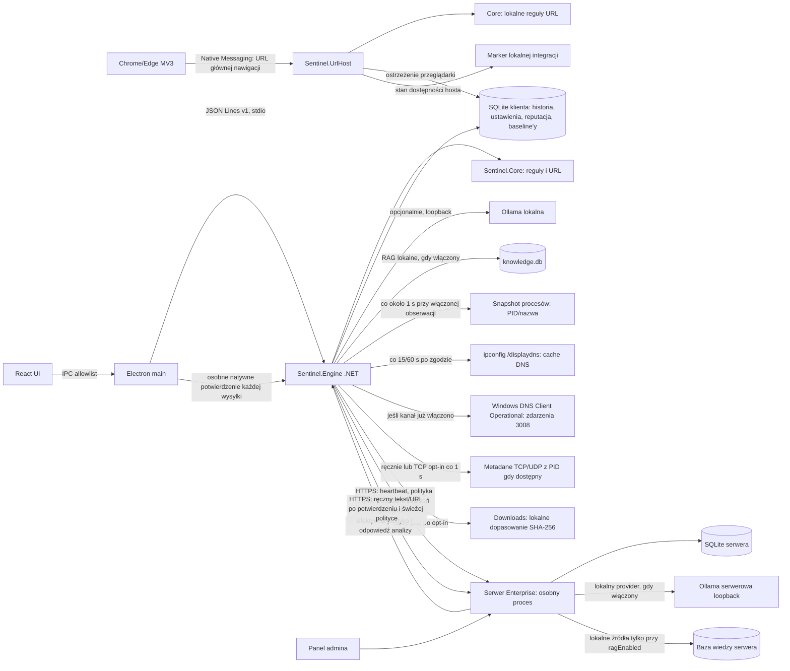

# Audyt luk i plan realizacji Sentinel AI

**Niezależna weryfikacja wcześniejszej próby checkoutu (2026-10-25):** bezpośrednie `dotnet test Sentinel.sln --no-restore -c Release` zakończyło się kodem 0: 385 PASS, 2 pominięte testy platformowe (387 łącznie). `npm test --prefix desktop` PASS 45/45; `node --test desktop/test/engine-client.test.cjs` PASS 11/11; `node scripts/check-product.cjs` PASS; `scripts/test-implementation-plans.ps1` PASS 14/14; `git diff --check` bez błędów (wyłącznie ostrzeżenia o konwersji LF/CRLF). Są to testy źródeł i statyczne kontrole; nie budowano instalatora, nie otwierano aplikacji ani przeglądarki i niczego nie pobierano. Dwa skipy .NET obejmują zależne od Windows DPAPI/środowiska; pełna suita serwerowa nadal ma opisany niżej błąd importu certyfikatu w sandboxie. **Nowsza bramka checkoutu i walidacja macierzy znajdują się w `docs/PROJECT_PROGRESS.md`.**

**Walidacja struktury planów (2026-10-25):** checker sprawdza teraz, że wszystkie ponumerowane nagłówki pogrubione są unikalne i rosną sekwencyjnie, także we wpisach postępu po 12 wymaganych sekcjach. Poprawiono rozjechaną numerację w planach 001, 003, 004, 007 i 008; `scripts/test-implementation-plans.ps1` PASS dla wszystkich 14 planów.

**F11 — blokada cache między instancjami i procesami (2026-10-25; wcześniejszy wpis):** wcześniejszy `SemaphoreSlim` należał do pojedynczej instancji, więc dwa obiekty `LocalKnowledgeBase` w tym samym procesie mogły równolegle przebudować semantyczny cache tego samego SQLite dla różnych endpointów/modeli. Blokada jest teraz współdzielona po pełnej ścieżce bazy w procesie i obejmuje inicjalizację, import, semantyczne wyszukiwanie, usuwanie oraz restore; w Windows dodatkowo wyłączny uchwyt `.operation.lock` serializuje te operacje między procesami i zwalnia się przy zamknięciu procesu. Testy dwóch instancji potwierdzają serializację modeli i usunięcia; w tym wcześniejszym przebiegu nie uruchomiono osobnego procesu. **Test międzyprocesowy przeszedł w lokalnym targeted teście oraz w suicie Windows CI run `40184972440`; ten run później zatrzymał się na niezależnym błędzie rozwiązywania `@electron/asar`, opisanym w `docs/PROJECT_PROGRESS.md`.**

**F02 — ścieżka deinstalatora (2026-10-25, przegląd kodu bez uruchamiania EXE):** `Main` rozpoznaje `Uninstall Sentinel AI.exe`/`--uninstall` przed pokazaniem kreatora instalacji; ten przepływ nie wywołuje `VerifyPayload` ani `SetupWizard`. `Uninstall` czyta osadzony `payload.zip`, aby usunąć znane pliki, wyrejestrowuje lokalny Native Messaging Host i uruchamia ograniczony skrypt sprzątający PowerShell. W metodzie deinstalacji nie ma klienta HTTP ani kodu pobierającego pliki. Tekst o ręcznym pobraniu nowej kopii pojawia się wyłącznie w błędzie weryfikacji payloadu instalatora/naprawy, więc możliwe, że użytkownik uruchomił instalator zamiast pliku deinstalatora; tego nie potwierdzono. `dotnet build installer/Sentinel.Setup/Sentinel.Setup.csproj --no-restore -c Release` PASS (0 ostrzeżeń, 0 błędów). Nie uruchamiano EXE, GUI ani instalacji/deinstalacji; zgłoszony przypadek pozostaje nieodtworzony.

**F02 — wynik rozstrzygającej diagnostyki Electron (2026-10-25):** lokalny Release instalatora kompiluje się bez ostrzeżeń/błędów, a `--self-test-no-app` przechodzi kodem 0. Pełny headless self-test kończy się kodem 1 po wykryciu `FATAL: install_dir_access.cc:52`: Chromium odrzuca sandbox, twierdząc, że katalog instalacji ma AppContainer SID bez `ALL APPLICATION PACKAGES`. Instalator nadaje wymagany SID przez `icacls` (375, następnie 376 wpisów, bez błędów), a bezpośrednia kontrola ACL katalogu potwierdza read/execute także po atomowej zamianie. Zmiana ponownego grantowania po swapie nie usunęła błędu, więc została zastąpiona kontrolą bez drugiej kosztownej modyfikacji. Autotest zachowuje teraz oczyszczony FATAL i nie czeka 120 s. Odczyt ACL `%USERPROFILE%` w sesji audytu zwraca `Access Denied`; nie naprawiano ani nie zmieniano ACL profilu. Przyczyna najpewniej leży w odziedziczonych ACL ścieżki poza katalogiem instalacji, ale bez dostępu do ACL nadrzędnych nie jest to potwierdzone. Pełny smoke i czysty Windows pozostają `IMPLEMENTED_UNVERIFIED/BLOCKED` na poziomie środowiska; nie wyłączono sandboxa.

**Walidacja bieżącego drzewa (2026-10-25):** `scripts/build-user.ps1 -Offline` PASS (kod 0): .NET 385 testów PASS i 2 platformowe SKIP, desktop 41/41, audyt npm lockfile 4/4, audyt licencji pakietu 5/5, testy ewaluatorów/guardów, wszystkie 14 planów, Engine/UrlHost/IPC oraz Vite 1581 modułów. Dodatkowy serwerowy loopback test ręcznej analizy z włączonym mock-modelem potwierdził, że `ragEnabled=false` nie ujawnia fragmentu dokumentu, a `true` go przekazuje; test obejmuje również odmowę bez zgody, URL-only oraz brak tekstu/URL w DB i WAL (1/1 PASS). Bez restore, instalacji zależności, live DNS, GUI i przeglądarki. Osobna próba `scripts/build-user.ps1 -Offline -Installer` zbudowała lokalny instalator v0.15.38, ale końcowy `--self-test` nie przeszedł z powodu odmowy zapisu do `%LOCALAPPDATA%`; hash i diagnostykę zapisano w `PROJECT_PROGRESS.md`. Nie wykonano publikacji ani uruchomienia instalacji GUI.

**Powtórzenie bramki po poprawce F02 (2026-10-25):** bieżące `scripts/build-user.ps1 -Offline` zakończyło się kodem 0: .NET 385 PASS + 2 platformowe SKIP, desktop 41/41, npm audits 4/4 i 5/5, evaluator/network guards, wszystkie plany 14/14, Engine/UrlHost publish i IPC oraz Vite 1581 modułów. To bramka źródeł bez budowania instalatora; nie uruchamia GUI/przeglądarki ani nie wykonuje restore/pobrań.

**F02 — pełny build i self-test bieżącego EXE (2026-10-25):** `scripts/build-user.ps1 -Offline -Installer` przeszedł bramki kodu (385 .NET PASS + 2 SKIP, Electron 41/41, audyty, guardy, Engine/UrlHost i UI), lecz ukryty `--self-test` zwrócił kod 1 po timeout 120 s smoke testu Electron. Wygenerowany lokalny EXE v0.15.38 (287 674 745 B, SHA-256 `59F8A6A40618768C6AFE2BB21CA29EAAF57869B1D0795EEE5485F34695632CE4`) przeszedł następnie `--self-test-no-app` kodem 0, potwierdzając symulowane install/update/rollback/uninstall. Nie zmieniono rejestru ani nie instalowano aplikacji w profilu; katalogi testowe posprzątano, artefakt pozostał lokalny i nieopublikowany. Oddzielne uruchomienie smoke z `win-unpacked` wykazało brak wymaganej ACE `ALL APPLICATION PACKAGES` na katalogu samego pakietu; to nie dowodzi, że jest to przyczyna timeoutu po instalacji testowej. Pełny smoke w instalowanej kopii i GUI nadal nieweryfikowane.

**F02 — diagnostyka smoke po timeoutcie (2026-10-25):** smoke Electron ma teraz 60-sekundowy limit ładowania oraz natychmiastowe, zredagowane wyjście po `did-fail-load` głównej ramki lub `render-process-gone`. Trzy testy zdarzeń PASS w desktop suite (łącznie 44/44), `node --check` dla `main.cjs`/modułu PASS. Nowego pełnego instalatora nie zbudowano po tej poprawce, więc przyczyna poprzedniego timeoutu pozostaje otwarta.

**F02 — poprawka nowej lokalizacji; wcześniejszy autotest EXE (2026-10-25):** rzeczywisty `--self-test` wcześniejszego artefaktu ujawnił próbę enumeracji celu instalacji, zanim katalog powstał. Po poprawce `installer/build-installer.ps1 -Offline` i ukryty `--self-test` przeszły dla EXE v0.15.38 o rozmiarze 287 662 457 B, SHA-256 `6E0ABDA09A3D68617CE60E2ACE9EA16CF6D3E913B810CE918CE3C47A1DDAD3F3`, ze zgodnym sidecar. To wynik wcześniejszego artefaktu; najnowszy lokalny build ma inny hash i jego self-test jest zablokowany dostępem do `%LOCALAPPDATA%` (opisany wyżej). Test nie zastępuje interaktywnego GUI ani testu na czystym profilu Windows.

**F02 — komunikat o weryfikacji pakietu (2026-10-25):** błąd kontroli integralności osadzonego payloadu prowadził do komunikatu „Pobierz go ponownie ze strony Sentinel AI”, który mógł sugerować automatyczne pobieranie. Komunikat wyjaśnia teraz, że aplikacja jest częścią instalatora i nie jest pobierana przez program; nowy instalator trzeba pobrać ręcznie tylko do ponownej instalacji/naprawy. Test kreatora PASS. Zgłoszony błąd podczas rzeczywistej deinstalacji nie został odtworzony i wymaga logu z komputera użytkownika.

**Ponowna pełna walidacja (2026-10-25):** `scripts/build-user.ps1 -Offline` PASS (kod 0): .NET 377/377 bez pominięć, guardy ewaluatorów i opt-in sieci, npm license audit 4/4, plany 14/14, Engine/UrlHost publish i IPC, desktop 37/37 oraz TypeScript/Vite 1581 modułów. Pełny test serwera Enterprise PASS 23/23 bez pominięć po powtórzeniu poza ograniczeniem CryptoAPI sandboxa. `DownloadedFileMonitorTests` PASS 13/13. Nie wykonano restore, pobierania, budowy instalatora, uruchomienia GUI ani przeglądarki. Te wyniki potwierdzają bieżące bramki kodu, ale nie zamykają jawnych luk F02/F03/F11 ani blokad środowiskowych.

**F20 — inspekcja istniejącego artefaktu (2026-10-25):** lokalny instalator z 2026-10-24, SHA-256 `42A0741A8AB21E73BD0EE2EEB12E1ABC36AAF3683A79EDBB112905E0E4B7B256`, ma zgodny sidecar. Odczyt `app.asar` wykazał dokładnie cztery dołączone pakiety npm, a notices zawierają pełne teksty ich licencji; obok znajdują się notices NuGet/.NET, PdfPig, Electron i Chromium. To dowodzi obecności tych plików w tym artefakcie, nie zastępuje decyzji właściciela o licencji produktu ani pełnego przeglądu prawnego całej dystrybucji.

**F20 — kontrola redystrybucji npm podczas builda (2026-10-25):** `installer/build-installer.ps1` porównuje teraz faktyczne pakiety z `app.asar` z produkcyjnym zestawem lockfile oraz wersjami, deklaracjami i tekstami licencji w notices. Pięć testów regresyjnych PASS; pełna bramka offline przeszła z audytem włączonym. Nie generowano nowego instalatora. Ocena prawna nietypowych licencji dev-only oraz decyzja o licencji Sentinel AI nadal są otwarte.

**F02 — logowanie deinstalacji (2026-10-25):** bieżące źródło loguje etapy deinstalacji i przy błędzie zapisuje etap, typ wyjątku oraz HRESULT; okno wskazuje lokalny log. Proces cleanup po wyjściu deinstalatora dopisuje końcowy status `complete`/`partial`/`failed`. Guard self-test oraz cleanup self-test PASS; test sprawdza usunięcie pustego folderu i zachowanie dodatkowego pliku użytkownika. Nie wykonano pełnej deinstalacji ani GUI; przyczyna zgłoszonego komunikatu o pobieraniu pozostaje nieznana.

**Końcowa lokalna bramka (2026-10-24):** `scripts/build-user.ps1 -Offline` PASS po udostępnieniu esbuildowi odczytu katalogu nadrzędnego: .NET 377/377 bez pominięć, guardy ewaluatorów i opt-in sieci, npm license audit 4/4, plany 14/14, Engine/UrlHost IPC i desktop 37/37; TypeScript/Vite 1581 modułów. Pełna suita serwera Enterprise PASS 23/23 bez pominięć, w tym live TLS. Bramka nie wykonała restore, pobierania, instalacji ani nie budowała instalatora.

**F11 — spójność cache przy równoległych modelach (2026-10-24):** test wymusił dwa równoległe wyszukiwania z różnymi endpointami/modelami i przed pierwszą poprawką zaobserwował dwa aktywne żądania embeddingów, które mogły mieszać konfiguracje cache. Blokada per instancja rozwiązała wyścig w pojedynczym obiekcie; aktualizacja z 2026-10-25 rozszerza ją na wszystkie instancje tego samego pliku w obrębie procesu. Targeted test z dwiema instancjami i test usuwania przez drugą instancję PASS. `KnowledgeBaseTests` + `AIProviderTests` wcześniejszego przebiegu 36/36 PASS. Nie dowodzi to jakości wyszukiwania na rzeczywistej Ollama ani synchronizacji wielu procesów.

**F02 — aktualny test strażników instalatora (2026-10-25):** `--uninstall-guard-self-test` uruchomiony z bieżącego źródła i lokalnych zależności PASS; obejmuje złą/brakującą rejestrację, własność wpisu autostartu, junctiony, enumerację i operacje na uchwytach. Test nie uruchamia GUI, instalacji ani modyfikacji rejestru. Ręczny cykl GUI na czystym profilu pozostaje niewykonany.

**F08 — ponowiona kontrola TOCTOU (2026-10-24):** test Windows wykonuje 100 kontrolowanych podmian sprawdzonego katalogu nadrzędnego na junction, dokładnie przed `CreateFileW`, w dziesięciu porcjach monitora. Wszystkie zewnętrzne ścieżki są odrzucane przed odczytem; potwierdzono zero haszowań, zdarzeń i wpisów baseline oraz niezmienioną treść plików zewnętrznych. Dodatkowy współbieżny stress test przełącza junction 40 razy podczas zbierania; wynik PASS 1/1, bez alertu i bez zapisu zewnętrznego pliku do baseline. Pełne `DownloadedFileMonitorTests` PASS 13/13, a bramka offline PASS .NET 377/377. Rzeczywiście przekierowany Known Folder pozostaje niezweryfikowany.

**F11 — pełne wyszukiwanie semantyczne (2026-10-24):** klient ma teraz oddzielną akcję wyszukiwania wektorowego, a `AnalysisOrchestrator` używa pełnego retrievera po wskazaniu modelu, niezależnie od FTS5. Pierwsze użycie wybranego modelu Ollama indeksuje wszystkie fragmenty, przechowuje wektory lokalnie w SQLite v2, wznawia brakujące fragmenty i liczy cosine similarity dla całej bazy. Cache ma limit 256 MB, jest związany z endpointem/modelem i czyszczony przy usunięciu lub przywróceniu dokumentów. Testy potwierdzają trafienie poza FTS5, migrację v1, redakcję, trwałość cache, zmianę endpointu/modelu i powrót do FTS5 przy błędzie. AIProviderTests 17/17, pełny Release .NET 366/366 bez pominięć. Produkcyjny build Vite PASS (1581 modułów). Rzeczywistej Ollama, jakości reprezentatywnej i UI runtime E2E nie zweryfikowano.

**F07/F15 — trwały backlog zmian procesów (2026-10-24):** limit 100 zdarzeń na próbkę nie gubi już automatycznie nadmiaru. SQLite v36 atomowo przechowuje do 20 000 zmian oczekujących; Engine opróżnia je po 100 na próbkę i odtwarza po restarcie. Pauza czyści backlog i przesuwa baseline. Przekroczenie twardego limitu nadal może odrzucić zmiany, ale licznik jest trwale zapisywany z baseline'em i widoczny po restarcie. Migracja v34→v36 zachowuje historię i baseline. Ścieżka obrazu jest rozwiązywana tylko dla startu emitowanego z bieżącej próbki; opóźniony start z backlogu nie otrzymuje ścieżki, aby uniknąć pomylenia procesu po ponownym użyciu PID. Testy monitoru 15/15 PASS, pełna suita .NET 370 PASS, 2 platformowe SKIP (372 łącznie). Krótkie procesy pomiędzy próbkami nadal mogą być niewidoczne.

**Stan macierzy funkcji (2026-10-24):** 21 funkcji: 3 `DONE_AND_VERIFIED`, 17 `PARTIALLY_IMPLEMENTED`, 1 `BLOCKED`, 0 `MISSING` i 0 `MOCK_OR_PLACEHOLDER`. Każda częściowa pozycja nadal ma jawne braki lub środowiskowe kryteria do weryfikacji. Wszystkie 14 planów są spisane, kompletne strukturalnie i otwarte (`IN_PROGRESS`); statusy nie są procentem gotowości produktu.

**Kontrola spójności audytu (2026-10-24):** macierz ma 21 funkcji (F01–F21) i 14 osobnych planów (PLAN-001–PLAN-014); wcześniej spis planów kończył się na PLAN-013. Dodano PLAN-014 do spisu i jawne mapowanie funkcji na plany. Późniejsza walidacja F16/F17 poza sandboxem przeszła pełną suitę serwera 23/23, w tym live TLS; wcześniejszy lokalny błąd CryptoAPI występował tylko w ograniczonym sandboxie. Dalsza walidacja wdrożeniowa nadal wymaga zaufanego certyfikatu, Windows Service i środowiska Enterprise.

**F16 — raportowanie zastosowanej polityki (2026-10-24):** klient zgłasza w heartbeat kompletną trójkę wersji globalnej, grupowej i urządzenia po zapisaniu efektywnych ustawień. Serwer waliduje kompletność i zakres, zapisuje wersje w SQLite v9, zachowuje je przy heartbeat błędu/legacy, a panel porównuje je z aktualnymi wersjami polityki i pokazuje `Aktualna`, `Nieaktualna` lub `Nieznana`. Niepełny raport jest odrzucany; nie raportuje treści ani ustawień polityki. Stary serwer bez wersji warstwowych nadal działa, ale urządzenie pozostaje `Nieznane`. Release kompilacja rozwiązania serwera i lokalny HTTP E2E PASS dla poprawnego, niepełnego oraz nieaktualnego raportu.

**F02 — ochrona drzewa i atomowa zamiana instalacji (2026-10-24):** walidacja odrzuca `FileAttributes.ReparsePoint` w komponentach ścieżki profilu i w drzewie instalacji. Skan używa nazw wyliczonych z otwartego uchwytu katalogu; odczyt/kopia/tworzenie plików stagingu, tworzenie katalogów i usuwanie operuje na sprawdzonych uchwytach. Zamiana katalogu używa `NtSetInformationFile(FileRenameInformation)` względem przypiętego uchwytu katalogu nadrzędnego; brak nadpisania istniejącego celu, a nieudany etap przywraca poprzednią instalację uchwytowo. Guard self-test obejmuje junction, konflikt nazwy, wielobuforową enumerację 1202 plików oraz operacje odczytu/kopii/tworzenia/usunięcia poza drzewem. Pełny bezokienkowy cykl self-test install/update/rollback/uninstall PASS w izolowanym katalogu; build Release i wizard self-test PASS. Pełny interaktywny GUI cykl pozostaje nieweryfikowany; podpis Authenticode i updater z podpisanym manifestem nadal brakują.

**F02 — zgłoszenie prośby deinstalatora o pobranie (2026-10-24):** przegląd aktualnego `Program.cs` nie znalazł klienta HTTP ani funkcji pobierania; deinstalator odczytuje listę plików z osadzonego payloadu, wyrejestrowuje lokalny host i uruchamia lokalne sprzątanie. Wcześniejszy headless PASS dotyczy innego artefaktu i nie rozstrzyga zgłoszonego zachowania GUI. Nie odtworzono komunikatu; rzeczywisty przebieg dla artefaktu użytkownika pozostaje niezweryfikowany.
**F02 — bezpieczna enumeracja i operacje na uchwytach (2026-10-24):** usunięto `SearchOption.AllDirectories` ze skanów miejsca, zachowania plików aktualizacji, rollbacku i sprzątania instalacji. Nazwy wpisów katalogu pobierane są z uchwytu; odczyt/długość/kopia/tworzenie plików i usuwanie operuje na sprawdzonych uchwytach, a katalogi stagingu są tworzone komponent po komponencie względnie do uchwytów rodziców. Test junctionem potwierdza odmowę operacji poza drzewem i enumerację 1202 plików. Build Release bez ostrzeżeń/błędów; self-tests PASS. Zamiana instalacji nadal korzysta ze ścieżek, więc TOCTOU nie jest całkowicie zamknięty.

**F09 — wyścig przy akcji pobierania (2026-10-24):** background odrzuca teraz `continue` dla ostrzeżeń typu `download`, nawet jeśli przycisk UI pozostaje chwilowo widoczny przed odczytem szczegółów. Regresja zapewnia, że nie nastąpi ponowna nawigacja do podejrzanego źródła ani drugi transfer; ważny token ostrzeżenia zostaje dostępny do zamknięcia lub anulowania. Pełne desktop `npm test` 37/37 PASS, bez uruchamiania przeglądarki.

**F11 — PDF i semantyczne wyszukiwanie w panelu Enterprise (2026-10-24):** endpoint i selektor dokumentów w panelu dopuszczają tekstowe PDF przez wspólny `LocalKnowledgeBase`/PdfPig; obowiązują limity 10 MB, 500 stron i 2 mln znaków, bez OCR. Test `KnowledgeBaseTests` 15/15 potwierdza ekstrakcję, limit stron i brak zmiany indeksu przy błędnym PDF; live loopback API E2E PASS potwierdził upload, wyszukiwanie leksykalne i semantyczne z atrapą Ollama oraz zachowanie oryginalnej nazwy źródła. Test RBAC potwierdza odmowę 403 dla roli `ReadOnly` bez żądania do modelu. Panelowy endpoint semantyczny jest dostępny tylko administratorom bezpieczeństwa/systemu, po jawnej zgodzie w interfejsie; transport blokuje proxy i przekierowania. Nie dodano zależności ani nic nie pobierano. Weryfikacja widoku przeglądarkowego, OCR i rzeczywistego modelu pozostają otwarte.

**F02 — tryb naprawy / aktualizacji (2026-10-24):** kreator ma osobną ścieżkę dla instalacji wskazanej w HKCU, odczytuje jej skróty i autostart oraz domyślnie nie uruchamia aplikacji po operacji. Jeśli odczyt ustawień zawiedzie, zatrzymuje się przed zmianami i pokazuje log; autotest zawiera wstrzyknięty błąd tego odczytu. Kompilacja instalatora z `--no-restore` PASS; GUI i autotest wizualny nie były uruchamiane, więc funkcja jest zaimplementowana, ale niezweryfikowana runtime. Podpis wydawcy i updater nadal są brakami.

**F13 — poprawka wykładniczego retry (2026-10-24):** supervisor nie zeruje już licznika restartu po krótkiej udanej odpowiedzi; reset następuje po minucie nieprzerwanego działania. Trzy testy regresyjne narastania 1/2/4 s, limitu 30 s i resetu po stabilnej minucie, desktop 36/36. Autostart i restart rzeczywistego Windows nadal niezweryfikowane.

**F03 — guard licencji ekstraktorów PhreshPhish (2026-10-24):** testowy, treningowy i benchmarkowy ekstraktor współdzielą walidację przypiętej rewizji oraz deklaracji `cc-by-4.0`; offline testy akceptacji/odrzucenia przechodzą 3/3. Guard nie zastępuje przestrzegania dodatkowego ograniczenia dataset card do badań antyphishingowych. Zmiana nie ponawiała transferu ani ewaluacji.

**F13 — diagnostyka kodu wyjątku (2026-10-24):** UI pokazuje obecnie zredagowany typ wyjątku .NET, jeśli host przechwyci standardową linię stderr, oraz kod zakończenia jako dziesiętny i szesnastkowy. Formatter obsługuje zarówno bez znaku, jak i ujemny zapis 32-bitowy; regresja potwierdza `-532462766` → `0xE0434352`. Po restarcie aplikacji UI odczytuje czas i ostatni bezpieczny rekord z dziennika ograniczonego do 64 awarii. Komunikat wyjątku i ścieżki pozostają ukryte; awarie bez rozpoznanego prefiksu nadal pokazują jedynie kod i informację o stderr. Testy desktop 32/32 i produkcyjny Vite build PASS; potwierdzenie widoku wymaga uruchomienia aplikacji Windows.

**F09 — ręczne zatrzymanie pobierania (2026-10-24):** ostrzeżenie po `downloads.onCreated` pozwala anulować dokładnie pobranie powiązane z ważnym tokenem ostrzeżenia; operacja następuje wyłącznie po kliknięciu użytkownika. Nie kasuje ukończonego pliku ani nie analizuje jego zawartości. Desktop tests 30/30, testy rozszerzenia 18/18 PASS. Akcji nie sprawdzono w Chrome/Edge E2E, a opóźnienie zdarzenia oznacza, że transfer może się zakończyć przed kliknięciem.

**F03 — defangowane URL-e w ręcznie wklejanej treści (2026-10-24):** reguły `2026.10.10` rozpoznają `hxxp[:]//` / `hxxps[:]//` oraz separatory hosta `[.]`, `[dot]` i `(.)`; lokalnie normalizują je wyłącznie w pamięci i tylko w części nazwy hosta, a następnie używają istniejącego URL analyzera. Nie zmieniają userinfo, portu ani ścieżki, nie otwierają adresu, a ostrzeżenie nie ujawnia URL-a. `AnalysisTests` 84/84 PASS, także przypadki userinfo i portu. Benchmarki PhishVN/Mendeley opisują zamrożone `2026.10.9` i nie mierzą tej nowej funkcji. To poprawia analizę wiadomości z celowo zneutralizowanym linkiem, lecz nie rozwiązuje niskiego recall dla zwykłych, nieznanych URL-i.

**F09 — źródła pobrań z linków (2026-10-24):** rozszerzenie używa `downloads.onCreated`, aby lokalnie sprawdzić końcowy URL, także dla pobrania, które nie zmienia bieżącej karty. Przy wykryciu ostrzeżenie otwiera się w osobnej karcie. Rozszerzenie przekazuje tylko URL do lokalnego hosta, bez nazwy pliku, ścieżki i referrera. Zdarzenie pojawia się po rozpoczęciu pobierania; transfer może trwać dalej i zawartość nie jest analizowana. Desktop tests 24/24 (extension 12/12), `check-product`, plan checker 14/14, kompilacja Engine i produkcyjny build UI PASS. Pełna `scripts/build-user.ps1 -Installer` PASS; artefakt testowy v0.15.38: 281146745 B, SHA-256 `0B215764EEE5712FC93F5C9C822F5707EFAEDBFB9D8B098D820B325E5F5A4B54` (nie wydanie; build+self-test PASS, `--integration-test` zakończył się kodem 1 po wykryciu istniejącej rejestracji Chrome Native Messaging; preflight odmówił instalacji). Pełne E2E Chrome/Edge dla linku pozostaje otwarte.

**F02 — headless weryfikacja artefaktów (2026-10-24):** artefakt testowy v0.15.38 SHA-256 `CE92935A97B79C5AFDCA845F086A975E6D3CB9EC0A58AE2A47390F45B5E85D08` przeszedł `--integration-test` (kod 0): install/verify/uninstall oraz Native Messaging; skróty i autostart wyłączone. Log ma `INTEGRATION_TEST_SUCCESS`, postflight nie znalazł testowego katalogu, wpisów uninstall/Run/Native Messaging ani procesów. Nowszy artefakt `0B215764EEE5712FC93F5C9C822F5707EFAEDBFB9D8B098D820B325E5F5A4B54` uruchomiono z `--integration-test`; świeży log i wynik procesu potwierdziły odmowę przez preflight z powodu istniejącej rejestracji Chrome Native Messaging. Test nie rozpoczął instalacji, a postflight potwierdził zachowanie tej rejestracji i brak testowego katalogu, wpisu uninstall/autostartu, skrótów oraz procesu. Audyt kodu potwierdza, że deinstalator korzysta z lokalnie osadzonego `payload.zip`, bez klienta HTTP ani kodu pobierającego aplikację. Zgłoszonego promptu nie odtworzono w GUI; GUI nie jest zweryfikowane.

**F03 — świeży domenowy holdout URL (2026-10-24):** na licencjonowanym CC BY 4.0 Mendeley Phishing URL v1 (Common Crawl/PhishTank) sprawdzono zamrożone reguły `2026.10.9`. Po deduplikacji 19 950 powtórek domenowy holdout 33 132 URL-i osiągnął TP=439, FP=2 629, TN=16 962, FN=13 102 (precision 14,31%, recall 3,24%, FPR 13,42%). Mapowanie etykiet numerycznych jest wnioskowane z dokładnej zgodności liczebności klas z oficjalną kartą, więc metryki są warunkowe. Holdout nie jest ruchem produkcyjnym i nie posłużył do strojenia. Nie znaleziono cechy, która uzasadnia bezpieczne podniesienie alertów; krytyczna luka F03 pozostaje otwarta.

**F09 — SPA, przekierowania, pobieranie i lifecycle kart (2026-10-24):** rozszerzenie analizuje `webNavigation.onHistoryStateUpdated` oraz końcowy URL na `onCommitted` dla głównej ramki; ten sam URL jest deduplikowany, a iframe pomijany. Desktop Node 21/21, w tym spóźniona odpowiedź ignorowana po zamknięciu karty oraz usunięcie jej szczegółów ostrzeżenia z session storage. Chrome 155.0.8059.86 i Edge 155.0.4283.62 E2E PASS na lokalnym fixture `*.test`: HTTP 302 do `paypal-login.test` wywołało produkcyjne ostrzeżenie z redakcją URL/hosta, zmiana `history.pushState` została przeanalizowana, iframe nie wygenerował dodatkowej analizy, dwa równoczesne ostrzeżenia pozostały niezależne, zamknięcie jednej karty nie zmieniło drugiej, a nawigacja do odpowiedzi `Content-Disposition: attachment` ostrzegła i zapisała fixture tylko w profilu tymczasowym. Nie sprawdzano treści pobranego pliku ani pobrań uruchamianych linkiem/API. Oba profile i wpisy HKCU sprzątnięto. Pełna `scripts/build-user.ps1 -Installer` PASS: .NET 350/350 bez pominięć, guardy evaluatorów, plan checker 14/14, Engine/UrlHost IPC/DNS/TCP/UDP, Electron 17/17, `npm audit` 0, UI produkcyjny i autotest instalatora. Artefakt testowy v0.15.38: 281146233 B, SHA-256 `CE92935A97B79C5AFDCA845F086A975E6D3CB9EC0A58AE2A47390F45B5E85D08`; nie jest wydaniem.

**F02 — ponowna próba GUI i pełna bramka (2026-10-24):** po usunięciu `ShowWithoutActivation => true` uruchomiono zatwierdzony artefakt `CAAF80BB3CA7A8084E7CF74A95B00B6FF41E0EAC98C807C6D11CE2B86E22088D` (281146233 B). Lista Windows zwróciła okno „Sentinel AI — Instalator”, lecz dwie próby przechwycenia zakończyły się `FrameArrived timed out` / `window capture timed out`; nie wykonano kliknięcia ani instalacji, a dokładny proces testowy zamknięto. Kontrola po teście: brak testowego wpisu uninstall, autostartu i Native Messaging, katalogów `.SentinelAI-*` oraz procesu. Zwykła instalacja nie była dotykana. Kod nieaktywujący okna usunięto i objęto autotestem; efekt w interaktywnej sesji nadal wymaga ręcznego testu, bo narzędzie przechwytywania zawiodło.

**Walidacja poprawki F02 (2026-10-24):** pełna `scripts/build-user.ps1 -Installer` PASS: .NET 350/350 bez pominięć, guardy i ewaluatory, plan checker 13/13 w czasie buildu, Engine/UrlHost IPC/DNS/TCP/UDP, Electron 16/16, `npm audit` 0, UI produkcyjny i autotest. Artefakt v0.15.38: 281146233 B, SHA-256 `CAAF80BB3CA7A8084E7CF74A95B00B6FF41E0EAC98C807C6D11CE2B86E22088D`; po dodaniu PLAN-014 osobny test struktury planów PASS 14/14. To artefakt testowy, nie wydanie.

**Audyt podatności zależności (2026-10-24):** `npm audit --audit-level=low` zgłosił 0 podatności w `desktop` i `website`. Odczyt `dotnet list package --vulnerable --include-transitive` objął główną solucję klienta, osobną solucję serwera Enterprise, instalator i projekt legacy; bieżące źródła NuGet nie zgłosiły podatnych pakietów. To nie zastępuje ręcznego audytu licencji F20 ani audytu natywnych komponentów.

**F03 — bieżący feed PhishTank (2026-10-24):** jednorazowa ewaluacja 57 392 aktywnych, zweryfikowanych wpisów z oficjalnego feedu dała recall wierszowy 11,5225% dla zamrożonych reguł `2026.10.9` przy progu Moderate (6 613 wykryć, 50 779 niewykryć, 3 niepoprawne URL-e). Adresów nie otwierano; pobrane surowe dane usunięto. To wyłącznie positive-only snapshot: nie estymuje FPR/precision i nie uzasadnia użycia wyniku jako walidacji produkcyjnej. Pełny opis i SHA-256: [DETECTION-EVALUATION.md](DETECTION-EVALUATION.md).

**F03 — PhreshPhish i model badawczy (2026-10-24):** zamrożone reguły `2026.10.9` na 168 059 rekordach testowych osiągnęły recall 4,9583% i FPR 5,9161%. Badawczy SGD char n-gram trenowany wyłącznie na `train`, kalibrowany na domenowo odseparowanym splitcie, uzyskał na 975 oficjalnych benchmarkach recall 43,60–74,17% oraz precision 2,91–94,40% zależnie od bazowego odsetka i progu; przy bazie 0,05% precision wynosi 13,72%, 4,38% i 2,91% dla kolejnych progów kalibracji. Dziesięć tysięcy bootstrapów na grupę wskazuje wąskie CI dla średnich, ale niski PPV przy rzadkim phishingu nie uzasadnia alertu produkcyjnego. Dataset dopuszcza wyłącznie badania antyphishingowe; model nie został wdrożony. HTML nie pobierano, URL-i nie otwierano, dane i pakiety usunięto. F03 pozostaje krytyczny do czasu walidacji na zgodnie licencjonowanych, aktualnych danych i poprawy precyzji. [Metody, wyniki i checksumy](DETECTION-EVALUATION.md).

**F03 — diagnostyczny model n-gramów (2026-10-24):** Multinomial Naive Bayes znaków 3–5 na checksumowanym PhishVN train/validation osiągnął 22/24 recall, ale przy 198 FP; próg wyznaczony na train obniżył wynik validation do 3/24 przy 3 FP. Model nie nadaje się do alertu produkcyjnego i nie został dodany. Odtwarzalny skrypt, guard splitów i pełne metryki: [DETECTION-EVALUATION.md](DETECTION-EVALUATION.md). Test split nie był czytany.

**F21 — AppInit_DLLs (2026-10-24):** opt-in monitor wykrywa zmiany `AppInit_DLLs`, `LoadAppInit_DLLs` oraz `RequireSignedAppInit_DLLs` w 32/64-bitowych widokach HKLM. W bazie pozostają tylko hashe wartości i identyfikatory źródeł. Migracja SQLite v28→v29→v30 oraz syntetyczny alert i redakcja ścieżek PASS w 27 testach monitora; read-only test enumeracji rejestru PASS 1/1. Pełna `scripts/build-user.ps1 -Installer` PASS: .NET 342/342 bez pominięć, ewaluatory, plany 13/13, Engine IPC/DNS/TCP/UDP, Electron 16/16, `npm audit` 0, UI i autotest instalatora. Lokalny artefakt v0.15.38 281138041 B, SHA-256 `7E772F4B81E359F4C992237ADC0A5B68120F131EC484F31630ECCA5FBBA582AF`; self-test PASS. Próba `--integration-test` zakończyła się kodem 1 bez nowego wpisu logu; po niej nie pozostały testowe klucze rejestru ani katalog. Wynik integracji jest nierozstrzygnięty i artefakt nie jest wydaniem.

**Weryfikacja F06 i bezpieczeństwa klienta (2026-10-24):** przy limicie 100 zdarzeń nowych TCP/UDP trwały baseline przesuwa się teraz wyłącznie o endpointy z zapisanymi zdarzeniami. Aktywne nadmiarowe endpointy wracają jako kandydaci w następnej próbce, również po restarcie Engine; regresja 150 endpointów dała 100+50. Krótkie połączenia zakończone przed kolejną próbką nadal mogą zostać pominięte. Pełna bramka `scripts/build-user.ps1 -Installer` PASS, .NET 340/340, testy desktop 16/16 i `npm audit` 0. Przy okazji zaktualizowano Electron 44.9.0→44.9.1 zgodnie z [oficjalnym advisory](https://github.com/electron/electron/security/advisories/GHSA-jr5w-w6x2-84p9); lokalny instalator i headless integration test PASS, lecz nie utworzono release.

**F03 — odtworzenie oficjalnego baseline'u (2026-10-23):** ponownie pobrano PhishVN v4 do katalogu tymczasowego (5 813 309 B; SHA-256 `308351E9D0C0FCA13A81F2F63524A7DEE08CCBA6C775848D125B3DA5525D0AB5`). Sumy train i validation zgadzają się z oficjalnym `MANIFEST.txt`; test nie był wyodrębniany. Reguły `2026.10.9` dały ponownie train TP=0/FP=3 oraz validation TP=0/FP=0. F03 pozostaje częściowe.

**F02 — częściowy test GUI aktualnego instalatora (2026-10-24):** artefakt v0.15.38 o SHA-256 `D2416104E1D35503352A12D2F711AE15E192C88A8711D03574953E3C2132D518` zainstalował i zweryfikował aplikację w `.SentinelAI-GUI-Test-20261023`. Przed instalacją potwierdzono brak autostartu, skrótów i startu aplikacji po zakończeniu. Pełny GUI uninstall nie został ukończony: Computer Use zablokował uruchomienie skopiowanego deinstalatora, a próba otwarcia Panelu sterowania przekroczyła limit zatwierdzenia. Dnia 2026-10-24 usunięto dokładny izolowany katalog testowy i powiązane wpisy HKCU deinstalacji oraz Native Messaging Chrome/Edge; kontrola potwierdziła brak katalogu i kluczy. Zwykła instalacja Sentinel AI nie była modyfikowana. Nie uznajemy F02 za w pełni zweryfikowane.

**F03 — aktualizacja źródła PhishVN (2026-10-23):** oficjalna v4 (v3.1.0) jest dokumentacyjną aktualizacją danych v3, więc istniejące checksumy i pomiary train/validation pozostają aktualne; nie jest to nowy holdout. Uzupełniony audyt etykiet 200 próbek wykrył szacowane 12,1% błędów w pozytywach (95% CI 7,1–20,0%; głównie bronze) i 4,0% w benign. Wyniki gold/silver traktujemy jako lepszy, lecz nie doskonały podzbiór. Szczegóły i źródła pierwotne są w [DETECTION-EVALUATION.md](DETECTION-EVALUATION.md).

**F02 — tryb pliku deinstalatora (2026-10-23):** wcześniej bezpośrednie uruchomienie `Uninstall Sentinel AI.exe` bez parametru otwierało kreator instalacji; wpis Windows przekazywał `--uninstall`, więc działał poprawnie. Program rozpoznaje teraz nazwę pliku deinstalatora i pokazuje potwierdzenie odinstalowania również przy uruchomieniu z Eksploratora. Autotest pokrywa nazwę, jawny parametr oraz nazwy zwykłego instalatora i aplikacji. Pełna bramka `scripts/build-user.ps1 -Installer`, self-test i `--integration-test` przeszły dla lokalnego artefaktu v0.15.38, SHA-256 `D2416104E1D35503352A12D2F711AE15E192C88A8711D03574953E3C2132D518` (nie jest wydaniem). Integracja potwierdziła install/verify/uninstall, Native Messaging i sprzątnięcie wpisów. Izolowana instalacja GUI tego artefaktu później przeszła do ekranu „Gotowe”; GUI deinstalacji nie ukończono. Pakiet jest osadzony lokalnie w EXE, a deinstalacja nie potrzebuje pobierania aplikacji.

**F03 — screening dodatkowych marek (2026-10-23):** dla 12 z góry wybranych marek uruchomiono odtwarzalny `scripts/evaluate-phishvn-brand-candidates.ps1` tylko na checksumowanych PhishVN gold/silver train i validation. Nie dopasowano kandydatów na train (TP=0/2 076, FP=0/11 004) ani validation (TP=0/24, FP=0/1 561); test split odrzucono przez guard. Reguł produktu nie zmieniono. Guard i pełna bramka bez pakowania instalatora PASS: .NET 340/340 bez pominięć, ewaluatory/13 planów, Engine IPC/DNS/TCP/UDP, Electron 16/16, `npm audit` 0 i UI build. Metoda i ograniczenia: [DETECTION-EVALUATION.md](DETECTION-EVALUATION.md).

**F07 — ponowna weryfikacja dostępu do zdarzeń procesu (2026-10-23):** w Windows PowerShell 5.1 tymczasowa subskrypcja `Win32_ProcessStartTrace` zwróciła `ManagementException: Access denied` zarówno w zwykłej sesji, jak i po uruchomieniu poza sandboxem; w teście podwyższonym subskrypcja nie powstała, więc nie uruchomiono procesu kontrolnego. Nie zmieniano członkostwa grup, ACL ani polityk. Microsoft dokumentuje `Win32_ProcessStartTrace` jako źródło startu procesu, ale uruchamianie SystemTraceProvider podlega osobnym wymaganiom dostępu do sesji; obecne prawa blokują tę ścieżkę. [Dokumentacja Win32_ProcessStartTrace](https://learn.microsoft.com/en-us/previous-versions/windows/desktop/krnlprov/win32-processstarttrace), [wymagania SystemTraceProvider](https://learn.microsoft.com/en-us/windows/win32/etw/configuring-and-starting-a-systemtraceprovider-session), [uprawnienia ETW](https://learn.microsoft.com/en-us/windows/win32/api/evntcons/nf-evntcons-eventaccesscontrol). Pozostaje polling co około sekundę i jego znane pominięcia.

**F02 — responsywność instalatora (2026-10-23):** po zgłoszeniu „Brak odpowiedzi” prześledzono ścieżkę UI. Pakiet aplikacji jest osadzony w instalatorze; instalacja nie pobiera aplikacji z Internetu. Instalator wcześniej kolejkował aktualizację UI dla każdego fragmentu 128 KiB podczas rozpakowywania. Ograniczono je do maksymalnie jednej na 200 ms; autotest symuluje 1000 aktualizacji w 1 s i sprawdza również natychmiastowe końcowe 100%. Komunikat zmieniono na „Rozpakowuję aplikację z pakietu lokalnego…”. `installer/build-installer.ps1`, `--self-test` i `--integration-test` PASS dla bieżącego artefaktu v0.15.38 SHA-256 `FBF4C4BB9305DFAF06673AEEA594915C038E3AF93E07B2E3FC4865D1BF5E1D48`; instalację, weryfikację, Native Messaging i deinstalację potwierdzono, a po teście nie pozostały wpisy HKCU ani pliki. Ręczny test GUI tej poprawki pozostaje wymagany.

**Najnowsza pełna bramka (2026-10-23, reguły `2026.10.9`):** `scripts/build-user.ps1 -Installer` PASS: .NET 340/340 bez pominięć, guardy ewaluatorów, plany 13/13, Engine IPC i DNS/TCP/UDP, Electron 16/16, `npm audit` 0, produkcyjny UI i autotest instalatora. Artefakt testowy v0.15.38 (281371513 B), SHA-256 `4B12BACC2FC247C567DD3125553E79D3E7950EC6B3350FA6D7EC2A08EBBCAB21`; `--integration-test` PASS dla bieżącego hasha: instalacja, weryfikacja, Native Messaging, odinstalowanie i brak pozostałości wpisów HKCU/autostartu/skrótu/katalogu. Próba GUI tego hasha została uruchomiona, ale przechwycenie okna dwukrotnie timeoutowało (`FrameArrived timed out`) przed pierwszą akcją; proces zamknięto i nie powstały wpisy ani katalog. Pełny cykl GUI pozostaje niezweryfikowany, a instalator nie jest wydaniem. Live read-only testy usług/sterowników i Run/Winlogon, ręczne pobranie CERT oraz opt-in automatyczne odświeżenie (125 412 domen, feed SHA-256 `003CBD2C358F9088E5D18C6C2DEA933D982A7CE40B81CFC52FB6068AD2B9E8FF`) przeszły. Chrome 155 E2E dla `.test` PASS z produkcyjnym `UrlRequestProcessor`, a profil i tymczasowy HKCU posprzątano.

**F04 — jawne odświeżanie w tle (2026-10-23):** dodano domyślnie wyłączoną opcję automatycznej aktualizacji feedu CERT co 24 h. Źródło pozostaje stałym HTTPS endpointem; analizowane URL-e nie są wysyłane. Błąd widoczny w stanie silnika/UI zawiera tylko typ wyjątku, a ponowienie następuje najwcześniej po 6 h. Testy harmonogramu, retry i persystencji preferencji przechodzą; live E2E przez Engine IPC PASS — feed został zapisany do unikalnej tymczasowej bazy (125 412 domen, SHA-256 `003CBD2C358F9088E5D18C6C2DEA933D982A7CE40B81CFC52FB6068AD2B9E8FF`), po teście katalog usunięto. Pełna bramka: .NET 340/340 bez pominięć, Electron 16/16, `npm audit` 0, UI production build i installer self-test. Artefakt testowy: 281371513 B, SHA-256 `4B12BACC2FC247C567DD3125553E79D3E7950EC6B3350FA6D7EC2A08EBBCAB21`; `--integration-test` tego hasha PASS, GUI nie wykonano.

**Walidacja po dodatkowym screeningu F03 (2026-10-23):** `scripts/build-user.ps1` bez `-Installer` PASS: .NET 327/327 bez pominięć, wszystkie guardy ewaluatorów, plany 13/13, Engine IPC/DNS/TCP/UDP, Electron 16/16, `npm audit` 0 i UI production build. Nie budowano nowego instalatora ani wydania. Test cechy entropii etykiety rejestrowalnej jest opisany w [DETECTION-EVALUATION.md](DETECTION-EVALUATION.md): wynik na URL-Phish v1 nie uogólnił się na PhishVN train/validation, więc nie zmieniono reguł produktu.

**Dodatkowa kontrola F03 (2026-10-23):** powtórzony o 15:02 UTC pomiar bieżącego feedu CERT Polska (125 421 domen; SHA-256 `CCD086A057422D783D42CF6B96538A4C3B15DA3C0FFECFB01D203911E2F6C1D9`) dał TP=0 i FP=0 na PhishVN gold/silver train (2 076 pozytywów) i validation (24 pozytywy). Nie wykorzystano test splitu ani nie otwierano URL-i. Lokalna reputacja CERT nie rozwiązuje luki offline URL-only; F03 pozostaje otwarte. Odtwarzalny skrypt i pełne checksumy: [DETECTION-EVALUATION.md](DETECTION-EVALUATION.md).

**F09 — produkcyjne reguły w przeglądarce (2026-10-23):** dodano `tests/Sentinel.NativeMessagingEngineHost`, testowy wrapper Native Messaging nad produkcyjnym `UrlRequestProcessor`, bez inicjalizacji profilu użytkownika, zapisu historii i powiadomień. Chrome 155 E2E dla `.test` potwierdził `status`/`analyze`, rzeczywiste `url.brand`, wersję `2026.10.9` oraz redakcję hosta i URL-a w ostrzeżeniu. Host buduje się bez ostrzeżeń, a test sprząta profil i tymczasowy HKCU. Nowy host jest objęty solution i `scripts/build-user.ps1`; pełna bramka bez instalatora PASS (.NET 327/327, Engine IPC/DNS/TCP/UDP, Electron 16/16, npm audit 0, UI build). Nie testowano lokalnej reputacji ani skutków ubocznych pełnego hosta.

**F21 — Policies Explorer Run i Winlogon (2026-10-23):** monitor opt-in obejmuje `HKCU/HKLM` dla `Policies\\Explorer\\Run` oraz wartości `Shell`/`Userinit` Winlogon w widokach 32- i 64-bit. Surowe nazwy wartości i polecenia nie trafiają do historii; testy syntetyczne potwierdzają ogólne alerty i redakcję. SQLite migruje v26→v27→v28 atomowo, zachowując istniejące baseline'y; testy pokrywają źródła user/machine i migracje. Nie wykonywano zapisu do rzeczywistego rejestru Winlogon.

**F03 — cross-source LegitPhish (2026-10-23):** z PhiLegit-100K v1 analizowano tylko 19 617 unikalnych wierszy oznaczonych `LegitPhish`, bez rekordów PhiUSIIL/`Both` i bez `features_json`. W domain holdout obecne reguły miały TP=3 878/FN=2 377/FP=1/TN=66. Entropia dodała 3 TP bez dodatkowego FP, ale holdout zawierał tylko 67 benign URL-i; to nie jest wystarczający pomiar produkcyjnego FPR i nie uzasadnia dodania reguły.

**F09 — Chrome E2E (2026-10-23):** Chrome 155 załadował kopię rozszerzenia ograniczoną do `*.test` przez CDP w profilu tymczasowym. Zewnętrzne hosty odrzucała reguła resolvera; lokalna nawigacja do fixture dotarła przez Native Messaging mock, a `warning.html` wyświetlił oczekiwany nagłówek i syntetyczny wskaźnik. Kod 0; po teście usunięto profil, mock, procesy i HKCU. To weryfikuje przepływ przeglądarki z atrapą, nie analizę produkcyjnego Engine ani ręczną instalację.

**Uzupełnienie pełnej bramki i F03 (2026-10-23):** po dodaniu skryptu diagnostycznego 29 cech URL wyłącznie dla train/validation ponowiono `scripts/build-user.ps1 -Installer`; .NET 327/327 bez pominięć, testy ewaluatorów, Engine IPC/DNS/TCP/UDP, Electron 16/16, `npm audit` 0, produkcyjny UI i installer self-test PASS. Nowy lokalny artefakt testowy v0.15.38: 281364345 B, SHA-256 `83ACD88B2DEDEF8BE1D96DFF337B94A92CB1B961F505F6FC888D4C237E7AC4D2`; nie uruchomiono GUI. Kandydaci cech z małym false-positive rate nie wykryli pozytywów w validation, a lepszy recall dla progu cyfr dawał FP=12/1 561; nie zmieniono reguł.
**F04 — semantyka domen CERT (2026-10-23):** dopasowanie obejmuje wpis i jego subdomeny na granicy etykiet, lecz nie domenę nadrzędną ani lookalike; wpis równy publicznemu sufiksowi nie blokuje jego tenantów. Zmiana realizuje regułę CERT Polska i podnosi wersję reguł do `2026.10.9`. Testy Core sprawdzają `evil.test`, `www.evil.test`, `notevil.test`, rodzica `only.test` i public suffix `co.uk`; przepływy ręcznej analizy oraz Browser Host potwierdzają wynik end-to-end w testach 18/18. Odpowiedź Browser Host pozostaje bez URL-a i hosta. Pełna bramka PASS: .NET 320/320, Engine IPC/DNS/TCP/UDP, Electron 16/16, `npm audit` 0, UI production build i self-test instalatora. Artefakt testowy v0.15.38: 281364345 B, SHA-256 `DA807241E9E5E26E440BAF9DAE8C27648C59108E1EA30F8D67676463D8DED736`; nie wykonano GUI ani `--integration-test` dla tego hasha.
**Kontrola planów (2026-10-23):** sprawdzono 13 planów wdrożenia względem wymaganej struktury 12 sekcji. Wykryto i poprawiono brak osobnej sekcji „Braki” w PLAN-011; `scripts/test-implementation-plans.ps1` przechodzi i został dodany do pełnej bramki.
**Dodatkowy test detekcji F03 (2026-10-23):** publiczny URL-Phish v1 (CC BY 4.0; 111 660 rekordów) zmierzono surowymi URL-ami bez feedu, z deterministycznym podziałem domen rejestrowalnych. Na 35 959 domenowo odseparowanych holdout URL-ach reguły `2026.10.8` przy progu Moderate uzyskały TP=1 395, FP=50, TN=30 180, FN=4 334 (recall 24,35%, FPR 0,1654%, precision 96,54%). To diagnostyczny wynik na znanym, opublikowanym zbiorze, którego phishingowa część pochodzi głównie z PhishTank; po nim nie strojono reguł. PhishVN URL-only nadal ma 0/487 na swoim czasowym teście, a F03 pozostaje częściowe. Reprodukcja, hash pliku i ograniczenia: [DETECTION-EVALUATION.md](DETECTION-EVALUATION.md); nowy lokalny ewaluator: `scripts/evaluate-url-phish.ps1`.
**Kandydat F03 — lokalne nazwy banków/platform (train → validation, 2026-10-23):** nowy ewaluator sprawdził 12 tokenów z granicami słowa w polu domeny PhishVN, bez używania testu. Train: TP=136/2 076, FP=16/11 004; validation: TP=0/24, FP=2/1 561. Reguły produktu nie zmieniono; mała walidacyjna próbka i zerowy recall nie potwierdzają tego kandydata. Hashy danych i komenda odtworzenia są w [DETECTION-EVALUATION.md](DETECTION-EVALUATION.md); fixture split-guard dołączono do `scripts/build-user.ps1`.
**Odrzucona kandydatura reguły TLD (2026-10-23):** na części treningowej URL-Phish wartości `.dev` (954 phishing / 1 benign), `.app` (326 / 1) i `.icu` (192 / 0) wyglądają predykcyjnie, ale benign próbka jest źródłowo ograniczona, a `.dev`/`.app` mają udokumentowane legalne zastosowania. Nie dodano ich do listy podejrzanych sufiksów; te metryki nie uzasadniają reguły produktu. ([Google Registry .dev](https://www.registry.google/domains/dev/), [Google Registry .app](https://www.registry.google/domains/app/)).
**F09 — wyścig przy starcie rozszerzenia (2026-10-23):** `background.js` czeka teraz na odczyt zapisanego `integrationEnabled` przed analizą pierwszej nawigacji; przy błędzie odczytu integracja pozostaje wyłączona. Regresje pokrywają opóźnione `false` oraz błąd magazynu i potwierdzają, że nie wysłano żądania do hosta. Testy desktop 16/16, lint PASS. Pełna bramka klienta PASS: .NET 301/301, Engine IPC/DNS/TCP/UDP, npm audit 0, UI production build i installer self-test; artefakt testowy v0.15.38 SHA-256 `1D51F1C1CFF2F28B6DFC276127487D411420FDBF5DDE92D113173ABD293E4FC3`. Ręczny test rozszerzenia w izolowanym profilu Chrome pozostaje niewykonany.

**F03 — reputacja CERT i korelacja linków w treści (2026-10-23):** `2026.10.8` rozszerza świeżą lokalną listę CERT na maksymalnie 10 adresów HTTP/HTTPS znalezionych w wiadomości. Dopasowanie jest dokładne względem hosta i nie wykonuje połączeń podczas ręcznej analizy. Wybór hosta do korelacji i lokalnego skrótu bierze pod uwagę, który URL rzeczywiście wygenerował wskaźniki; osadzony podejrzany link nie jest wiązany z osobnym, zwykłym URL-em. Ręczne ostrzeżenia URL deduplikują się przez 10 minut dla tego samego źródła, skrótu sygnału i poziomu ryzyka; zmiana ryzyka zachowuje osobne zdarzenie. Release PASS: .NET 301/301 bez pominięć, Engine IPC i DNS/TCP/UDP, Electron 14/14, `npm audit` 0, UI production build i autotest instalatora; artefakt testowy v0.15.38 SHA-256 `B888C805065D1DC6419D8CC3A1F8DCEF9CC08179EC10494C94F0290A0B9C1E11`. Testy obejmują dokładne dopasowanie, feed wygasły, granice URL, limit 10, podniesienie do High, brak hosta w wyjaśnieniu, zachowanie Critical, IPC korelacji hosta i trwałą deduplikację. Wynik heurystyk URL-only PhishVN `0/487` pozostaje bez zmian bez feedu; F03 pozostaje częściowe.
**Weryfikacja bieżącego drzewa (2026-10-23, commit `25badad`):** poza sandboxem `scripts/build-user.ps1 -Installer` PASS: .NET 295/295 bez pominięć, ewaluatory PhishVN/domen, Engine IPC oraz Windows DNS/TCP/UDP, Electron 14/14, `npm audit` 0, production UI build i autotest instalatora. Artefakt testowy v0.15.38: SHA-256 `A9B9718E25176592874A252DC2319A259B6A2062D712519B63AC73169A63B97A`. Instalatora GUI nie uruchamiano; jego pełny interaktywny cykl pozostaje nieweryfikowany.
**Zmiana F03 — linki w treści (2026-10-23):** `2026.10.7` analizuje lokalnie do 10 adresów HTTP/HTTPS znalezionych w tekście wiadomości i wskazuje niepewność celu kliknięcia; nie otwiera ich, nie podnosi ryzyka za sam zwykły URL i raportuje pominięcie nadmiaru. Pełny build `scripts/build-user.ps1 -Installer` PASS: .NET 295/295 bez pominięć, strażniki ewaluatorów PhishVN/domen, Engine IPC/DNS/TCP/UDP, Electron 14/14, `npm audit` 0, UI build i installer self-test. Test IPC potwierdza wykrycie linku osadzonego w treści i redakcję historii. Artefakt testowy v0.15.38 SHA-256 `0CBAD69990B12B6AB81DF6373A3FDBC1987EDB06B0EDD917C51D0904A36D1F1E`. To usprawnienie wklejonych wiadomości nie zmienia URL-only wyniku PhishVN `0/487`; skuteczność wykrywania phishingu pozostaje krytyczną luką.
**Najnowsza pełna bramka klienta (2026-10-23, commit `58a04c1`):** `scripts/build-user.ps1 -Installer` PASS: Release .NET 293/293 bez pominięć, ewaluatory PhishVN/domen, Engine IPC i Windows DNS/TCP/UDP, Electron 14/14, `npm ci` bez podatności, UI production build i autotest instalatora. Lokalny artefakt testowy v0.15.38 SHA-256 `8E9129E5DEEF52AC6CBD843071DBBB72EA7319542FB4D6FEF626E1EF8D4DA8B3`; test self-test był bezokienkowy, nie sprawdzono instalacji GUI.
**Ponowna próba testowa instalatora (2026-10-23):** lokalny artefakt v0.15.38 SHA-256 `228D8CC143E51E1935696C52DBA4E2925F008881B1971FFA05FD9E876B350B9E` zakończył tryby `--integration-test` i `--self-test` kodem 1 bez dopisania logu; poprzedni v0.15.37 (SHA-256 `5CA5B78A1650ECC8CF1EF10BB3E012D2B549558BE33F329D5F3E35D134B8493B`) również zwrócił 1 dla `--self-test`. Nie było wpisów HKCU, katalogu testowego, zdarzenia awarii ani zrzutu. To zawęża problem do wspólnej ścieżki uruchomienia/sesji, ale przyczyna nie jest znana. Wyniku nie uznaję za zaliczony; GUI ani skróty nie były uruchamiane.
**Audyt tekstu P3 (2026-10-23):** reguły `2026.10.6` wykryły 0/193 parafraz phishingowych w wariancie a/train i 0/193 w b/test. Zbiór zawiera wyłącznie pozytywy, a każdy `src_id` występuje w obu rolach, więc wynik nie mierzy false-positive rate ani generalizacji na niezależne wiadomości. Nie zmieniono reguł. F03 pozostaje częściowe; przyszła walidacja tekstu wymaga benign próbek i splitu po źródłowej wiadomości. Szczegóły i SHA-256: `docs/DETECTION-EVALUATION.md`.
**Naprawa kursora DNS Operational (2026-10-23):** reset dziennika z niższym `EventRecordID` nie pomija już aktualnych rekordów: czytnik wraca do początku bieżącego logu, a ID alertu obejmuje numer, czas i pola zapytania, by zachować idempotencję i odróżnić rekord po resecie. Test parsera/ID: 4/4; pełny Release .NET: 289/289 bez pominięć. Pełna bramka klienta PASS, instalator testowy SHA-256 `5D457A2EF1CCA4C78D6778918E7B6BCD3D95F99D367ACB4EC7388EC27B134A7B` (self-test, nie GUI). Windows `--dns-live` sprawdził widoczny fallback; kanał `Microsoft-Windows-DNS-Client/Operational` pozostaje wyłączony, więc odczytu zdarzeń 3008 nie zweryfikowano na żywo.
**Trwała deduplikacja sygnału DNS cache (2026-10-23):** SQLite atomowo pomija powtórkę z tego samego źródła i dla tego samego skrótu hosta w oknie 10 min, także po restarcie silnika; oddzielne źródło, host i sygnał po upływie okna są zachowane. Test Core sprawdza ponowne otwarcie bazy i granice deduplikacji. Release .NET 291/291 bez pominięć, Engine IPC i DNS/TCP/UDP PASS, Electron 14/14, `npm audit` 0, UI production build i installer self-test PASS. Artefakt testowy v0.15.38 SHA-256 `228D8CC143E51E1935696C52DBA4E2925F008881B1971FFA05FD9E876B350B9E`; nie jest wydaniem ani testem GUI. Szersza deduplikacja pozostałych źródeł pozostaje otwarta.
**Dodatkowa analiza F03 (2026-10-23):** liczba ≥4 cyfr w domenie wykrywała TP=62/2 076, FP=72/11 004 w train oraz TP=5/24, FP=12/1 561 w validation PhishVN. Progi przeglądano na obu splitach, więc nie jest to niezależne potwierdzenie. Nie dodano reguły ani nie użyto testu; detekcja phishingu nadal jest krytycznym brakiem. Szczegóły w `docs/DETECTION-EVALUATION.md`.
**Ograniczenie logu instalatora (2026-10-23):** zauważono, że `icacls` dopisywał do lokalnego logu pełną listę ścieżek dla każdego z kilkuset plików stagingu. Logowanie zmieniono na rozmiar wyjścia i zbiorcze podsumowanie; test sprawdza ograniczenie do 400 znaków i usunięcie ścieżek. Build i autotest instalatora PASS, artefakt testowy SHA-256 `EB2532BFB60652DCA89A19A1C2F8C2F5053A909533D9DE2E394F9094D93FA170`. To nie weryfikuje GUI instalacji; interaktywny cykl nadal jest otwarty.
**Pełna bramka klienta (2026-10-23):** na bieżącym `main` `scripts/build-user.ps1 -Installer` PASS: .NET 287/287, testy splitu domenowego i PhishVN, Engine IPC z Windows DNS/TCP/UDP, Electron 14/14, `npm ci` 0 podatności, UI production build i installer self-test. Artefakt 281340793 B, SHA-256 `C9CE33960AD5851435C1FA9BE554737FDD4E55E2E3BB97872B5E171372E2CE8D`; automat uruchomił tryb `--self-test`, nie GUI.
**Aktualizacja weryfikacji (2026-10-23):** poprawka prywatności embeddingów F11 przechodzi Release .NET 287/287; testy serwera Enterprise Release 22/22 PASS poza sandboxem. Bramka `scripts/build-user.ps1 -Installer` przeszła na bieżącym kodzie: Electron 14/14, npm audit 0, production UI oraz self-test instalatora z wiarygodnym kodem wyjścia. Dodatkowa próba `--integration-test` na artefakcie 281339257 B, SHA-256 `465359E674A06E277D4DB14C04F63C79273CB28F27E2A6D164597A1BE6BBE0F4`, zakończyła się kodem 1 bez znacznika startu w logu; kontrola nie znalazła pozostałych wpisów HKCU ani katalogu testowego, więc cykl integracyjny dla tego artefaktu pozostaje niepotwierdzony. Wcześniejszy `INTEGRATION_TEST_SUCCESS` dotyczy innego hasha. GUI kreatora nadal nie jest zweryfikowane.
**Enterprise API CI (2026-10-23):** run `39906511631` ujawnił przekroczenie limitu 60 s przez test aktywnego retry TLS (21/22). Zwiększono limit do 3 min; test przeszedł lokalnie 1/1, cały zestaw serwera 22/22 bez pominięć, Release build bez ostrzeżeń. Run `39907563169` dla poprawki zakończył się PASS dla klienta, instalatora i Enterprise API.
**Ostrzeżenie F03 w UI (2026-10-23):** ekran analizy pokazuje ograniczenia oraz wynik PhishVN v3.1.0 `0/487` dla reguł `2026.10.6`, tylko gdy taka wersja jest aktywna; inne wersje pokazują ogólne ograniczenie bez nieaktualnej metryki. Testy desktop 14/14, produkcyjny UI build i Windows CI `39908296663` PASS. Detekcja pozostaje częściowa i niewystarczająca do ochrony phishingowej.
**Spójność strony (2026-10-23):** opis publiczny został zsynchronizowany z próbkowaniem procesów/TCP/UDP co ~1 s i dokładnie rozróżnia UDP local endpoint od potwierdzonego transferu. Strona ujawnia obecny wynik PhishVN `0/487`; dodano test regresyjny copy. Website test/lint/build PASS, Pages run `39909475483` wdrożył stronę i zweryfikował live page, instalator, SHA-256 sidecar oraz cztery linki zewnętrzne (HTTP 200).
**Aktualny lokalny test instalatora (2026-10-22):** nowy tryb `--integration-test` sprawdza czystą obecność HKCU, wykonuje rzeczywistą instalację per-user do losowego katalogu tymczasowego, weryfikuje rejestrację i Native Messaging, a potem odinstalowuje bez tworzenia skrótów i autostartu. Test zakończył się `INTEGRATION_TEST_SUCCESS`; po procesie nie pozostały wpisy HKCU ani katalog. Pełny GUI install/update/uninstall wciąż nieweryfikowany: dostępne sterowanie oknem nie udostępnia geometrii kliknięć, a przechwytywanie obrazu timeoutuje. Aktualny nieopublikowany artefakt: 281335673 B, SHA-256 `C1F7AE8F682BE88F829AC1FABD30677EDA99195D51DD1759C6127E7EA9B0345D`.
**Poprawka skrótu instalatora (2026-10-22):** skrót uruchomienia po instalacji zmieniono z Alt+Z (globalny skrót nakładki NVIDIA) na Alt+I. Autotest teraz wymaga czterech unikalnych mnemoników. `scripts/build-user.ps1 -Installer` PASS: .NET 284/284, Electron 14/14, `npm audit` 0, UI production build i installer self-test. Artefakt v0.15.38 `E575539BEA78582343CA1B7F555E38B43155A4740D3AA6160B1F31BD49E83626` uruchomiono w GUI, lecz z powodu ograniczeń sterowania oknem zamknięto go przed instalacją; nie jest wydaniem.
**Aktualizacja fokusu instalatora (2026-10-22):** podczas powtarzanej próby GUI na artefakcie `E7043707…C93C0A6A` potwierdzono w podsumowaniu wyłączone skróty i autostart, lecz fokus po zmianie ekranu nie pozwalał niezawodnie wykonać akcji instalacji. Próby anulowano przed kopiowaniem; kontrola systemu nie znalazła folderu, procesu, wpisu uninstall/autostartu ani skrótów. Jedna próba `Alt+Z` otworzyła nakładkę NVIDIA, bo jest to systemowy skrót — nie był to efekt instalatora; skrótu nie powtórzono. Kod `ShowPage` ustawia teraz `ActiveControl` na widocznym przycisku akcji, a self-test sprawdza ten warunek dla wszystkich ekranów. Pełna bramka `scripts/build-user.ps1 -Installer` PASS: .NET 284/284 bez pominięć, Electron 14/14, `npm audit` 0, UI production build i self-test instalatora. Nowy artefakt testowy v0.15.38 ma SHA-256 `49D2310F18B30B4796307BF60564B8C7F96D50DDDC5CD7A1D69416BB720D791F`; nie jest wydaniem i nie został uruchomiony. GUI install/uninstall nadal wymaga wiarygodnej sesji interaktywnej.
**Soak monitora sieci (2026-10-22):** `node scripts/benchmark-engine.cjs --duration=900 --interval-ms=1000 --tcp-monitor` PASS: 900 próbek/900 s, kontrolowane połączenie zapisane w pierwszych próbkach, brak pominięć; CPU silnika 0,257% łącznej mocy procesorów, working set 57,7–82,3 MiB, mediana `collect` 5,9 ms / maksimum 846,2 ms, 53 zdarzenia TCP widoczne w ograniczonej historii. Smoke 30 s PASS. To jedna lokalna sesja, nie długotrwała gwarancja; testowy katalog tymczasowy i proces silnika zostały posprzątane. Benchmark został poprawiony, by walidować zdarzenie przed końcem profilu, gdy może wypaść z ograniczonego widoku historii.
**Aktualizacja instalatora (2026-10-22):** dodano Enter/Escape oraz unikalne klawisze Alt dla opcji kreatora. Pełny `scripts/build-user.ps1 -Installer` PASS po zmianach: .NET 284/284 bez pominięć, Engine IPC, Windows DNS/TCP/UDP, Electron 14/14, `npm audit` 0, UI production build i autotest instalatora. Testowy artefakt 281331065 B ma SHA-256 `E70437079FA1EA053E5EB3CD8F8273FD86D1B4E72A6144BED5BC3A4BC93C0A6A`; nie jest wydaniem. Użytkownik przerwał próbę Computer Use klawiszem Escape, więc GUI install/uninstall nie ma wyniku. Kontrola systemu potwierdziła brak katalogu testowego, wpisu uninstall, autostartu i procesu.
**Serwer Enterprise (2026-10-22):** `dotnet test server/Sentinel.Server.sln -c Release --no-restore` PASS: 22/22 bez pominięć po uruchomieniu poza sandboxem. Pierwsza próba w sandboxie nie mogła zaimportować tymczasowego PFX; testowy certyfikat TLS nie został zapisany w magazynach Windows.
**Poprzednia pełna bramka (2026-10-23, SQLite v23):** .NET 318/318, ewaluatory domen/PhishVN, Engine IPC, UI i autotest instalatora PASS. Artefakt v0.15.38: 281355641 B, SHA-256 `0FA93ABCB8E9F138C821F3C3F79DA61EBB1E17F91CA09D742C8FEDB621E00E5A`.
**Aktualizacja audytu (2026-10-22):** Windows CI dla commita `ea54f3b` zakończyło się PASS: [run 39779854381](https://github.com/Matyyyy68/asystent/actions/runs/39779854381), w tym klient, Enterprise API i HTTP smoke. Dodany skan NuGet objął zależności przechodnie obu rozwiązań i nie znalazł podatnych pakietów; `npm audit` również wykazał 0. Lokalny audyt NuGet nadal nie może pobrać raportu z `api.nuget.org:443` z powodu odmowy dostępu do gniazda.
**Najnowsza walidacja:** procesy i opt-in sieć są próbkowane co około 1 s. Benchmark procesu 30 s przy 1 s vs 5 s zmierzył CPU 0,377% vs 0,130% i working set maks. 56 vs 51 MiB. Osobny pięciominutowy profil sieci co 1 s uzyskał CPU 0,182%, working set 53,4–69,8 MiB, `collect` medianę 6 ms / maksimum 46,5 ms i nie pominął zmian w tej sesji. Status procesu diagnostycznego jest allowlistowany (`starting`, `ready`, `restarting`, `stopped`), kod zakończenia filtrowany do ASCII alfanumerycznych oraz `-_` (maksymalnie 40 znaków), a stderr występuje tylko jako flaga. Test IPC sprawdza sanitizację; eksport nie zawiera treści ani ścieżek. To pomiary z pojedynczej lokalnej sesji, nie gwarancja dla długiego obciążenia.
**Walidacja automatycznej rotacji (2026-10-21):** po testach progu 89/90 dni oraz odzyskiwania po HTTP 503 pełny `scripts/build-user.ps1 -Installer` przeszedł: .NET 229/229 bez pominięć, desktop 9/9, `npm audit` 0, produkcyjny UI, Engine IPC, Windows DNS/TCP/UDP i installer self-test. Nieopublikowany artefakt v0.15.38: 281236857 B, SHA-256 `2B950562938A6E4525B36293BC266F5BFB9AA0114DBC8618616F27A3E4FD8E24`. Pełny test GUI nadal wymaga interaktywnej sesji Windows.
**Scalanie ostrzeżeń URL (2026-10-21):** ręczne i browserowe ostrzeżenia z tym samym hashem hosta i identycznymi kodami `url.*` scalają się przy równym ryzyku i oknie 60 s. Każde zdarzenie zachowuje ID, czas, źródło i kody; surowy host i hash nie są eksportowane, a powtórki z tego samego źródła pozostają osobne. Testy .NET 230/230, Electron 10/10, `npm audit` 0, Windows DNS/TCP/UDP, UI produkcyjny i installer self-test PASS. Lokalny nieopublikowany v0.15.38: 281241465 B, SHA-256 `4A4C233C20F1BDE7A3624D78B68415F7B1A0F8820B340DA8C2EE29A4FDEF775A`.

**Metadane obrazu procesu (2026-10-21):** zdarzenie startu procesu przechowuje lokalnie dostępną ścieżkę obrazu; ograniczona kolejka w tle (33 elementy, w tym jedna praca w toku) liczy SHA-256 plików do 256 MiB, sprawdza Authenticode i porównuje digest wyłącznie z lokalnym feedem użytkownika. Oczekujące inspekcje są ponawiane po restarcie silnika. Historia pokazuje ścieżkę, hash, status i wynik listy; eksport JSON/CSV i Enterprise nie otrzymują tych pól. Test worker'a zapisuje syntetyczny plik, porównuje obliczony SHA-256 z importowanym feedem, sprawdza zapis statusu oraz prywatność eksportu; Release .NET: 231 zaliczonych, 2 testy zależne od platformy pominięte. Pełny build lokalny PASS: .NET 232/232, Electron 10/10, `npm audit` 0, Engine IPC, Windows DNS/TCP/UDP, UI produkcyjny i self-test instalatora. Nowy artefakt v0.15.38 nie został opublikowany; CI dla bieżących zmian zostanie uruchomione po pushu. Nadal PARTIALLY_IMPLEMENTED: polling może pominąć krótkie procesy, ścieżka może być niedostępna, ETW/WMI wymaga uprawnień, a lokalny feed nie jest globalną bazą reputacji.
**Diagnostyka awarii silnika (2026-10-21):** typ wyjątku .NET w eksporcie pomocy technicznej aktualizuje się po kolejnych awariach procesu Engine, zachowując wyłącznie filtrowaną nazwę typu. Regresja Electron 10/10 i pełny `scripts/build-user.ps1 -Installer` PASS: .NET 229/229 bez pominięć, `npm audit` 0, Engine IPC, Windows DNS/TCP/UDP, UI produkcyjny i autotest instalatora. Nieopublikowany artefakt v0.15.38: 281240953 B, SHA-256 `43C32A738038C81505D778679465C473BBDD96552A3E42C3CBF671A2E91FB87D`. Pełny test GUI pozostaje niezweryfikowany.
**Weryfikacja korelacji procesu po restarcie (2026-10-22):** monitor odbudowuje mapę PID/nazwy z lokalnych zdarzeń startu procesu z ostatnich 60 s; pauza czyści mapę. Test regresyjny symuluje restart monitora pomiędzy startem procesu i połączeniem TCP. Release .NET: 231 zaliczonych, 2 zależne od platformy pominięte; pełny lokalny build/self-test dla commita `2417f24` przeszedł: .NET 233/233 bez pominięć, Engine IPC, Windows DNS/TCP/UDP, Electron 10/10, `npm audit` 0, UI production build i autotest instalatora PASS. Lokalny instalator v0.15.38 ma SHA-256 `3DA6DADE0E90801785517D3C55540334116EC0A1EF361357F347CA39983C9E91`; nie jest opublikowany jako Release. CI `39775921333` dla `2417f24` PASS; pełny build/test `caf9325` potwierdza najnowszy [run 39778035061](https://github.com/Matyyyy68/asystent/actions/runs/39778035061).
**Diagnostyka zgłoszonych awarii (2026-10-22):** zrzuty ekranu podawały ogólny wyjątek CLR. Zrzut zapisano 2026-10-22 16:09:54; Application log nie zawiera zdarzeń .NET Runtime 1026 ani Application Error 1000 w oknie ±15 min. Odczyt 90 dni znalazł starszy, niezwiązany wyjątek `dotnet.exe` w `Cp5Harness.Program` oraz zdarzenie `r.exe`; brak stosu Sentinel, więc nie wyjaśniają zrzutu. Dodano lokalny `%LOCALAPPDATA%/Sentinel AI/Logs/engine-lifecycle.jsonl` o limicie 64 wpisów; zapisuje wyłącznie czas, kod wyjścia, flagę stderr i walidowaną nazwę wyjątku. Eksport diagnostyczny włącza te wpisy na wyraźne żądanie, bez treści/ścieżek. Testy poprzedniej zmiany: .NET 233/233, desktop 14/14, Engine IPC, Windows DNS/TCP/UDP, `npm audit` 0, UI build i installer self-test PASS. Nieopublikowany instalator v0.15.38: SHA-256 `D307A37809F1009A68E0E4C0BD45B90EA5218DEF6F9A80AE69E4E0092DCA382D`. Brak lokalnego dziennika silnika po reprodukcji, więc potrzebne jest zdarzenie Windows z właściwej chwili albo cykl logu po następnym restarcie silnika.

**Audytowany stan:** prerelease `0.15.38` pozostaje ostatnim wydaniem. Commit `2584691` potwierdzał automatyczny retry aktywnego Engine; testy serwera przeszły 22/22, ale GitHub Windows CI `39613853143` FAIL w `scripts/test-engine.cjs`: plik syntetyczny bez podpisu zwrócił `Unknown` zamiast `NotSigned`. Źródło nie ujawniło, czy przyczyną był timeout czy błąd procesu PowerShell. Podniosłem ograniczony timeout w `ReadAuthenticodeSignatureAsync` z 10 do 30 s; pełny lokalny `scripts/build-user.ps1 -Installer` następnie przeszedł: .NET 208/208, Engine IPC, DNS-live, TCP/UDP, desktop 6/6, UI build oraz autotest instalatora PASS. Ponowne testy serwera Windows 22/22 i HTTP API smoke także PASS. GitHub Windows CI `39615470449` zakończył się terminalnie PASS dla commita `e766203`. Bieżący commit `484126f` naprawia fałszywe wnioski przy obciętym snapshotcie procesów przez deterministyczny limit 10 000 PID i trwałą flagę SQLite v14; lokalnie .NET 211/211, pełny build/self-test instalatora, Engine IPC, DNS/TCP/UDP, desktop 6/6 i testy Enterprise API 22/22 PASS; Windows CI `39619932040` PASS. Bieżąca poprawka rozwiązuje limit tabel TCP/UDP: czytnik wybiera deterministycznie maksymalnie 800/200 wpisów, SQLite v15 zapisuje flagi obcięcia, a monitor wstrzymuje niepewne alerty do kolejnej pełnej próbki. Retry Enterprise przez zwykłe `collect` po restarcie API/interwale pozostaje zweryfikowany. Testowy certyfikat jest przypięty wyłącznie w pamięci Debug Engine; magazyny Windows nie są zmieniane. Commity `85f675e`, `694863b`, `4fc299a`, `0d0ca0d` i `b042307` oraz historyczne wyniki opisano w dalszych wpisach i planach. Opublikowany instalator v0.15.38 ma 262559349 B, SHA-256 `bb34834eb654e450728f95093d500715b5f6ef5ab9f7825c32d146b9fb2c4cd8` oraz sidecar. Chrome 155 i Edge 155 E2E PASS na osobnych profilach z fixture `.test`; profile, manifest, wpis HKCU i dane testowe posprzątano. Rzeczywisty Ollama nadal nieweryfikowany, bo nie jest dostępny lokalnie.
**Zakres:** opublikowane prerelease `0.15.1`, `0.15.3`–`0.15.38`, nieopublikowane kandydaty `0.15.2` i `0.15.29`, osobny katalog `server/`, rozszerzenie MV3, instalator, witryna i dostępne testy Windows.
**Wniosek:** projekt jest działającym prototypem ochrony lokalnej, nie produkcyjnym antywirusem ani monitorem całego ruchu. Nie wykrywa wszystkich zagrożeń, nie filtruje ani nie blokuje ruchu.

## A. Stan i architektura

Aktywny produkt Windows to React/TypeScript w Electronie (`desktop/`), osobny proces .NET 10 (`src/Sentinel.Engine`) i biblioteka reguł/SQLite (`src/Sentinel.Core`). Electron przekazuje ograniczony zestaw metod przez sandboxowany preload i JSON Lines v1 po odziedziczonym stdio. Aktywny wariant EnterpriseClient obejmuje agenta w tym samym Engine: HTTPS pairing, zgodę na minimalne metadane oraz ręczną analizę po osobnym potwierdzeniu. Host Native Messaging (`src/Sentinel.UrlHost`) jest odrębną ścieżką rozszerzenia Chrome/Edge MV3 (`browser-extension/`), z własnym lokalnym procesorem URL. Osobny ASP.NET Core/SQLite w `server/` jest backendem Enterprise. Pozostały klient WPF jest w `legacy/` i nie należy do wspieranego buildu.

Przepływ lokalny: użytkownik wkleja tekst/URL → lokalne reguły i reputacja → SQLite klienta → UI/historia; Ollama lokalna jest opcjonalna, a wyszukiwanie wiedzy odbywa się wyłącznie przy włączeniu funkcji. Browser host analizuje URL nawigacji, nie treść strony, i zapisuje tylko lokalne ostrzeżenia/stan integracji. Agent Enterprise w zwykłej synchronizacji wysyła po zgodzie ograniczone metadane heartbeat/polityki/kolejki. Osobna analiza tekstu lub URL przechodzi przez natywne potwierdzenie w Electronie, świeżą kontrolę polityki `includeContext=true` i HTTPS; API sprawdza `contextPersisted=false`. Serwerowy provider Ollama jest loopback-only, a pobranie kontekstu z bazy wiedzy zależy od `ragEnabled`. Ta ścieżka ręczna jest zintegrowana i ma test API z mock-modelem; pełny aktywny klient przez zaufany TLS i GUI pozostają nieweryfikowane. Drugi monitorowany przepływ: jawne włączenie obserwacji → Electron wywołuje `collect` → silnik odczytuje cache DNS, migawkę procesów, IP Helper lub źródła plików zgodnie z opt-in → reguły/deduplikacja → trwały baseline i historia. Odczyt błędów DNS pokazuje ograniczony stan. Proces .NET jest uruchamiany przez Electron; po awarii, niepoprawnej odpowiedzi lub timeout (45 s) supervisor odrzuca oczekujące IPC i ponawia start z ograniczonym wykładniczym opóźnieniem. Surowe stderr nie jest logowane. Tabele TCP/UDP czyta natywny Windows IP Helper; polling co 1 s może pominąć krótkie połączenia, a migawka UDP nie pokazuje zdalnego celu ani nie potwierdza wysłania datagramu.

## B. Macierz funkcjonalności

| ID / funkcja | Status | Dowód i brak | Zależności | Priorytet / złożoność | Kryteria akceptacji |
|---|---|---|---|---|---|
| F01 Build klienta i UI | DONE_AND_VERIFIED | Pełna bramka offline `scripts/build-user.ps1 -Offline` (2026-10-25, commit `31cb490`): .NET 390 PASS + 2 platformowe SKIP, guardy, plany 14/14, audyty paczek/notices, Engine/UrlHost IPC, desktop 47/47 i Vite 1581 modułów. Niezależny Windows CI run [40188393458](https://github.com/Matyyyy68/asystent/actions/runs/40188393458) dla tego commita: .NET 392/392, desktop 47/47, instalator build+self-test PASS i Enterprise API 23/23+HTTP smoke PASS. Lokalny pełny self-test instalatora nadal zatrzymuje Chromium na FATAL ACL/AppContainer; szczegóły i różnice środowiska opisano w `docs/PROJECT_PROGRESS.md`. | .NET 10, Node 24, lokalne zależności | P0 / M | Build/testy źródła na Windows; lokalny instalator wymaga powtórnego GUI/self-testu poza ograniczeniem ACL/AppContainer |
| F02 Instalator per-user | `PARTIALLY_IMPLEMENTED` | Własny kreator WinForms x64 z lokalnie osadzonym payloadem; install/verify/uninstall i rollback. Walidacja odrzuca reparse points; enumeracja, odczyt, rozmiar, kopiowanie, tworzenie plików/katalogów i usuwanie używa sprawdzonych uchwytów. Atomowa zamiana stagingu/instalacji i rollbacku działa względem przypiętego uchwytu rodzica; istniejący cel nie jest nadpisywany. Junction guard obejmuje 1202 pliki, odmowę działania poza drzewem, bezpieczną zmianę nazwy i konflikt celu; wcześniejsze self-testy headless install/update/rollback/uninstall PASS. Autostart usuwa tylko wpis wskazujący na plik instalacji i odmawia nadpisania obcego celu; uninstall guard self-test PASS. Lokalny kandydat v0.15.38 został odświeżony z aktualnym kodem instalatora i już zbudowanym payloadem (281 320 313 B, SHA-256 `286ED3F7214BF92FBDC70DAFA288C483CD46FA36F62D61E5204EA41812273015`; sidecar zgodny). `--self-test-no-app` PASS; pełny `--self-test` FAIL po natychmiastowym FATAL `install_dir_access.cc:52`, mimo potwierdzonego ACE `ALL APPLICATION PACKAGES` na katalogu docelowym; tryb testowy zachowuje zredagowany komunikat. Nowszy Windows CI run 40185662962 wykonał `scripts/build-user.ps1 -Installer -AllowDownloads` na odizolowanym runnerze: pakowanie instalatora i jego ukryty pełny `--self-test` PASS. Najnowszy run [40189411503](https://github.com/Matyyyy68/asystent/actions/runs/40189411503) dla bieżącego kodu `e129efe` również przeszedł build i self-test; artefakt runnera ma SHA-256 `AFBF22734C0755DEA8CB1F1337485B1750A59AA028B9DF31A79BAE83BAE3258F` i nie został opublikowany. Lokalny FATAL pozostaje specyficzny dla ograniczonego profilu audytu; czysty GUI install/update/uninstall nie został potwierdzony. Pakowanie `electron-builder --win dir` używa lokalnego Electron; żadnych źródeł sieciowych nie użyto. Pełny GUI cykl pozostaje niewykonany; brak podpisu Authenticode i automatycznego updatera. | interaktywna sesja Windows do pełnego GUI install/update/uninstall; odczyt ACL profilu i powtórny test Chromium w zwykłej sesji; certyfikat podpisu | P0 / L | pełny GUI cykl na maszynie testowej; podpisany manifest i updater |
| F03 Ręczna analiza treści i URL | `PARTIALLY_IMPLEMENTED` | `ThreatAnalysisEngine`, `UrlAnalyzer`, `ManualUrlReputationMatcher`, `scripts/test-engine.cjs`; reguły deterministyczne, offline. `2026.10.7` analizuje do 10 różnych URL-i osadzonych w treści i jawnie sygnalizuje, że faktyczny cel kliknięcia pozostaje nieznany; `2026.10.8` wprowadziła reputację świeżego lokalnego feedu CERT; `2026.10.9` dopasowuje wpis i jego subdomeny na granicy etykiet, bez dopasowania rodzica/lookalike i bez sieci; `2026.10.10` rozpoznaje popularne defangowane zapisy linków w hostach wklejonej treści, z normalizacją tylko w pamięci; `2026.10.11` rozszerza ograniczony skeleton znanych marek o cyrylickie `ѕ` (U+0455) → `s`, dzięki czemu syntetyczny `mіcrоѕоft.example` trafia do istniejącej reguły `url.brand`. To pojedyncza para confusable według UTS #39, a nie pełny skeleton Unicode ani pomierzona poprawa recallu. `2026.10.12` rozszerza parser defangowanych linków o `hxxps[://]` i `{.}` w hoście; reguły pozostają lokalne i nie były mierzone na niezależnym zbiorze. Dodano też opcjonalny import lokalnej listy dokładnych URL użytkownika: SHA-256 at rest, atomic replacement/rollback, limit 20 MiB, 250 000 wpisów i 500 000 linii (także przy duplikatach), ważność 48 h; nie ma automatycznego pobierania ani walidacji źródła. Testy IPC sprawdzają wykrycie i redakcję historii, a testy Core świeżość feedu, granice dopasowania domen, interpunkcję oraz limit 10. `2026.10.4` dodaje wielowymiarową strukturę URL. `2026.10.5` rozpoznaje zamknięte brandowe TLD `.google`, `.apple`, `.microsoft`, a exact-brand label obniża do wagi 1, gdy właściciel jest niezweryfikowany; literówki i nazwa marki w cudzej subdomenie nadal dają silny sygnał. `2026.10.6` dodaje słaby sygnał mieszanego alfabetu łacińskiego i greckiego/cyrylickiego w jednej etykiecie IDN; nie podnosi samodzielnie ryzyka do Moderate. Testy syntetyczne: TP=15, FP=0, TN=17, FN=0 przy progu `Moderate`, plus regresje brandowych domen i mieszanych IDN. UCI PhiUSIIL URL-only v2026.10.6: TP=4 363, FP=5, TN=134 845, FN=96 582; recall 4,3222%, FPR 0,0037%. Powtórzony pomiar dał te same wyniki; zbiór był wcześniej eksplorowany, nie jest niezależnym wynikiem ani skalibrowaną pewnością. Osobny sanity-check Tranco 746PX analizował syntetyczne homepage top100k bez DNS; nie jest ground truth ani pomiarem FPR. Metoda, checksums i reprodukcja: [DETECTION-EVALUATION.md](DETECTION-EVALUATION.md). Split domenowy jest diagnostyczny, nie niezależny holdout. `scripts/evaluate-phishvn.ps1` obsługuje jawnie train/val/test, filtr tierów, URL-e bez schematu i guard splitu. PhishVN v3.1.0 CC BY 4.0, URL-only bez feedu, próg Moderate; historyczny pomiar reguł `2026.10.9` przed obsługą defangowania: train gold/silver TP=0, FP=3, TN=11 001, FN=2 076; validation TP=0, FP=0, TN=1 561, FN=24; test TP=0, FP=2, TN=3 843, FN=487. Brak wykryć w train i validation również wskazuje krytyczną lukę; oddzielny zbiór P3 SMS/e-mail dał 0/193 w obu wariantach, lecz powtarza te same źródłowe wiadomości i nie ma benign przykładów, więc nie stanowi niezależnej walidacji. Nie dostrajano reguł na tych wynikach; `.9` zmienia wyłącznie semantykę dopasowania CERT, której nie ma w tym benchmarku. Pełne metryki, checksums i ograniczenia: [DETECTION-EVALUATION.md](DETECTION-EVALUATION.md). Dane nie są dołączone Nowy holdout Mendeley v1 (2026-10-24), po deduplikacji i domenowym podziale: test 33 132 URL-i, TP=439, FP=2 629, TN=16 962, FN=13 102; precision 14,31%, recall 3,24%, FPR 13,42%. Mapowanie etykiet jest inferencją; wynik nie uzasadnia zmiany alarmów. | lokalne reguły i PSL; niezależny czasowo holdout i reprezentatywne etykiety nadal potrzebne | P1 / M | niezależny czasowo holdout, realistyczna częstość bazowa, deduplikacja i kalibracja |
| F04 Feed CERT Polska | `PARTIALLY_IMPLEMENTED` | `DomainReputation`; ręczna aktualizacja i domyślnie wyłączone, opt-in odświeżanie co 24 h korzystają ze stałego HTTPS feedu, bez wysyłania URL-a; odrzucane są przekierowania, treść ma limit 20 MiB, walidacja i atomowa aktualizacja SQLite zachowują rollback. Jawny live test manual i Engine IPC auto-refresh PASS; świeży feed zawierał 125 412 domen, test użył unikalnej bazy tymczasowej i usunął ją. Syntetyczne testy harmonogramu/retry/persistencji PASS 7/7; wyłączenie auto-refresh anuluje trwające żądanie. Windows CI run [40189411503](https://github.com/Matyyyy68/asystent/actions/runs/40189411503) dla `e129efe` PASS: .NET 393/393, build/self-test instalatora, Enterprise API 23/23 i HTTP smoke. Feed wygasa po 48 h. Dopasowanie wpisu/subdomen na granicy PSL ma testy Core. | internet po kliknięciu albo świadomym opt-in; harmonogram działa, gdy Engine jest uruchomiony | P1 / M | Feed poprawny, atomowy, świeży; brak wysyłania analizowanego URL; cache/status DNS Operational |
| F05 Cache DNS | `PARTIALLY_IMPLEMENTED` | `Sentinel.Engine/Program.cs`: okresowe `ipconfig /displaydns`, parser limituje/normalizuje do 2000 domen, działa na zwykłym koncie; parser XML EventID 3008 i read-only `wevtutil` są wdrożone, z trwałym kursorem v22 (po resecie niższy EventRecordID wznawia odczyt od zera; deterministyczne ID uwzględnia czas i pola zapytania) i bez zapisu `QueryResults`. Dopasowanie źródeł `dns-cache` i `dns-operational` deduplikuje ten sam source+signal trwale przez 10 min; drugie źródło może zostać zapisane jako obserwacja nawet wtedy, gdy wspólny limiter pomija już tylko powiadomienie. Status/diagnostyka/UI pokazują dostępność kanału; dopasowania mogą wywołać powiadomienie Windows, gdy powiadomienia są włączone. Testy syntetyczne i Windows fallback dla wyłączonego kanału PASS. Odczyt stanu kanału read-only 2026-10-23 potwierdził `Microsoft-Windows-DNS-Client/Operational` jako wyłączony; live odczytu zdarzeń pozostaje niezweryfikowany i kanału nie włączano. Nadal brak PID, DoH/DoT/VPN i IP feedu automatycznego | Windows, feed | P1 / L | Zmierzone opóźnienie/pominięcia, kontrolowane testowe domeny, degradacja widoczna |
| F06 TCP/UDP i przypisanie procesu | `PARTIALLY_IMPLEMENTED` | Natywny IP Helper snapshot do 800 TCP/200 UDP z PID/nazwą; opt-in poll co 1 s zapisuje przyrostowo metadane nowych zewnętrznych połączeń TCP i lokalnych endpointów UDP. Czytnik wybiera deterministycznie wpisy, przekazuje flagi limitu i trwale zapisuje je w SQLite v15; nie zgłasza alertów z niepełnej próbki ani na pierwszej pełnej próbce po niej. Test obejmuje zmianę składu próbki, restart i migrację v14→v15. UDP endpoint nie potwierdza transferu ani celu zdalnego. TCP baseline SQLite v7 i procesowy v8 przechowują stan między restartami; zmiany i zdarzenia są atomowe. Przy limicie 100 zdarzeń na próbkę nowe endpointy ponad limit nie są przedwcześnie dodawane do snapshotu: pozostają do ponowienia w następnych próbkach i przetrwają restart; regresja 150 endpointów zapisała 100+50. Endpointy, które znikną przed kolejną próbką, nadal podlegają ograniczeniom pollingu. Wydanie v0.15.34 zapisuje wspólny correlationId dla startu procesu i jego TCP/UDP zdarzenia, gdy PID i nazwa procesu są zgodne w oknie 60 s; correlationId jest trwały; monitor odbudowuje mapę z lokalnych zdarzeń startu z ostatnich 60 s po restarcie, a pauza czyści mapę. Pięciominutowy profil przy collect co 1 s zebrał 300 próbek: CPU 0,182% łącznej mocy procesorów, working set 53,4–69,8 MiB, `collect` mediana 6 ms / max 46,5 ms; kontrolowane połączenie znalazło się w historii (17 zdarzeń TCP łącznie), bez pominiętych zmian w tej sesji. To pojedynczy pomiar lokalny; krótkie połączenia nadal mogą zostać pominięte. Nowe TCP może być dopasowane offline do jawnie zaimportowanej listy IP/CIDR; dopasowanie zapisuje alert High z dowodem `reputation.ip-feed.match`, bez blokowania. UI pozwala po potwierdzeniu wyczyścić listę i jej metadane; lokalna historia pozostaje. Test Core i Engine IPC sprawdza brak dopasowania po usunięciu. Test IPC obejmuje import i odrzucenie błędnej podmiany, a kontrolowane połączenie do własnego interfejsu przechodzi test `--tcp-live`; brak event stream i reputacji UDP, a jakość alertu zależy od źródła listy. Próba sesji ETW kernel process wymaga jawnego dostępu systemowego, niedostępnego na maszynie audytu | Windows IP Helper; dostęp do sesji i providera ETW | P1 / L | Stabilne snapshoty/zdarzenia i jawne ograniczenia; test restartu, atomowości, nie-loopback i pięciominutowy soak PASS |
| F07 Monitorowanie procesów/zdarzeń Windows | `PARTIALLY_IMPLEMENTED` | próbki `Process.GetProcesses()` co około 1 s wykrywają PID/nazwę pojawiające się i znikające między próbkami; deterministyczny wybór pierwszych 10 000 PID i trwała flaga obcięcia SQLite v14 zapobiegają fałszywym startom/zniknięciom na granicy limitu; SQLite utrwala baseline i atomowo zapisuje zmiany ze zdarzeniami, pauza przesuwa baseline bez alertów, a wykluczone aplikacje nie są utrwalane. Start procesu dołącza lokalną ścieżkę obrazu, jeśli Windows ją udostępnia; kolejka w tle o pojemności 32 sprawdza SHA-256/Authenticode do 256 MiB i porównuje hash z lokalnie zaimportowanym feedem. Inspekcje oczekujące są odzyskiwane po restarcie. Ścieżka/hash nie trafiają do eksportu ani Enterprise. Brak uprawnień do obrazu, zbyt duży plik, pełna kolejka i status Authenticode są rozróżniane; brak lokalnego dopasowania nie oznacza, że plik jest bezpieczny, a brak podpisu sam w sobie nie oznacza malware. Korelacja z siecią pozostaje PID/nazwa i 60 s; limit 100 zdarzeń/próbkę chroni zapis, a nadmiar trafia do trwałej kolejki SQLite v36 z limitem 20 000 i jest ponawiany po restarcie. Przekroczenie twardego limitu jest trwale zliczane w SQLite i pozostaje widoczne po restarcie. WMI `Win32_ProcessStartTrace` i prywatny kernel ETW zwróciły `Access denied`; read-only próba odczytu kanału Security/zdarzeń 4688 z 2026-10-25 zwróciła `UnauthorizedAccessException` (`0x80070005`) przed odczytem rekordu, bez zmiany polityki audytu lub konfiguracji Windows. Ponowna inwentaryzacja 2026-10-22 nie znalazła logu Kernel-Process ani Sysmon, a kanał DNS Operational jest wyłączony. Polling nadal może pominąć krótkie procesy, a ETW/event stream nie jest wdrożony | Windows; kernel ETW wymaga jawnego dostępu do sesji/providera | P1 / L | bezpieczny test procesu, PID, start/stop, restart, atomiczność, wydajność i jawna informacja o pominięciach |
| F08 Monitorowanie plików i reputacja | `PARTIALLY_IMPLEMENTED` | Na jawne żądanie UI wybiera plik ≤256 MiB; liczy SHA-256 i sprawdza Authenticode. Lokalna lista (≤20 MiB/250 000 hashy) jest walidowana i importowana transakcyjnie; użytkownik może też po potwierdzeniu wyczyścić feed bez usuwania historii, a kolejny skan zwraca brak aktywnej listy. Obecność feedu i dopasowanie są pobierane w jednym zapytaniu SQLite, więc równoległy import/reset nie miesza stanu. Opcjonalny MalwareBazaar lookup po osobnym kliknięciu wysyła wyłącznie hash do stałego HTTPS endpointu; Auth-Key chroni DPAPI. Domyślnie wyłączony watcher Downloads sprawdza nowe/zmienione pliki w całym drzewie względem lokalnego feedu; odrzuca reparse points w podkatalogach i samym root Downloads; root otwiera przez FILE_FLAG_OPEN_REPARSE_POINT i sprawdza atrybuty uchwytu, a przed i po hashowaniu porównuje kanoniczne ścieżki finalne uchwytów. Otwiera plik tylko do odczytu i bez współdzielenia zapisu/usunięcia; także oversize baseline zatwierdza dopiero po tej kontroli. Uzgadnia drzewo co 5 min, a pauza zatrzymuje watcher i czyści baseline; sieci nie używa. Windows Known Folder resolver, reconciliacja po overflow i usuwanie nieaktualnych ścieżek po skasowaniu podfolderu działają w aktywnej sesji; SQLite v9 zachowuje ścieżki/rozmiary/czasy modyfikacji, wykrywa zmiany podczas restartu, zapis zdarzenia i fingerprintu jest atomowy; limit 100 000 plików. Testy regresyjne obejmują nowe dopasowanie w podfolderze, ignorowanie plików sprzed włączenia, usunięcie drzewa oraz odmowę baselineu dla rootu będącego junctionem od startu. Brak dopasowania nie oznacza bezpieczeństwa. Deterministyczne testy wstrzykują 100 podmian katalogu nadrzędnego w 10 porcjach oraz podmianę samego rootu na junction przed otwarciem; uchwyty odrzucają zewnętrzne pliki bez odczytu, zdarzenia ani baseline. Testy DownloadedFileMonitorTests 12/12 PASS. Losowy adversarialny stress, test przekierowanego Known Folder i real API z kluczem pozostają niezweryfikowane | zgoda opt-in; klucz i zgodność z warunkami MalwareBazaar do konfiguracji | P2 / M | stress test podmiany ścieżek, test real API i test realnie przekierowanego Known Folder |
| F09 Browser URL | `PARTIALLY_IMPLEMENTED` | Rozszerzenie `onBeforeNavigate` dla głównej nawigacji Chrome/Edge, Native Messaging i reguły; warning może pojawić się po rozpoczęciu ładowania; ręczna instalacja. Wydanie v0.15.36 używa `chrome.storage.session`, by zachować stan ostrzeżenia po restarcie service workera; token jest ważny 10 minut, a wpis jest usuwany po akcji/zamknięciu karty. Desktop test symuluje restart workera i odzyskanie danych. Chrome 155 i Edge 155 E2E PASS na osobnych profilach: CDP załadował rozszerzenie, lokalny fixture `.test` dotarł przez host Native Messaging, a ostrzeżenie UI zawierało HTTPS/port/brand indicators i wersję reguł `2026.10.1`; ruch zewnętrzny blokował proxy. Dodatkowy test Browser Host sprawdza URL `https://paypal.com@attacker.test/login`: host zwraca ostrzeżenie `Moderate` z wersją reguł `2026.10.2` i nie ujawnia `attacker.test` w odpowiedzi. Rozszerzony test ramkowanego Native Messaging przez `Program.ServeAsync` potwierdza, że bieżąca reguła `url.structure_combination` zwraca ostrzeżenie `Moderate` i wersję `2026.10.4`, bez ujawnienia URL ani hosta w JSON. SQLite v24 zapisuje w historii ostrzeżeń przeglądarki allowlistowany kod `analysis.redirect-chain-unverified`, ponieważ host nie potwierdza końcowego celu po przekierowaniach; regresja BrowserIntegrationTests PASS. Najnowszy Chrome 155 E2E PASS: kopia rozszerzenia ograniczona do *.test rozmawiała przez Native Messaging z testowym hostem uruchamiającym produkcyjny UrlRequestProcessor. Fixture paypal-login.test wywołał url.brand, a warning.html pokazał reguły 2026.10.9 bez URL-a ani hosta. Host nie zapisywał danych profilu; profil i HKCU sprzątnięto. Pełne skutki uboczne hosta, lokalne feedy i ręczna instalacja nadal nie są objęte. Automatyczne fixture testy desktop przeszły 4/4. Workflow Windows CI uruchamia teraz Chrome/Edge headless z kontrolowanymi fixture pobrań na jednorazowym runnerze; lokalne składnia, guard opt-in, desktop 47/47 i plany 14/14 PASS, ale wynik nowego E2E oczekuje na CI. Ręczna instalacja, zwykły profil użytkownika i zachowanie poza kontrolowanym fixture pozostają do sprawdzenia | Chrome/Edge 102+, rozszerzenie ręczne | P1 / M | ręczna instalacja GUI i nawigacja `.test` przez rzeczywisty Sentinel host; brak claim blokowania |
| F10 Lokalne AI Ollama | `PARTIALLY_IMPLEMENTED` | `AIProviders.cs` jest podłączony do silnika i aktywnej analizy; UI pozwala pobrać listę modeli localhost oraz jawnie włączyć provider. Produkcyjny transport wyłącza proxy systemowe i automatyczne przekierowania; test z dwoma lokalnymi listenerami potwierdza, że odpowiedź 302 nie przekazuje żądania do kolejnego endpointu. AIProviderTests 17/17 obejmuje prompt injection w treści oraz nazwie aplikacji, adresie, nazwie dokumentu i fragmencie KB: wszystkie dynamiczne wartości trafiają wyłącznie do roli `user`, a cały input jest nazwany niezaufanym; e-mail, hasło i token są redagowane. Pełna suita .NET po zmianie 377/377 bez pominięć poza sandboxem. Test potwierdza granicę budowy żądania, nie odporność każdego modelu runtime. Ollama nie była dostępna w ostatniej inwentaryzacji (`Get-Command ollama` bez wyniku, `127.0.0.1:11434` zamknięty), więc brak weryfikacji zachowania rzeczywistego modelu | Ollama zainstalowane, model zgodny | P2 / M | jawne opt-in, lista/test modelu, mock HTTP i test bez Ollama/fallback |
| F11 Baza wiedzy/RAG | `PARTIALLY_IMPLEMENTED` | `LocalKnowledgeBase` obsługuje TXT/MD/DOCX i tekstowy PDF; pełne wyszukiwanie semantyczne klienta, `AnalysisOrchestrator` i osobna akcja panelu Enterprise obejmują wszystkie fragmenty przez jawnie wybrany model Ollama. Cache wektorów jest lokalny w SQLite v2, ma limit 256 MB, wznawia brakujące fragmenty, unieważnia się przy zmianie endpointu lub modelu i czyści przy usuwaniu/przywracaniu dokumentów. Wyszukiwanie, import, usuwanie i restore współdzielą blokadę per ścieżka bazy w procesie; Windows używa też uchwytu `.operation.lock` z `FileShare.None`. Regresja uruchamia osobny proces PowerShell, który trzyma wyłączny lock; import z procesu testowego czeka i kończy się po zwolnieniu. Test z dwiema instancjami i test wieloprocesowy PASS; `KnowledgeBaseTests` 20/20. Enterprise API E2E potwierdza trafienie oraz odmowę ReadOnly bez żądania embeddingów. Najnowsza pełna bramka offline: .NET 387 PASS + 2 platformowe SKIP, desktop 47/47, plany 14/14, Vite PASS. Kontrola read-only 2026-10-25 nie wykryła lokalnej Ollama, a loopback API nie odpowiedziało; runtime wymaga lokalnej instalacji/modelu przez właściciela. Pozostają OCR, UI runtime i ocena jakości na reprezentatywnej bazie. PDF ma limit 10 MB/500 stron/2 mln znaków, bez OCR. | SQLite, jawny import plików, model Ollama uprzednio zainstalowany przez użytkownika i loopback | P1 / L | Panel Enterprise ograniczony do administratorów bezpieczeństwa/systemu; semantyczne wyszukiwanie wymaga jawnego potwierdzenia przekazania fragmentów do lokalnej usługi. Jakość i runtime wymagają dalszej walidacji |
| F12 Historia i wspólny model zdarzeń | `PARTIALLY_IMPLEMENTED` | lokalny model zdarzenia zapisuje schemaVersion, EventId, source, ruleVersion, evidenceCodes, opcjonalne PID/nazwę procesu oraz correlationId; confidence pozostaje null bez kalibracji. Wydanie v0.15.35 ogranicza kody do 32 unikalnych wartości ASCII o długości do 64 znaków. Wydanie v0.15.34 koreluje czasowo start procesu z TCP/UDP tego samego PID/nazwy w 60 s; v0.15.35 zapisuje kody dowodowe źródła widoczne w historii, JSON/CSV i kopii. Historia grupuje teraz wpisy ze wspólnym correlationId w jeden rozwijany widok, zachowując każde źródło, zdarzenie, dowody i akcję statusu; UI wyjaśnia, że grupa nie dowodzi przyczynowości. Korelacja domenowa obsługuje zdarzenia poza kolejnością bez przesuwania okna wstecz. W v0.15.34 SQLite v11, JSON/CSV i backup/restore v6–v11 zachowują correlationId. Wydanie v0.15.35 migruje SQLite do v12, zapisuje kody dowodowe w JSON/CSV i kopiach oraz odtwarza kopie v6–v12; starsze wpisy dostają pustą listę. Wydanie v0.15.33 wprowadziło wspólny `Sentinel.Contracts` między klientem i serwerem; testy .NET 198/198 PASS dla v0.15.35. Wydanie v0.15.37 dodaje czasową korelację DNS, przeglądarki i ręcznego URL po rejestrowalnej domenie; bieżąca zmiana jawnie mapuje kategorie Enterprise zamiast dopasowywać fragmenty tekstu. Migracja SQLite v16 scala potwierdzone wykrycia CERT dla identycznego hosta oraz dopasowania lokalnego SHA-256 pliku z Downloads i ręcznej analizy, zachowując każdą obserwację. Nowe scalanie URL obejmuje ręczną analizę i rozszerzenie tylko dla tego samego hosta, zestawu kodów url.*, ryzyka i okna 60 s; przechowuje wyłącznie lokalny skrót i nie scala powtórek z tego samego źródła. Hash pozostaje w lokalnej DB i kopii, lecz pomija się go w JSON/CSV/Enterprise. Trwała deduplikacja source+signal przez 10 min obejmuje DNS cache, DNS operational, rozszerzenie przeglądarki, ręczną analizę URL i ręczne skany SHA-256 plików; deduplikacja testowana jest też przez powtórne wywołanie Engine IPC. Pozostałe źródła i skalibrowane confidence wymagają dalszej pracy | migracja SQLite i kontraktu API | P1 / M | wersjonowany kontrakt, migracja bez utraty danych, deduplikacja między źródłami i test retencji |
| F13 Tray/autostart/ustawienia | `PARTIALLY_IMPLEMENTED` | Electron ma tray, autostart, ukrywanie okna i jawne zakończenie. Supervisor silnika ponawia uruchomienie po błędzie procesu i timeout z wykładniczym backoffem 1–30 s, resetowanym dopiero po minucie stabilnej pracy; desktop `npm test` 47/47 obejmuje backoff, redakcję błędu spawn oraz retry/IPC/shutdown/hang i prywatność stderr, w tym marker dzielony na fragmenty. Nieobsłużone wyjątki zarządzane z głównego przebiegu Engine są teraz przechwytywane na granicy procesu: zapisują tylko typ `SENTINEL_ENGINE_FATAL`, kończą kodem 1 i są widoczne dla supervisora bez CLR `Unhandled exception`. Test procesu potomnego wstrzykuje błąd katalogu danych, potwierdza exit 1 i brak ścieżki/stack w stderr; pełny Release .NET 387 PASS + 2 platformowe SKIP. Ostatnie 64 awarie są zapisywane lokalnie jako czas, ograniczony kod zakończenia, flaga stderr i filtrowany typ wyjątku; ekran pokazuje typ i kod dziesiętnie/szesnastkowo, a eksport zawiera wpisy tylko na żądanie, bez treści i ścieżek. Nie potwierdzono, że popup zgłoszony przez użytkownika ma tę przyczynę; wyjątki runtime/native poza głównym przebiegiem Engine nadal mogą kończyć proces. Pełny self-test instalatora ma osobną nierozwiązaną blokadę Chromium `install_dir_access.cc:52`. Realny restart Windows/autostart nadal nieprzetestowany | Windows shell, zainstalowany klient | P1 / M | test crash/restart GUI i autostartu na czystym profilu
| F14 Ustawienia zdarzeń, eksport, status obsługi | `DONE_AND_VERIFIED` | Aktywne UI/IPC udostępnia redagowany eksport JSON/CSV, statusy i oznaczanie fałszywych alarmów oraz pakiet diagnostyczny dla pomocy technicznej. CSV ma quoting, UTF-8 BOM i neutralizację formuł; diagnostyka zawiera tylko wersje środowiska, stan hosta (allowlistowany status, sanitowany kod do 40 znaków, flaga stderr i filtrowany typ wyjątku .NET), stany monitorów, wybrane ustawienia oraz metryki baz. Typ wyjątku aktualizuje się po kolejnych awariach silnika bez eksportu komunikatu lub ścieżki. Test IPC sprawdza pola lifecycle, ich filtrowanie oraz brak historii, URL-i, ścieżek, nazw procesów i endpointu AI | IPC i UI | P2 / M | eksporty i bezpieczny pakiet diagnostyczny testowane w .NET/IPC |
| F15 Lokalna baza danych | `PARTIALLY_IMPLEMENTED` | Bieżący schemat SQLite v38: v25 rozszerza allowlistę baseline'u trwałości o usługi i sterowniki, a v26 dodaje flagę cichego baseline'u usług; v29 dopuszcza źródła AppInit DLLs, v30 dodaje IFEO Debugger, v31 ShellServiceObjectDelayLoad, a v32 RunOnceEx, a v33 SilentProcessExit, a v34 dodaje źródła StartupApproved, v35 dodaje trwały backlog zmian procesów do 20 000 wpisów, a v36 trwale zachowuje licznik odrzuconych zmian, v37 izoluje baseline IFEO dla widoków 32/64-bit, a v38 podnosi limit klucza baseline'u z 100 do 160 znaków dla pełnych nazw źródeł StartupApproved. Pozostałe migracje: v13 korelacja domen, v14 flaga obcięcia snapshotu procesu, v15 flagi obcięcia TCP/UDP, v16 hashe sygnału i osobne obserwacje, v17 trwałe odroczenie nadmiarowych metadanych Enterprise, v18 metadane lokalnej inspekcji obrazów procesów, v19 trwały zredagowany baseline autostartu użytkownika, v20 rozszerzenie jego allowlisty na HKLM i wspólny Startup, v21 baseline Scheduled Tasks, v22 kursor DNS Operational, v23 czas przetworzenia zdarzeń i obserwacji, a v24 privacy-safe kody ograniczeń analizy. Nowe rekordy zachowują te metadane w bazie i eksporcie; historyczne wartości pozostają NULL, bez odtwarzania wstecz. Backup/restore historii akceptuje v6–v38; retencja i restore walidują integralność i zachowują profil oraz aktywne baseline'y monitorów; 32 równoległe zapisy. Migracje v9→v12 zachowują pochodzenie kolejki, correlationId i walidowane evidence codes; stare wpisy dostają puste listy kodów. Diagnostyka rozmiaru DB/WAL/SHM, stron i rekordów. Limit historii 512 MiB, limity bazy wiedzy 100 dokumentów/20 mln znaków, trwałe baseline'y sieci, procesów, Downloads, zadań, Policies Explorer Run, Winlogon, AppInit DLLs, IFEO Debugger, ShellServiceObjectDelayLoad, RunOnceEx, SilentProcessExit, StartupApproved, usług i sterowników (lokalne hashe). Symulowany `SQLITE_FULL`, atomowość zdarzeń/baseline'ów, retry monitorów i fail-closed ACL testowane. Brakuje fizycznego disk-full na oddzielnym wolumenie, ACL rzeczywistej ścieżki po instalacji i długiego testu obciążeniowego | SQLite, polityka retencji historii | P1 / M | kopie walidowane i możliwe do przywrócenia bez zmiany tożsamości instalacji, jawne limity i test awarii |
| F16 Enterprise API/panel | `PARTIALLY_IMPLEMENTED` | Backend API i panel admina mają RBAC, consent gate, polityki, zaproszenia, audyt, wyszukiwanie FTS5, raport zgodności wersji zastosowanej polityki oraz diagnostykę hosta tylko dla SystemAdministratora. Diagnostyka ujawnia wersję, OS/runtime, uptime i pamięć procesu, rozmiar SQLite/WAL/SHM oraz bezpieczne podsumowanie wdrożenia (schemat/port, loopback vs sieć, retencja, czy katalog danych jest nadpisany); nie zwraca hosta, ścieżek ani sekretów. Loopback HTTP E2E sprawdził odpowiedź i odmowę roli ReadOnly (1/1 PASS). Raport wersji ma testy aktualny/nieaktualny/niepełny i migrację v8→v9. Ponowna suita serwera: 21 PASS, 1 SKIP, 1 FAIL. Failing live TLS importuje tymczasowy PFX i kończy się `CryptographicException` CryptoAPI („Nie można odnaleźć określonego pliku”). PEM przez standardowy loader Kestrel również próbuje `PersistKey`; testowy certyfikat w pamięci uruchomił listener, ale klient Schannel nie ustanowił TLS. Eksperymentalny hook API został wycofany; test zachowuje lepszą diagnostykę przy timeoutach. Nowszy Windows CI run 40185662962 dla bieżącego commita przeszedł pełną suitę Enterprise 23/23 bez pominięć i awarii, w tym live TLS; wcześniejszy błąd PFX jest ograniczeniem lokalnego sandboxa. Magazynów certyfikatów Windows nie zmieniano. Zaufany certyfikat wdrożeniowy, Windows Service, pełna diagnostyka logów/konfiguracji oraz natywne testy operacyjne pozostają otwarte. | zaufany certyfikat TLS dla wdrożenia LAN; Windows Server | P1 / L | live TLS test Windows CI PASS (run 40185662962); wdrożenie jako usługa |
| F17 Agent Enterprise w aktywnym kliencie | `PARTIALLY_IMPLEMENTED` | Aktywny Electron/IPC udostępnia HTTPS invite pairing, jawny consent gate i jego odwołanie, token DPAPI CurrentUser, heartbeat, polityki local/server/hybrid (odstęp 10–300 s) i ręczną analizę server/hybrid po jednorazowej zgodzie użytkownika przy `includeContext=true`, kolejkę wysyłkową do 10 000 rekordów i idempotentny batch. Nadmiarowe wykrycia trafiają atomowo do trwałej tabeli deferred i są przenoszone do kolejki, gdy zwolnią się miejsca; limit kolejki nie powoduje utraty wykryć. SQLite v17 wprowadziła tabelę odroczoną; bieżący schemat v38 i backup/restore zachowują ją wraz z metadanymi obrazu procesu oraz baseline'ami monitorów. Payload v1 wyklucza treść, URL, nazwę aplikacji i wyjaśnienie. Zwykła synchronizacja przesyła wyłącznie metadane; treść/URL ręcznej analizy trafia przez HTTPS po osobnym potwierdzeniu i tylko przy świeżej polityce `includeContext=true`, a endpoint deklaruje `contextPersisted=false`. Polityka `ragEnabled` jest pokryta na poziomie API przy włączonym mock-modelu: wyłączenie pomija fragment dokumentu w promptach, włączenie przekazuje go; oddzielny test AI sprawdza pominięcie wyszukiwania wiedzy. Loopback test obejmuje też odmowę bez zgody, URL-only i brak treści/URL w DB oraz WAL (1/1 PASS). DPAPI wymaga interaktywnego środowiska Windows. Live TLS przechodzi pełną suitę Windows CI 40185662962 (23/23); lokalny sandbox nadal może blokować import PFX przez CryptoAPI. Zaufany certyfikat wdrożeniowy wymaga konfiguracji środowiska. Pozostają interwały poza 10–300 s, automatyczna analiza bez ręcznej akcji, zaufany certyfikat wdrożeniowy, testy restart/offline UI i podpisane aktualizacje | serwer Enterprise, Windows DPAPI, certyfikat CA wdrożenia | P1 / L | trwały overflow outboxa wdrożony; pozostałe wymagania w planie 010 |
| F18 Aktualizacje/naprawa | `PARTIALLY_IMPLEMENTED` | Kod obsługuje ponowne uruchomienie instalatora do zarejestrowanej ścieżki: staging, zachowanie plików spoza payloadu, zamiana katalogu i odtworzenie kopii po anulowaniu/błędzie. Lokalny self-test przetestował tę transakcję w trybie testowym z jawnym override ścieżki; faktyczny odczyt HKCU i GUI nie były testowane. Tryb naprawy/aktualizacji z UI został dodany i kompiluje się poprawnie, lecz nie był testowany w działającym GUI. Nadal brak automatycznego sprawdzania/pobierania aktualizacji, podpisanego manifestu i podpisu Authenticode | certyfikat podpisu dla zaufanego autoupdate; release pipeline | P1 / L | aktualizacja/rollback testowane w izolacji; tryb naprawy/aktualizacji UI dodany, lecz nieweryfikowany runtime; podpisany manifest, hash i autoupdate pozostają |
| F19 Witryna publiczna | `DONE_AND_VERIFIED` dla v0.15.38 | Website test/lint/build PASS; Pages `39489165920` PASS; release API potwierdza instalator i sidecar v0.15.38. Live GET do `https://matyyyy68.github.io/asystent/` zwrócił HTTP 200 i zawiera v0.15.38; oba asset linki zwracają HTTP 200 (instalator sprawdzony HEAD, sidecar GET), a sidecar SHA-256 zgadza się z audytem. | GitHub Pages/release | P2 / M | post-deploy live-check automatycznie sprawdza publiczną stronę, assety i wszystkie zewnętrzne linki HTTPS; Pages run `39505227865` z pełnym post-deploy checkiem PASS, prawne/produktowe roszczenia nadal wymagają decyzji właściciela |
| F20 Licencja i redystrybucja | `BLOCKED` | brak pliku LICENSE; inwentarz obejmuje 23 pary NuGet i 290 par npm z lockfile: 4 runtime z MIT/ISC oraz 286 dev-only, w tym 13 z nietypowymi deklaracjami; wszystkie 50 wpisów nieobecnych lokalnie są dev-only. Ręczne porównanie lokalnych manifestów potwierdziło 13 deklaracji; 12 par ma tekst licencji, natomiast `truncate-utf8-bytes@1.0.2` deklaruje WTFPL bez lokalnego tekstu licencji i jest dev-only. Instalator zawiera 4 produkcyjne pakiety npm z pełnymi tekstami MIT/ISC oraz deklaracje siedmiu pakietów NuGet runtime z Engine manifestu i `ThirdPartyNotices.txt` z .NET SDK. W payloadzie sprawdzono licencje Electron/Chromium i PdfPig. Pozostaje ręczna ocena nietypowych warunków i decyzja właściciela o licencji produktu; generator notices nie jest opinią prawną. | decyzja właściciela; ręczny przegląd licencji | P0 / M | licencja źródeł i sprawdzone licencje zależności |
| F21 Zmiany trwałości/autostartu Windows | `PARTIALLY_IMPLEMENTED` | opt-in monitor co ≥30 s obejmuje HKCU/HKLM Run/RunOnce/RunOnceEx/Policies Explorer Run, Winlogon Shell/Userinit, AppInit_DLLs, IFEO Debugger i ShellServiceObjectDelayLoad HKLM (widoki 32/64-bit), SilentProcessExit HKLM (widoki 32/64-bit) (w tym `LoadAppInit_DLLs`/`RequireSignedAppInit_DLLs`), StartupApproved Run/Run32/StartupFolder jako nieprzezroczyste hashe oraz Startup użytkownika/wspólny, Scheduled Tasks przez `schtasks /query /xml` oraz usługi/sterowniki z `HKLM\SYSTEM\CurrentControlSet\Services`; limit 1024 elementów łącznie i 32 zdarzeń/próbkę. XML i surowe wartości są tylko w pamięci; SQLite v38 przechowuje wyłącznie identyfikatory/odciski SHA-256, flagę lokalizacji zapisywalnej i niezależny stan inicjalizacji Scheduled Tasks, usług oraz IFEO 32/64-bit. Testy syntetyczne monitora potwierdzają prywatność, migracje v24→v28/v26→v28/v27→v28 oraz v28→v29→v30→v31→v32→v33→v34 i cichy baseline po odzyskaniu dostępu; historyczny live read-only przepływ potwierdził 175 zadań. Po v34 pełna `scripts/build-user.ps1` PASS: .NET 348/348, ewaluatory, plany 13/13, Engine/UrlHost, IPC/DNS/TCP/UDP, Electron 16/16, `npm audit` 0 i produkcyjny UI. Wcześniejsze live smoke odczytały 175 zadań i sprawdziły usługi/sterowniki oraz Run/Winlogon. Odmowa odczytu IFEO i błędy dostępu/IO w pojedynczych źródłach bazowych są izolowane; poprzedni baseline niedostępnego zakresu jest zachowywany, dostępne źródła nadal raportują zmiany, a nowy baseline czeka na dostępność wszystkich źródeł bazowych. Root folderu Startup będący reparse pointem jest odrzucany. `WindowsPersistenceSnapshotMonitorTests` 38/38 oraz pełna suita .NET 380 PASS, 2 platformowe SKIP; jawny test bieżącego rejestru jest read-only i PASS, bez zmian systemu. Najnowszy lokalny build instalatora z hash `3D64DC95…DE5761` nie przeszedł końcowego self-testu z powodu ograniczenia dostępu sandboxa do `%LOCALAPPDATA%`; wcześniejszy PASS dotyczy innego artefaktu. GUI install/uninstall i pozostałe mechanizmy trwałości pozostają nieweryfikowane. | dostęp do odczytu rejestru/usług oraz Scheduled Tasks; bez zmian systemowych | P1 / L | syntetyczna zmiana tworzy zredagowany alert; cichy baseline; awaria źródła nie kasuje baseline |

`S/M/L` oznacza względną pracochłonność, nie obietnicę terminu. `DONE_AND_VERIFIED` odnosi się do wymienionych testów; nie rozszerza zakresu ponad nie.

**Aktualizacja F11 (2026-10-22):** wyszukiwanie FTS5 zachowuje dopasowanie dokładne i dodaje alternatywę prefiksową dla długich tokenów, co przechodzi regresję polskich form „logowania” → „logować”. Aktywna analiza ma teraz opcjonalny reranking maksymalnie 20 leksykalnych kandydatów przy użyciu lokalnego `/api/embed` Ollama; jest to ograniczone porządkowanie istniejących wyników, nie pełne wyszukiwanie semantyczne. Testy mock przechodzą, lecz rzeczywista Ollama i jakość na reprezentatywnej bazie pozostają niezweryfikowane. OCR nadal nie jest wdrożony.

## C. Macierz pokrycia monitorowania

| Źródło / ruch | Metoda teraz | Ciągłość | Uprawnienia | Ograniczenia i wynik | Status |
|---|---|---|---|---|---|
| TCP | Windows IP Helper `GetExtendedTcpTable`, do 800 wierszy; ręczny snapshot plus opcjonalny observer co 1 s | polling przyrostów (domyślnie wyłączony) | zwykłe konto; PID/nazwa mogą być niedostępne | nowe zewnętrzne połączenia `Established`/`SynSent`; krótkie połączenia mogą umknąć; reputacja tylko z jawnie zaimportowanej lokalnej listy IP/CIDR; alert nie blokuje połączenia; payload nie jest czytany | `PARTIALLY_IMPLEMENTED` |
| UDP | Windows IP Helper, do 200 punktów końcowych; snapshot ręczny i przyrostowy opt-in co 1 s | zapis pojawienia się lokalnego endpointu UDP; bez zdalnego endpointu | odczyt w bieżącym koncie; PID/nazwa mogą być niedostępne | endpoint nie potwierdza datagramu; nie śledzi jego zawartości; brak reputacji | `PARTIALLY_IMPLEMENTED` |
| DNS cache | `ipconfig /displaydns`, parser ogranicza wynik do 2000 domen | próbkowanie co 15/60 s po opt-in | zwykły użytkownik; Windows-live cache read PASS | nie jest strumieniem zapytań; cache, DoH/DoT, VPN, IP i krótki TTL pominięte; bez PID/czasu zapytania | `PARTIALLY_IMPLEMENTED` |
| DNS ETW / zdarzenia | kanał `Microsoft-Windows-DNS-Client/Operational` wyłączony na maszynie audytu | brak dostępnych zdarzeń do weryfikacji | włączenie kanału to zmiana konfiguracji Windows; wymaga testu na kontrolowanej maszynie | Microsoft opisuje Query Completed (3008); kanał nie został włączony ani nie zmieniano ustawień systemu; DoH/obcy resolver nadal ogranicza widoczność ([Microsoft WEF profile](https://learn.microsoft.com/en-au/windows/security/threat-protection/use-windows-event-forwarding-to-assist-intrusion-detection)) | `BLOCKED` dla weryfikacji w obecnym środowisku |
| HTTPS/TLS | brak przechwytywania payloadu | n/d | MITM wymaga oddzielnej zgody/architektury i zaufania CA | aplikacja nie zna treści request/response | `NOT_APPLICABLE` w obecnym, prywatnościowym modelu |
| Browser | MV3 `webNavigation.onBeforeNavigate`, `onCommitted`, `onHistoryStateUpdated` + lokalny host | główne nawigacje, cel 302, SPA; iframe pomijany; dwie równoczesne karty izolowane w E2E | instalacja hosta per-user i ręczne rozszerzenie | Chrome 155 i Edge 155 E2E potwierdzone na fixture `.test`; nie obejmuje pełnej instalacji/aktualizacji/deinstalacji ani pobierania; warning nie jest twardą blokadą | `PARTIALLY_IMPLEMENTED` |
| Procesy | próbka `Process.GetProcesses()` co około 1 s; zdarzenia pojawienia/zniknięcia PID w SQLite | polling, nie event-driven; może pominąć proces krótszy niż próbka | zwykłe konto dla widocznych procesów; ścieżka obrazu zależy od dostępu Windows; WMI i prywatna sesja kernel ETW odmówiły dostępu na maszynie audytu | lokalna ścieżka, SHA-256, Authenticode i dopasowanie do lokalnie importowanej listy są zapisywane dla nowych startów; inspekcja ≤256 MiB w kolejce 33; dane pozostają poza eksportem i Enterprise. Korelacja TCP/UDP używa PID/nazwy i 60 s, nie dowodzi przyczynowości | `PARTIALLY_IMPLEMENTED` |
| Pliki | wybrany plik → SHA-256 + status Authenticode; opt-in watcher Downloads sprawdza nowe/zmienione pliki w podfolderach względem lokalnego feedu | watcher ze settle debounce, bounded queue, pomijaniem reparse points, uzgadnianiem co 5 min i baseline'em SQLite v9 | dostęp użytkownika do pliku; Windows PowerShell Security | `DownloadedFileMonitorTests` 13/13; 100 deterministycznych podmian parenta na junction zostało odrzuconych przed odczytem, a osobny współbieżny stress wykonał 40 przełączeń podczas zbierania bez alertu ani wpisu zewnętrznego pliku. Przekierowany Known Folder nadal niezweryfikowany. Pauza/wyłączenie świadomie czyści baseline; okresowe uzgodnienie może opóźnić wykrycie do 5 min; podpis/hash nie oznacza bezpieczeństwa | `PARTIALLY_IMPLEMENTED` |
| VPN | brak punktu przechwytywania/rozpoznania | n/d | zależne od adaptera i endpointu | widoczność ograniczona do tego, co wystawi lokalny stos; zewnętrzny tunel ukrywa przepływy | `BLOCKED` dla pełnego pokrycia |

Nie należy reklamować „monitorowania całego ruchu”. Nie wdrożono ukrytego TLS MITM, przechwytywania sekretów, sterownika WFP ani automatycznego blokowania. Pełna widoczność zależy od źródła zdarzeń, wersji Windows, VPN, resolvera i procesu.

## D. Zależności i kolejność

Wspólny model zdarzeń i źródła danych poprzedzają korelację oraz centralną synchronizację. Najpierw należy ustabilizować jawne ograniczenia, schemat, retencję i diagnostykę; następnie dodać procesy i zdarzenia sieciowe w ograniczonym zakresie, bez bloku ruchu. Reputacja plików wymaga audytowanego źródła i zasad licencyjnych. Integracja lokalnego AI może być równoległa dopiero po podłączeniu istniejącego providera do aktywnego IPC/UI i zabezpieczeniu importu wiedzy. Enterprise wymaga aktywnego agenta, DPAPI, jawnej polityki i testów offline. Autoupdate wymaga decyzji o podpisywaniu kodu.

## E. Plany wdrożenia

**Pokrycie macierzy:** F01 jest wdrożone i zweryfikowane. Pozostałe funkcje łączą się z planami tak: F02→008; F03→004/013; F04–F05→002; F06→001/012; F07→001/011; F08→003; F09→014; F10–F11→005; F12→004/007; F13→006; F14→006/007; F15→007; F16–F17→010; F18→008; F19–F20→009; F21→011.

| Plan | Zakres | Status / ostatnia weryfikacja |
|---|---|---|
| [PLAN-001: monitoring TCP/procesów](implementation-plans/PLAN-001-network-and-process-monitoring.md) | zdarzenia TCP/UDP i bezpieczna korelacja PID | `IN_PROGRESS` — poll TCP/UDP, baseline i zdarzenia SQLite atomowe przez restart, test nie-loopback i soak TCP PASS; limit 10 000 procesów ma stabilny wybór i bezpieczne zachowanie przy obcięciu; krótkie zdarzenia, event stream i pełna korelacja pozostają |
| [PLAN-002: DNS i reputacja](implementation-plans/PLAN-002-dns-and-threat-intelligence.md) | źródła DNS, freshness, diagnostyka i feed | `IN_PROGRESS` — polling działa; pusty feed nie jest świeży; event log Windows jest wyłączony, IP feeds i testy kontrolowanego Windows pozostają |
| [PLAN-003: pliki](implementation-plans/PLAN-003-file-monitoring.md) | weryfikacja i reputacja plików | `IN_PROGRESS` — SHA-256/Authenticode, lokalny feed, ręczny hash-only MalwareBazaar i opt-in watcher Downloads z podfolderami, reconciliacją overflow/restartu oraz ograniczonym baseline'em SQLite wdrożone. `DownloadedFileMonitorTests` 13/13 PASS, w tym 100 deterministycznych podmian parenta na junction i współbieżny stress 40 przełączeń. Pełna bramka offline 2026-10-25: .NET 377/377, desktop 37/37 i Vite 1581 modułów PASS. Read-only resolver zwrócił domyślne `C:\Users\Mateusz\Downloads`; test rzeczywiście przekierowanego folderu i prawdziwe API z autoryzowanym kluczem nadal pozostają otwarte |
| [PLAN-004: detection/event schema](implementation-plans/PLAN-004-event-schema-and-detection.md) | model, korelacja, confidence, false-positive workflow | `IN_PROGRESS` — migracje, provenance, false-positive UI, jawny adapter Enterprise, ograniczone scalanie CERT, hashy plików i identycznych URL warningów z ręcznej analizy/browsera; szersza deduplikacja pozostałych sygnałów oraz kalibracja confidence pozostają |
| [PLAN-005: AI/RAG](implementation-plans/PLAN-005-local-ai-and-knowledge.md) | aktywne UI/IPC dla wyszukiwania FTS5 i semantycznego oraz lokalnego providera | `IN_PROGRESS` — pełne wyszukiwanie embeddingowe jest dostępne w kliencie, a FTS5 stanowi fallback; rzeczywisty model, reprezentatywny pomiar jakości, UI E2E i OCR pozostają |
| [PLAN-006: klient Windows](implementation-plans/PLAN-006-windows-client-and-background.md) | niezawodność tray, diagnostyka, UI i start | `IN_PROGRESS` — supervisor silnika i testy retry/IPC/timeout wdrożone; Windows CI PASS; test czystego Windows/autostartu nadal wymagany |
| [PLAN-007: baza i prywatność](implementation-plans/PLAN-007-database-and-privacy.md) | limity, backup, szyfrowanie/ACL, retencja | `IN_PROGRESS` — limit historii 512 MiB, symulowany `SQLITE_FULL`, retry monitorów, test ACL fail-closed, kopie/restore i limity KB zweryfikowane; brak fizycznego disk-full, ACL zainstalowanej lokalizacji danych i długiego obciążenia |
| [PLAN-008: instalator i aktualizacje](implementation-plans/PLAN-008-installer-updater.md) | naprawa, signed update, rollback i realne czyste Windows | `IN_PROGRESS` — najnowszy lokalny artefakt testowy v0.15.38 SHA-256 `0B215764EEE5712FC93F5C9C822F5707EFAEDBFB9D8B098D820B325E5F5A4B54` przeszedł build i self-test; `--integration-test` zakończył się kodem 1, ponieważ preflight wykrył istniejącą rejestrację Chrome Native Messaging i odmówił instalacji. Poprzedni hash przeszedł headless install/verify/uninstall. GUI, test update na czystym Windows, podpis Authenticode, naprawa GUI i autoupdate nadal pozostają niewykonane |
| [PLAN-009: publiczna witryna/dokumentacja](implementation-plans/PLAN-009-website-and-release.md) | zgodność claimów, live hosting, wersjonowanie i licencja | `IN_PROGRESS` — prerelease v0.15.38 i asset/sidecar opublikowane; witryna HTTP 200, Pages, post-deploy link check, Windows CI i installer/release workflow PASS; hash sidecar zgodny. Pozostają decyzja właściciela o licencji produktu i GUI na czystym Windows |
| [PLAN-010: Enterprise](implementation-plans/PLAN-010-enterprise-client-and-server.md) | aktywny agent, serwer i testy operacyjne | `IN_PROGRESS` — klient Electron paruje, przechowuje DPAPI token, stosuje ograniczoną politykę i synchronizuje metadane po zgodzie; test Windows potwierdza automatyczny retry przez `collect` po restarcie API i interwale polityki (serwer 23/23 PASS); test kontrolowanego zegara potwierdza automatyczną rotację po 90 dniach, a zaufany certyfikat i operacyjne testy przeciążeniowe pozostają |
| [PLAN-011: trwałość Windows](implementation-plans/PLAN-011-windows-persistence-monitoring.md) | zmiany HKCU/HKLM Run/RunOnce/RunOnceEx, Startup, Scheduled Tasks, usług i sterowników | `IN_PROGRESS` — opt-in read-only źródła obejmują Run/RunOnce/RunOnceEx, Policies, Winlogon, AppInit, IFEO, SilentProcessExit, ShellServiceObjectDelayLoad, Startup, Scheduled Tasks i usługi/sterowniki; zredagowany baseline SQLite v34. Testy monitora 33/33; pełna `scripts/build-user.ps1` po v34 PASS: .NET 348/348, evaluatory, plany 13/13, Engine/UrlHost, IPC/DNS/TCP/UDP, Electron 16/16, `npm audit` 0 i UI production build. Instalatora nie pakowano ani nie uruchamiano. StartupApproved jest hashowany bez interpretacji nieudokumentowanego formatu. Headless test instalatora z tego builda PASS. Live odczyt IFEO Debugger nadal blokuje `SecurityException`; polling może pominąć krótkie zmiany, a inne mechanizmy trwałości pozostają poza zakresem |
| [PLAN-012: lokalna reputacja IP](implementation-plans/PLAN-012-ip-reputation.md) | ręczny feed IP/CIDR dla nowych połączeń TCP | `IN_PROGRESS` — implementacja i testy IPC/live TCP działają; ręczny UI importu na czystym profilu, pochodzenie feedu, automatyczna aktualizacja i krótkotrwałe połączenia pozostają |
| [PLAN-013: lokalna reputacja URL](implementation-plans/PLAN-013-url-reputation.md) | ręczny exact URL feed TXT/PhishTank CSV dla analizy i rozszerzenia | `IN_PROGRESS` — komponenty, UI/IPC, filtrowanie `verified=yes` i `online=yes`, redakcja, limity i full-build testowane; Sentinel nie weryfikuje autentyczności pliku ani warunków automatycznej dystrybucji. Pozostają ręczna walidacja UI i pochodzenia listy. |
| [PLAN-014: ochrona URL w rozszerzeniu przeglądarki](implementation-plans/PLAN-014-browser-url-protection.md) | nawigacje, SPA, pobierane adresy, ostrzeżenia i cykl życia integracji Chrome/Edge | `IN_PROGRESS` — pełna bramka offline 2026-10-24 PASS (desktop 37/37); regresja blokuje akcję `continue` dla ostrzeżeń pobierania. Istniejące Chrome/Edge E2E obejmują przekierowania, SPA, iframe i nawigację do odpowiedzi download; osobne E2E pobrań uruchamianych linkiem oraz czysta instalacja/aktualizacja/deinstalacja hosta i rozszerzenia pozostają otwarte.

## F. Ograniczenia i decyzje

- **Rozwiązywalne w kodzie:** wspólny schemat zdarzeń, PID/monitoring ograniczony do dostępnych API, diagnostyka i retencja, aktywne podłączenie AI/KB, eksport, agent Enterprise, aktualizator.
- **Windows/sprzęt:** rzeczywiste testy instalacji, startu po restarcie, zachowania Chrome/Edge, ETW i długotrwałych zasobów na czystych Windows. Obecny komputer potwierdził build/self-test, DNS, TCP/UDP, PID oraz polling start/stop procesu w bieżącym koncie.
- **Szyfrowanie:** zawartość HTTPS nie jest dostępna bez odrębnej, jawnej i ryzykownej architektury TLS; nie wolno wdrożyć po cichu.
- **Uprawnienia:** cache DNS oraz snapshot TCP/UDP i procesów testowano w koncie użytkownika. `Win32_ProcessStartTrace` i `logman create trace` dla `Microsoft-Windows-Kernel-Process` zwróciły `Access denied`, choć konto należy do `Performance Log Users`; event stream wymaga jawnego ACL/uprawnień SystemTraceProvider albo usługi z odpowiednim kontem. Szczegóły: [ETW session control](https://learn.microsoft.com/en-us/windows/win32/etw/controlling-event-tracing-sessions), [SystemTraceProvider](https://learn.microsoft.com/en-us/windows/win32/etw/configuring-and-starting-a-systemtraceprovider-session). Nie zmieniano uprawnień ani polityk. WFP/automatyczne blokowanie nie jest planowane bez rollbacku i podpisywania.
- **Zewnętrzne:** feed CERT wymaga Internetu tylko przy ręcznym pobraniu; Ollama/model wymagają osobnej instalacji; Enterprise zdalny wymaga certyfikatu CA; update wymaga certyfikatu podpisu.
- **Zależności npm:** ponowny audyt wykazał 8 umiarkowanych alertów w łańcuchu build-time `electron-builder` → `@electron/get@3.1.0` → `global-agent` → `roarr` → `sprintf-js@1.1.3` (CVE-2026-97058); `--omit=dev` wykazał 0 runtime. Zastosowano npm override `@electron/get: ^5.1.0`, który usuwa podatny łańcuch bez downgrade'u buildera. Pełny audit po zmianie oraz `npm ci` wykazały 0 podatności; pakowanie electron-builder 26.15.3 i autotest instalatora przeszły. [GitHub Advisory](https://github.com/advisories/GHSA-hp3w-g68c-fv3c). Wcześniejszy downgrade buildera do 26.5.0 wprowadzał alerty high/critical i nie został przyjęty.
- **Właściciel:** brak licencji i warunków redystrybucji wymaga decyzji właściciela; nie dopisuję licencji prawnej w jego imieniu.
- **Testy z audytu:** v0.15.32 ma 190/190 testów klienta .NET PASS, 20/20 testów serwera, Release solution build i HTTP API smoke PASS. Installer workflow `39472689007` wykonał Windows build, testy, self-test i publikację. Release asset: 262539381 B, SHA-256 `efda654ec6e03cdcc5f9d865fb8adccff4665ecc3f8e346d4bb0ed9eadbcc396` oraz sidecar. Lokalny self-testowany installer: 279339897 B, SHA-256 `4FA4BCB6CA8C77A2A9CCBC914D7FAC1ACA5A8CB1DF6733D5BE08601E6DEC73CF`. Windows validation `39472685283` PASS; website test/lint/build i Pages deployment dla v0.15.32 są w toku. Wydanie v0.15.32 dodaje pochodzenie i wersję schematu Enterprise do kolejki, API i panelu admina. Cztery testy Node sprawdzają restart procesu silnika, backoff, watchdog timeout, odrzucenie IPC i prywatność stderr. Testy bazowe obejmują lokalną reputację SHA-256 i mock MalwareBazaar hash-only API, UDP z zastrzeżeniem braku dowodu datagramu, trwałe baseline'y sieci/procesów, atomowy zapis zdarzeń/baseline'ów, procesy wykluczone, zachowanie zmian przez restart/pauzę, 32 równoległe zapisy SQLite, ACL fail-closed, zalew 10 500 PID, dropped-event accounting, awarię/odzyskanie źródła, profile/consent gate, restore baz, limity KB, świeżość pustego feedu, symulowany `SQLITE_FULL`, retry monitora i czasową korelację PID procesu z TCP; Windows DPAPI round-trip sprawdzony w interaktywnej sesji. Pozostałe testy pokrywają CSV quoting i formuły, prywatność JSON diagnostics, Authenticode trusted/tampered fixtures, limity skanu, Downloads opt-in/local-only/match, backup/restore, AI loopback, FTS5, proces potomny, Enterprise consent gate i kontrolowany live test TCP. Live HTTP, realny lookup MalwareBazaar, Chrome/Edge przepływ z zarejestrowanym hostem i pełny GUI/update/uninstall na czystym Windows pozostają niewykonane.
