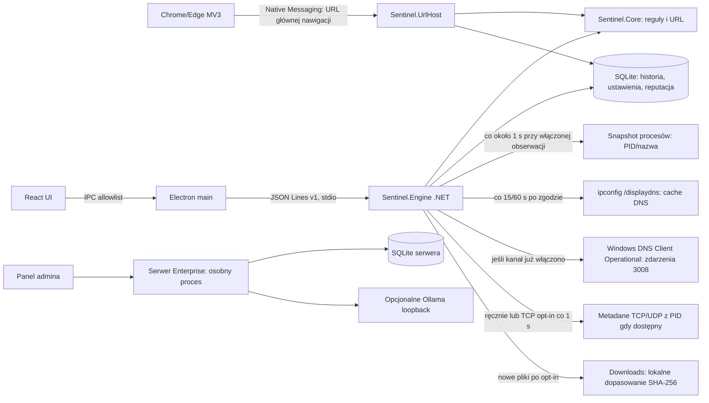

# Audyt luk i plan realizacji Sentinel AI

**Data audytu:** 2026-10-22
**Najnowsza pełna walidacja lokalna (2026-10-22, SQLite v22, reguły URL 2026.10.6):** `scripts/build-user.ps1 -Installer` PASS: .NET 282/282 bez pominięć, test splitu domenowego, Engine IPC, Windows DNS/TCP/UDP i fallback DNS Operational, wyszukiwanie bazy wiedzy, Electron 14/14, `npm audit` 0, UI production build i autotest instalatora. Self-test sprawdza siedem stanów kreatora, osadzone ilustracje, opcje, logowanie i ponawianie, dokładną wartość autostartu, manifest Native Messaging i wybrane skróty. Instalator testowy ma 281330553 B i SHA-256 `35E0E95C10C78B45B4922E1F6AA88DFF2E1A6238EF4D6E8FFBD930AE2A0AE898`; nie jest wydaniem. Live read-only test Scheduled Tasks odczytał 175 zadań. Pełny cykl GUI i podpis wydawcy pozostają niezweryfikowane.
**Aktualizacja audytu (2026-10-22):** Windows CI dla commita `ea54f3b` zakończyło się PASS: [run 39779854381](https://github.com/Matyyyy68/asystent/actions/runs/39779854381), w tym klient, Enterprise API i HTTP smoke. Dodany skan NuGet objął zależności przechodnie obu rozwiązań i nie znalazł podatnych pakietów; `npm audit` również wykazał 0. Lokalny audyt NuGet nadal nie może pobrać raportu z `api.nuget.org:443` z powodu odmowy dostępu do gniazda.
**Najnowsza walidacja:** procesy i opt-in sieć są próbkowane co około 1 s. Benchmark procesu 30 s przy 1 s vs 5 s zmierzył CPU 0,377% vs 0,130% i working set maks. 56 vs 51 MiB. Osobny pięciominutowy profil sieci co 1 s uzyskał CPU 0,182%, working set 53,4–69,8 MiB, `collect` medianę 6 ms / maksimum 46,5 ms i nie pominął zmian w tej sesji. Status procesu diagnostycznego jest allowlistowany (`starting`, `ready`, `restarting`, `stopped`), kod zakończenia filtrowany do ASCII alfanumerycznych oraz `-_` (maksymalnie 40 znaków), a stderr występuje tylko jako flaga. Test IPC sprawdza sanitizację; eksport nie zawiera treści ani ścieżek. To pomiary z pojedynczej lokalnej sesji, nie gwarancja dla długiego obciążenia.
**Walidacja automatycznej rotacji (2026-10-21):** po testach progu 89/90 dni oraz odzyskiwania po HTTP 503 pełny `scripts/build-user.ps1 -Installer` przeszedł: .NET 229/229 bez pominięć, desktop 9/9, `npm audit` 0, produkcyjny UI, Engine IPC, Windows DNS/TCP/UDP i installer self-test. Nieopublikowany artefakt v0.15.38: 281236857 B, SHA-256 `2B950562938A6E4525B36293BC266F5BFB9AA0114DBC8618616F27A3E4FD8E24`. Pełny test GUI nadal wymaga interaktywnej sesji Windows.
**Scalanie ostrzeżeń URL (2026-10-21):** ręczne i browserowe ostrzeżenia z tym samym hashem hosta i identycznymi kodami `url.*` scalają się przy równym ryzyku i oknie 60 s. Każde zdarzenie zachowuje ID, czas, źródło i kody; surowy host i hash nie są eksportowane, a powtórki z tego samego źródła pozostają osobne. Testy .NET 230/230, Electron 10/10, `npm audit` 0, Windows DNS/TCP/UDP, UI produkcyjny i installer self-test PASS. Lokalny nieopublikowany v0.15.38: 281241465 B, SHA-256 `4A4C233C20F1BDE7A3624D78B68415F7B1A0F8820B340DA8C2EE29A4FDEF775A`.

**Metadane obrazu procesu (2026-10-21):** zdarzenie startu procesu przechowuje lokalnie dostępną ścieżkę obrazu; ograniczona kolejka w tle (33 elementy, w tym jedna praca w toku) liczy SHA-256 plików do 256 MiB, sprawdza Authenticode i porównuje digest wyłącznie z lokalnym feedem użytkownika. Oczekujące inspekcje są ponawiane po restarcie silnika. Historia pokazuje ścieżkę, hash, status i wynik listy; eksport JSON/CSV i Enterprise nie otrzymują tych pól. Test worker'a zapisuje syntetyczny plik, porównuje obliczony SHA-256 z importowanym feedem, sprawdza zapis statusu oraz prywatność eksportu; Release .NET: 231 zaliczonych, 2 testy zależne od platformy pominięte. Pełny build lokalny PASS: .NET 232/232, Electron 10/10, `npm audit` 0, Engine IPC, Windows DNS/TCP/UDP, UI produkcyjny i self-test instalatora. Nowy artefakt v0.15.38 nie został opublikowany; CI dla bieżących zmian zostanie uruchomione po pushu. Nadal PARTIALLY_IMPLEMENTED: polling może pominąć krótkie procesy, ścieżka może być niedostępna, ETW/WMI wymaga uprawnień, a lokalny feed nie jest globalną bazą reputacji.
**Diagnostyka awarii silnika (2026-10-21):** typ wyjątku .NET w eksporcie pomocy technicznej aktualizuje się po kolejnych awariach procesu Engine, zachowując wyłącznie filtrowaną nazwę typu. Regresja Electron 10/10 i pełny `scripts/build-user.ps1 -Installer` PASS: .NET 229/229 bez pominięć, `npm audit` 0, Engine IPC, Windows DNS/TCP/UDP, UI produkcyjny i autotest instalatora. Nieopublikowany artefakt v0.15.38: 281240953 B, SHA-256 `43C32A738038C81505D778679465C473BBDD96552A3E42C3CBF671A2E91FB87D`. Pełny test GUI pozostaje niezweryfikowany.
**Weryfikacja korelacji procesu po restarcie (2026-10-22):** monitor odbudowuje mapę PID/nazwy z lokalnych zdarzeń startu procesu z ostatnich 60 s; pauza czyści mapę. Test regresyjny symuluje restart monitora pomiędzy startem procesu i połączeniem TCP. Release .NET: 231 zaliczonych, 2 zależne od platformy pominięte; pełny lokalny build/self-test dla commita `2417f24` przeszedł: .NET 233/233 bez pominięć, Engine IPC, Windows DNS/TCP/UDP, Electron 10/10, `npm audit` 0, UI production build i autotest instalatora PASS. Lokalny instalator v0.15.38 ma SHA-256 `3DA6DADE0E90801785517D3C55540334116EC0A1EF361357F347CA39983C9E91`; nie jest opublikowany jako Release. CI `39775921333` dla `2417f24` PASS; pełny build/test `caf9325` potwierdza najnowszy [run 39778035061](https://github.com/Matyyyy68/asystent/actions/runs/39778035061).
**Diagnostyka zgłoszonych awarii (2026-10-22):** zrzuty ekranu podawały ogólny wyjątek CLR. Zrzut zapisano 2026-10-22 16:09:54; Application log nie zawiera zdarzeń .NET Runtime 1026 ani Application Error 1000 w oknie ±15 min. Odczyt 90 dni znalazł starszy, niezwiązany wyjątek `dotnet.exe` w `Cp5Harness.Program` oraz zdarzenie `r.exe`; brak stosu Sentinel, więc nie wyjaśniają zrzutu. Dodano lokalny `%LOCALAPPDATA%/Sentinel AI/Logs/engine-lifecycle.jsonl` o limicie 64 wpisów; zapisuje wyłącznie czas, kod wyjścia, flagę stderr i walidowaną nazwę wyjątku. Eksport diagnostyczny włącza te wpisy na wyraźne żądanie, bez treści/ścieżek. Testy poprzedniej zmiany: .NET 233/233, desktop 14/14, Engine IPC, Windows DNS/TCP/UDP, `npm audit` 0, UI build i installer self-test PASS. Nieopublikowany instalator v0.15.38: SHA-256 `D307A37809F1009A68E0E4C0BD45B90EA5218DEF6F9A80AE69E4E0092DCA382D`. Brak lokalnego dziennika silnika po reprodukcji, więc potrzebne jest zdarzenie Windows z właściwej chwili albo cykl logu po następnym restarcie silnika.

**Audytowany stan:** prerelease `0.15.38` pozostaje ostatnim wydaniem. Commit `2584691` potwierdzał automatyczny retry aktywnego Engine; testy serwera przeszły 22/22, ale GitHub Windows CI `39613853143` FAIL w `scripts/test-engine.cjs`: plik syntetyczny bez podpisu zwrócił `Unknown` zamiast `NotSigned`. Źródło nie ujawniło, czy przyczyną był timeout czy błąd procesu PowerShell. Podniosłem ograniczony timeout w `ReadAuthenticodeSignatureAsync` z 10 do 30 s; pełny lokalny `scripts/build-user.ps1 -Installer` następnie przeszedł: .NET 208/208, Engine IPC, DNS-live, TCP/UDP, desktop 6/6, UI build oraz autotest instalatora PASS. Ponowne testy serwera Windows 22/22 i HTTP API smoke także PASS. GitHub Windows CI `39615470449` zakończył się terminalnie PASS dla commita `e766203`. Bieżący commit `484126f` naprawia fałszywe wnioski przy obciętym snapshotcie procesów przez deterministyczny limit 10 000 PID i trwałą flagę SQLite v14; lokalnie .NET 211/211, pełny build/self-test instalatora, Engine IPC, DNS/TCP/UDP, desktop 6/6 i testy Enterprise API 22/22 PASS; Windows CI `39619932040` PASS. Bieżąca poprawka rozwiązuje limit tabel TCP/UDP: czytnik wybiera deterministycznie maksymalnie 800/200 wpisów, SQLite v15 zapisuje flagi obcięcia, a monitor wstrzymuje niepewne alerty do kolejnej pełnej próbki. Retry Enterprise przez zwykłe `collect` po restarcie API/interwale pozostaje zweryfikowany. Testowy certyfikat jest przypięty wyłącznie w pamięci Debug Engine; magazyny Windows nie są zmieniane. Commity `85f675e`, `694863b`, `4fc299a`, `0d0ca0d` i `b042307` oraz historyczne wyniki opisano w dalszych wpisach i planach. Opublikowany instalator v0.15.38 ma 262559349 B, SHA-256 `bb34834eb654e450728f95093d500715b5f6ef5ab9f7825c32d146b9fb2c4cd8` oraz sidecar. Chrome 155 i Edge 155 E2E PASS na osobnych profilach z fixture `.test`; profile, manifest, wpis HKCU i dane testowe posprzątano. Rzeczywisty Ollama nadal nieweryfikowany, bo nie jest dostępny lokalnie.
**Zakres:** opublikowane prerelease `0.15.1`, `0.15.3`–`0.15.38`, nieopublikowane kandydaty `0.15.2` i `0.15.29`, osobny katalog `server/`, rozszerzenie MV3, instalator, witryna i dostępne testy Windows.
**Wniosek:** projekt jest działającym prototypem ochrony lokalnej, nie produkcyjnym antywirusem ani monitorem całego ruchu. Nie wykrywa wszystkich zagrożeń, nie filtruje ani nie blokuje ruchu.

## A. Stan i architektura

Aktywny produkt Windows to React/TypeScript w Electronie (`desktop/`), osobny proces .NET 10 (`src/Sentinel.Engine`) i biblioteka reguł/SQLite (`src/Sentinel.Core`). Electron przekazuje ograniczony zestaw metod przez sandboxowany preload i JSON Lines v1 po odziedziczonym stdio. Host Native Messaging (`src/Sentinel.UrlHost`) obsługuje rozszerzenie Chrome/Edge MV3 (`browser-extension/`). Osobny ASP.NET Core/SQLite w `server/` jest backendem Enterprise; aktywny klient Electron nie jest jego agentem. Pozostały klient WPF jest w `legacy/` i nie należy do wspieranego buildu.

Przepływ rzeczywiście działający: użytkownik wkleja tekst/URL → lokalne reguły domeny i tekstu → opcjonalne dopasowanie do świeżej lokalnej listy CERT → zapis metadanych zdarzenia do SQLite → UI/historia. Drugi przepływ: jawne włączenie obserwacji → Electron wywołuje `collect` według ustawionego odstępu → silnik odczytuje do 2000 wpisów cache DNS → dokładne dopasowanie do lokalnej listy → deduplikacja i zapis ostrzeżenia. Błąd odczytu jest obecnie skracany do nazwy typu wyjątku w stanie DNS. Proces .NET jest uruchamiany przez Electron; po błędzie uruchomienia, wyjściu procesu, błędzie stdin, niepoprawnej odpowiedzi lub timeout żądania (45 s) supervisor odrzuca oczekujące IPC, kończy zawieszony proces i ponawia start z ograniczonym wykładniczym opóźnieniem. Surowe stderr nie jest logowane. Tabele TCP/UDP czyta natywny Windows IP Helper; domyślnie wyłączony observer co 1 s zapisuje przyrostowo metadane nowych zewnętrznych połączeń TCP `Established`/`SynSent` oraz lokalnych endpointów UDP. Migawka UDP nie pokazuje celu zdalnego ani nie potwierdza wysłania datagramu. Połączenia TCP krótsze niż interwał mogą zostać pominięte.

## B. Macierz funkcjonalności

| ID / funkcja | Status | Dowód i brak | Zależności | Priorytet / złożoność | Kryteria akceptacji |
|---|---|---|---|---|---|
| F01 Build klienta i UI | `DONE_AND_VERIFIED` | Ostatnia pełna bramka SQLite v22/reguł URL 2026.10.6: `scripts/build-user.ps1 -Installer`, .NET 282/282 bez pominięć, test splitu domenowego, wyszukiwanie bazy wiedzy, Electron 14/14, `npm audit` 0, Engine IPC, UI production build i autotest instalatora; artefakt testowy 281330553 B, SHA-256 `35E0E95C10C78B45B4922E1F6AA88DFF2E1A6238EF4D6E8FFBD930AE2A0AE898`. | .NET 10, Node 24, sieć przy restore | P1 / S | Czysty build i testy na Windows |
| F02 Instalator per-user | `PARTIALLY_IMPLEMENTED` (transakcyjna aktualizacja/rollback, odizolowane usuwanie i render stanu 7 ekranów sprawdzone lokalnie; pełny cykl GUI nadal nieweryfikowany) | `installer/Sentinel.Setup/Program.cs`; własny WinForms EXE x64 z identyfikacją Sentinel, ilustracjami z `media/illustrations/installer`, skalowaniem DPI i ekranami powitania, lokalizacji/miejsca, ustawień, podsumowania, instalacji, weryfikacji i zakończenia. Ustawienia domyślne obejmują skróty Start/pulpit, autostart i uruchomienie po zakończeniu; każdy przełącznik jest podłączony do instalacji lub działania kreatora. Postęp pokazuje rzeczywiste kopiowanie plików. Przejście dalej blokuje preflight braku miejsca. Po instalacji kreator sprawdza wymagane pliki, wpis deinstalacji, dokładny wpis autostartu, skróty, oba klucze hosta i manifest Native Messaging Chrome/Edge. Błędy mają ekran z ponowieniem i otwarciem logu. Test formularza sprawdza widoczność ekranów, zasoby, opcje i stany autostartu; self-test v0.15.12 powtarzalnie odrzucał `chrome_100_percent.pak`, a `Flush()` przed sprawdzeniem rozmiaru naprawił ekstrakcję. Opublikowany v0.15.38 ma 262559349 B, SHA-256 `bb34834eb654e450728f95093d500715b5f6ef5ab9f7825c32d146b9fb2c4cd8` i sidecar `.sha256`. Najnowszy pełny build/test utworzył artefakt 281330553 B, SHA-256 `35E0E95C10C78B45B4922E1F6AA88DFF2E1A6238EF4D6E8FFBD930AE2A0AE898`; to nie jest wydanie. Self-test pokrywa hash/podmianę payloadu, miejsce, rollback, update, anulowanie, smoke aplikacji/SQLite, opcje skrótów oraz zachowanie obcego skrótu. Pozostają interaktywny cykl GUI, rzeczywiste ustawienia w czystym profilu i podpis wydawcy | Windows, interaktywna sesja | Test GUI install/update/uninstall, autostart/skróty i rejestr hosta na czystym Windows |
| F03 Ręczna analiza treści i URL | `PARTIALLY_IMPLEMENTED` | `ThreatAnalysisEngine`, `UrlAnalyzer`, `scripts/test-engine.cjs`; reguły deterministyczne, offline. `2026.10.4` dodaje wielowymiarową strukturę URL. `2026.10.5` rozpoznaje zamknięte brandowe TLD `.google`, `.apple`, `.microsoft`, a exact-brand label obniża do wagi 1, gdy właściciel jest niezweryfikowany; literówki i nazwa marki w cudzej subdomenie nadal dają silny sygnał. `2026.10.6` dodaje słaby sygnał mieszanego alfabetu łacińskiego i greckiego/cyrylickiego w jednej etykiecie IDN; nie podnosi samodzielnie ryzyka do Moderate. Testy syntetyczne: TP=15, FP=0, TN=17, FN=0 przy progu `Moderate`, plus regresje brandowych domen i mieszanych IDN. UCI PhiUSIIL URL-only v2026.10.6: TP=4 363, FP=5, TN=134 845, FN=96 582; recall 4,3222%, FPR 0,0037%. Powtórzony pomiar dał te same wyniki; zbiór był wcześniej eksplorowany, nie jest niezależnym wynikiem ani skalibrowaną pewnością. Osobny sanity-check Tranco 746PX analizował syntetyczne homepage top100k bez DNS; nie jest ground truth ani pomiarem FPR. Metoda, checksums i reprodukcja: [DETECTION-EVALUATION.md](DETECTION-EVALUATION.md). Split domenowy jest diagnostyczny, nie niezależny holdout. `scripts/evaluate-phishvn.ps1` obsługuje jawnie train/val/test, filtr tierów, URL-e bez schematu i guard splitu. PhishVN v3.1.0 CC BY 4.0 dla zamrożonych reguł `2026.10.6`, próg Moderate: train gold/silver TP=0, FP=3, TN=11 001, FN=2 076; validation TP=0, FP=0, TN=1 561, FN=24; test TP=0, FP=2, TN=3 843, FN=487. Brak wykryć w train i validation również wskazuje krytyczną lukę; nie dostrajano reguł na tych wynikach. Pełne metryki, checksums i ograniczenia: [DETECTION-EVALUATION.md](DETECTION-EVALUATION.md). Dane nie są dołączone | lokalne reguły i PSL; niezależny czasowo holdout i reprezentatywne etykiety nadal potrzebne | P1 / M | niezależny czasowo holdout, realistyczna częstość bazowa, deduplikacja i kalibracja |
| F04 Feed CERT Polska | `DONE_AND_VERIFIED` | `DomainReputation`; import transakcyjny, IDN, duplikaty, rollback, 48 h; test Windows/network pobrał 125344 domeny | internet tylko po kliknięciu | P1 / M | Feed poprawny, atomowy, świeży; brak wysyłania analizowanego URL |
| F05 Cache DNS | `PARTIALLY_IMPLEMENTED` | `Sentinel.Engine/Program.cs`: okresowe `ipconfig /displaydns`, parser limituje/normalizuje do 2000 domen, działa na zwykłym koncie; parser XML EventID 3008 i read-only `wevtutil` są wdrożone, z trwałym kursorem v22 i bez zapisu `QueryResults`. Status/diagnostyka/UI pokazują dostępność kanału; dopasowanie z obu źródeł jest zapisywane i może wywołać powiadomienie Windows, gdy powiadomienia są włączone. Testy syntetyczne i Windows fallback dla wyłączonego kanału PASS; live odczytu zdarzeń nie zweryfikowano, bo kanał jest wyłączony. Nadal brak PID, DoH/DoT/VPN i IP feedu automatycznego | Windows, feed | P1 / L | Zmierzone opóźnienie/pominięcia, kontrolowane testowe domeny, degradacja widoczna |
| F06 TCP/UDP i przypisanie procesu | `PARTIALLY_IMPLEMENTED` | Natywny IP Helper snapshot do 800 TCP/200 UDP z PID/nazwą; opt-in poll co 1 s zapisuje przyrostowo metadane nowych zewnętrznych połączeń TCP i lokalnych endpointów UDP. Czytnik wybiera deterministycznie wpisy, przekazuje flagi limitu i trwale zapisuje je w SQLite v15; nie zgłasza alertów z niepełnej próbki ani na pierwszej pełnej próbce po niej. Test obejmuje zmianę składu próbki, restart i migrację v14→v15. UDP endpoint nie potwierdza transferu ani celu zdalnego. TCP baseline SQLite v7 i procesowy v8 przechowują stan między restartami; zmiany i zdarzenia są atomowe. Wydanie v0.15.34 zapisuje wspólny correlationId dla startu procesu i jego TCP/UDP zdarzenia, gdy PID i nazwa procesu są zgodne w oknie 60 s; correlationId jest trwały; monitor odbudowuje mapę z lokalnych zdarzeń startu z ostatnich 60 s po restarcie, a pauza czyści mapę. Pięciominutowy profil przy collect co 1 s zebrał 300 próbek: CPU 0,182% łącznej mocy procesorów, working set 53,4–69,8 MiB, `collect` mediana 6 ms / max 46,5 ms; kontrolowane połączenie znalazło się w historii (17 zdarzeń TCP łącznie), bez pominiętych zmian w tej sesji. To pojedynczy pomiar lokalny; krótkie połączenia nadal mogą zostać pominięte. Nowe TCP może być dopasowane offline do jawnie zaimportowanej listy IP/CIDR; dopasowanie zapisuje alert High z dowodem `reputation.ip-feed.match`, bez blokowania. UI pozwala po potwierdzeniu wyczyścić listę i jej metadane; lokalna historia pozostaje. Test Core i Engine IPC sprawdza brak dopasowania po usunięciu. Test IPC obejmuje import i odrzucenie błędnej podmiany, a kontrolowane połączenie do własnego interfejsu przechodzi test `--tcp-live`; brak event stream i reputacji UDP, a jakość alertu zależy od źródła listy. Próba sesji ETW kernel process wymaga jawnego dostępu systemowego, niedostępnego na maszynie audytu | Windows IP Helper; dostęp do sesji i providera ETW | P1 / L | Stabilne snapshoty/zdarzenia i jawne ograniczenia; test restartu, atomowości, nie-loopback i pięciominutowy soak PASS |
| F07 Monitorowanie procesów/zdarzeń Windows | `PARTIALLY_IMPLEMENTED` | próbki `Process.GetProcesses()` co około 1 s wykrywają PID/nazwę pojawiające się i znikające między próbkami; deterministyczny wybór pierwszych 10 000 PID i trwała flaga obcięcia SQLite v14 zapobiegają fałszywym startom/zniknięciom na granicy limitu; SQLite utrwala baseline i atomowo zapisuje zmiany ze zdarzeniami, pauza przesuwa baseline bez alertów, a wykluczone aplikacje nie są utrwalane. Start procesu dołącza lokalną ścieżkę obrazu, jeśli Windows ją udostępnia; kolejka w tle o pojemności 32 sprawdza SHA-256/Authenticode do 256 MiB i porównuje hash z lokalnie zaimportowanym feedem. Inspekcje oczekujące są odzyskiwane po restarcie. Ścieżka/hash nie trafiają do eksportu ani Enterprise. Brak uprawnień do obrazu, zbyt duży plik, pełna kolejka i status Authenticode są rozróżniane; brak lokalnego dopasowania nie oznacza, że plik jest bezpieczny, a brak podpisu sam w sobie nie oznacza malware. Korelacja z siecią pozostaje PID/nazwa i 60 s, limit 100 zdarzeń/próbkę. WMI `Win32_ProcessStartTrace` i prywatny kernel ETW zwróciły `Access denied`; ponowna inwentaryzacja 2026-10-22 nie znalazła logu Kernel-Process ani Sysmon, a kanał DNS Operational jest wyłączony. Polling nadal może pominąć krótkie procesy, a ETW/event stream nie jest wdrożony | Windows; kernel ETW wymaga jawnego dostępu do sesji/providera | P1 / L | bezpieczny test procesu, PID, start/stop, restart, atomiczność, wydajność i jawna informacja o pominięciach |
| F08 Monitorowanie plików i reputacja | `PARTIALLY_IMPLEMENTED` | Na jawne żądanie UI wybiera plik ≤256 MiB; liczy SHA-256 i sprawdza Authenticode. Lokalna lista (≤20 MiB/250 000 hashy) jest walidowana i importowana transakcyjnie; użytkownik może też po potwierdzeniu wyczyścić feed bez usuwania historii, a kolejny skan zwraca brak aktywnej listy. Opcjonalny MalwareBazaar lookup po osobnym kliknięciu wysyła wyłącznie hash do stałego HTTPS endpointu; Auth-Key chroni DPAPI. Domyślnie wyłączony watcher Downloads sprawdza nowe/zmienione pliki w całym drzewie względem lokalnego feedu; pomija reparse points, uzgadnia drzewo co 5 min, a pauza zatrzymuje go i czyści baseline; sieci nie używa. Windows Known Folder resolver, reconciliacja po overflow i usuwanie nieaktualnych ścieżek po skasowaniu podfolderu działają w aktywnej sesji; SQLite v9 zachowuje ścieżki/rozmiary/czasy modyfikacji, wykrywa zmiany podczas restartu, zapis zdarzenia i fingerprintu jest atomowy; limit 100 000 plików. Testy regresyjne obejmują nowe dopasowanie w podfolderze, ignorowanie plików sprzed włączenia i usunięcie drzewa. Brak dopasowania nie oznacza bezpieczeństwa. Real API nie zweryfikowano z kluczem | zgoda opt-in; klucz i zgodność z warunkami MalwareBazaar do konfiguracji | P2 / M | test real API, test realnie przekierowanego Known Folder |
| F09 Browser URL | `PARTIALLY_IMPLEMENTED` | Rozszerzenie `onBeforeNavigate` dla głównej nawigacji Chrome/Edge, Native Messaging i reguły; warning może pojawić się po rozpoczęciu ładowania; ręczna instalacja. Wydanie v0.15.36 używa `chrome.storage.session`, by zachować stan ostrzeżenia po restarcie service workera; token jest ważny 10 minut, a wpis jest usuwany po akcji/zamknięciu karty. Desktop test symuluje restart workera i odzyskanie danych. Chrome 155 i Edge 155 E2E PASS na osobnych profilach: CDP załadował rozszerzenie, lokalny fixture `.test` dotarł przez host Native Messaging, a ostrzeżenie UI zawierało HTTPS/port/brand indicators i wersję reguł `2026.10.1`; ruch zewnętrzny blokował proxy. Dodatkowy test Browser Host sprawdza URL `https://paypal.com@attacker.test/login`: host zwraca ostrzeżenie `Moderate` z wersją reguł `2026.10.2` i nie ujawnia `attacker.test` w odpowiedzi. Rozszerzony test ramkowanego Native Messaging przez `Program.ServeAsync` potwierdza, że bieżąca reguła `url.structure_combination` zwraca ostrzeżenie `Moderate` i wersję `2026.10.4`, bez ujawnienia URL ani hosta w JSON. Bieżące GUI E2E Chrome/Edge nie zostało ponowione. Ręczna instalacja, zwykły profil użytkownika i zachowanie poza kontrolowanym fixture pozostają do sprawdzenia | Chrome/Edge 102+, rozszerzenie ręczne | P1 / M | ręczny cykl instalacji oraz nawigacja `.test`, brak claim blokowania |
| F10 Lokalne AI Ollama | `PARTIALLY_IMPLEMENTED` | `AIProviders.cs` jest podłączony do silnika i aktywnej analizy; UI pozwala pobrać listę modeli localhost oraz jawnie włączyć provider; audyt 2026-10-22: ponowny `Get-Command ollama` nie zwrócił programu, a `127.0.0.1:11434` nie przyjmuje połączeń TCP; brak weryfikacji z rzeczywistym serwerem/modelami | Ollama zainstalowane, model zgodny | P2 / M | jawne opt-in, lista/test modelu, mock HTTP i test bez Ollama/fallback |
| F11 Baza wiedzy/RAG | `PARTIALLY_IMPLEMENTED` | `LocalKnowledgeBase` indeksuje FTS5 (TXT/MD/DOCX oraz tekstowy PDF do 10 MB i 500 stron; 2 mln znaków na dokument, 100 dokumentów i 20 mln znaków łącznie). PDF ekstrakcja nie wykonuje OCR; skan bez warstwy tekstowej jest odrzucany. Import nadmiarowy jest odrzucany bez kasowania poprzednich danych. UI ma import, ręczne wyszukiwanie, listę i usuwanie; aktywny `AnalysisOrchestrator` pobiera do 5 trafień leksykalnych dla jawnie włączonej Ollama i dołącza je do promptu jako niezaufane źródła. Wskaźniki modelu mogą pokazywać nazwę dokumentu, numer fragmentu i tekst z aktualnego kontekstu; nie dowodzi to, że źródło uzasadnia wskaźnik. Testy sprawdzają poprawny cytat i odrzucenie indeksu spoza listy. Brak embeddingów i semantycznego rankingu; kontrolowany benchmark 4 zapytań potwierdza Hit@3=100% i MRR=1,00 wyłącznie dla syntetycznego korpusu; brak reprezentatywnej ewaluacji trafności; nie jest to semantyczny RAG | SQLite, jawny import plików, osobne opt-in Ollama | UI import/search/delete; ocena trafności; brak twierdzeń o wyszukiwaniu semantycznym |
| F12 Historia i wspólny model zdarzeń | `PARTIALLY_IMPLEMENTED` | lokalny model zdarzenia zapisuje schemaVersion, EventId, source, ruleVersion, evidenceCodes, opcjonalne PID/nazwę procesu oraz correlationId; confidence pozostaje null bez kalibracji. Wydanie v0.15.35 ogranicza kody do 32 unikalnych wartości ASCII o długości do 64 znaków. Wydanie v0.15.34 koreluje czasowo start procesu z TCP/UDP tego samego PID/nazwy w 60 s; v0.15.35 zapisuje kody dowodowe źródła widoczne w historii, JSON/CSV i kopii. Historia grupuje teraz wpisy ze wspólnym correlationId w jeden rozwijany widok, zachowując każde źródło, zdarzenie, dowody i akcję statusu; UI wyjaśnia, że grupa nie dowodzi przyczynowości. Korelacja domenowa obsługuje zdarzenia poza kolejnością bez przesuwania okna wstecz. W v0.15.34 SQLite v11, JSON/CSV i backup/restore v6–v11 zachowują correlationId. Wydanie v0.15.35 migruje SQLite do v12, zapisuje kody dowodowe w JSON/CSV i kopiach oraz odtwarza kopie v6–v12; starsze wpisy dostają pustą listę. Wydanie v0.15.33 wprowadziło wspólny `Sentinel.Contracts` między klientem i serwerem; testy .NET 198/198 PASS dla v0.15.35. Wydanie v0.15.37 dodaje czasową korelację DNS, przeglądarki i ręcznego URL po rejestrowalnej domenie; bieżąca zmiana jawnie mapuje kategorie Enterprise zamiast dopasowywać fragmenty tekstu. Migracja SQLite v16 scala potwierdzone wykrycia CERT dla identycznego hosta oraz dopasowania lokalnego SHA-256 pliku z Downloads i ręcznej analizy, zachowując każdą obserwację. Nowe scalanie URL obejmuje ręczną analizę i rozszerzenie tylko dla tego samego hosta, zestawu kodów url.*, ryzyka i okna 60 s; przechowuje wyłącznie lokalny skrót i nie scala powtórek z tego samego źródła. Hash pozostaje w lokalnej DB i kopii, lecz pomija się go w JSON/CSV/Enterprise. Nadal pozostają szersza deduplikacja innych sygnałów i skalibrowane confidence | migracja SQLite i kontraktu API | P1 / M | wersjonowany kontrakt, migracja bez utraty danych, deduplikacja między źródłami i test retencji |
| F13 Tray/autostart/ustawienia | `PARTIALLY_IMPLEMENTED` | Electron ma tray, autostart, ukrywanie okna i jawne zakończenie. Supervisor silnika ponawia uruchomienie po błędzie procesu i timeout; testy Node pokrywają retry/IPC/shutdown/hang oraz prywatność stderr. Ostatnie 64 awarie są zapisywane lokalnie jako czas, ograniczony kod zakończenia, flaga stderr i filtrowany typ wyjątku; eksport diagnostyczny dołącza wpisy na jawne żądanie, bez treści i ścieżek. Bieżący build: desktop 14/14, pełny self-test instalatora PASS. Realny restart Windows/autostart nadal nieprzetestowany | Windows shell, zainstalowany klient | P1 / M | test crash/restart GUI i autostartu na czystym profilu |
| F14 Ustawienia zdarzeń, eksport, status obsługi | `DONE_AND_VERIFIED` | Aktywne UI/IPC udostępnia redagowany eksport JSON/CSV, statusy i oznaczanie fałszywych alarmów oraz pakiet diagnostyczny dla pomocy technicznej. CSV ma quoting, UTF-8 BOM i neutralizację formuł; diagnostyka zawiera tylko wersje środowiska, stan hosta (allowlistowany status, sanitowany kod do 40 znaków, flaga stderr i filtrowany typ wyjątku .NET), stany monitorów, wybrane ustawienia oraz metryki baz. Typ wyjątku aktualizuje się po kolejnych awariach silnika bez eksportu komunikatu lub ścieżki. Test IPC sprawdza pola lifecycle, ich filtrowanie oraz brak historii, URL-i, ścieżek, nazw procesów i endpointu AI | IPC i UI | P2 / M | eksporty i bezpieczny pakiet diagnostyczny testowane w .NET/IPC |
| F15 Lokalna baza danych | `PARTIALLY_IMPLEMENTED` | Bieżący schemat SQLite v22: v13 dodała ulotną mapę korelacji domen, v14 flagę obcięcia snapshotu procesu, v15 flagi obcięcia TCP/UDP, v16 hashe sygnału i osobne obserwacje, v17 trwałe odroczenie nadmiarowych metadanych Enterprise, v18 metadane lokalnej inspekcji obrazów procesów, v19 trwały zredagowany baseline autostartu użytkownika, v20 rozszerzenie jego allowlisty na HKLM i wspólny Startup, v21 baseline Scheduled Tasks, a v22 kursor DNS Operational. Backup/restore historii akceptuje v6–v22; retencja i restore walidują integralność i zachowują profil oraz aktywne baseline'y monitorów; 32 równoległe zapisy. Migracje v9→v12 zachowują pochodzenie kolejki, correlationId i walidowane evidence codes; stare wpisy dostają puste listy kodów. Diagnostyka rozmiaru DB/WAL/SHM, stron i rekordów. Limit historii 512 MiB, limity bazy wiedzy 100 dokumentów/20 mln znaków, trwałe baseline'y sieci, procesów, Downloads i zadań (lokalne hashe). Symulowany `SQLITE_FULL`, atomowość zdarzeń/baseline'ów, retry monitorów i fail-closed ACL testowane. Brakuje fizycznego disk-full na oddzielnym wolumenie, ACL rzeczywistej ścieżki po instalacji i długiego testu obciążeniowego | SQLite, polityka retencji historii | P1 / M | kopie walidowane i możliwe do przywrócenia bez zmiany tożsamości instalacji, jawne limity i test awarii |
| F16 Enterprise API/panel | `DONE_AND_VERIFIED` (testy API, jednostkowe i live TLS E2E) | osobny backend ma HTTPS guard, RBAC, sesje, polityki, zaproszenia, wydarzenia, FTS5 i consent gate. Panel `wwwroot/admin/app.js` ma zatwierdzenie/odrzucenie i unieważnienie urządzenia. Test live TLS uruchamia syntetyczny serwer na loopback z przypiętym certyfikatem tymczasowym | certyfikat dla wdrożenia LAN | testy serwera 22/22, live API smoke i klient TLS E2E PASS; certyfikat zaufany/publiczny i Windows Service pozostają niezweryfikowane |
| F17 Agent Enterprise w aktywnym kliencie | `PARTIALLY_IMPLEMENTED` | Aktywny Electron/IPC udostępnia HTTPS invite pairing, jawny consent gate i jego odwołanie, token DPAPI CurrentUser, heartbeat, lokalne polityki (tryb local; odstęp 10–300 s), kolejkę wysyłkową do 10 000 rekordów i idempotentny batch. Nadmiarowe wykrycia trafiają atomowo do trwałej tabeli deferred i są przenoszone do kolejki, gdy zwolnią się miejsca; limit kolejki nie powoduje utraty wykryć. SQLite v17 wprowadziła tabelę odroczoną; bieżący schemat v22 i backup/restore zachowują ją wraz z metadanymi obrazu procesu oraz baseline'ami monitorów sieci, procesów, Downloads, Startup, Scheduled Tasks i kursorem DNS Operational. Wycofanie zgody czyści obie kolejki atomowo z aktualizacją profilu, a retencja usuwa stare wpisy. Aktywny RecordDetectionAsync zapisuje lokalne zdarzenie i jawnie skategoryzowane metadane atomowo. Payload v1 zawiera tylko ID/czas/kategorię/ryzyko/kod reguły/schemaVersion/allowlistowane źródło/bezpieczną wersję reguły; treść, URL, nazwa aplikacji i wyjaśnienie są wykluczone. Aktywny Engine ma test live TLS: gdy API jest niedostępne zwraca `sync_failed` i zachowuje kolejkę; po restarcie API zwykłe `collect` automatycznie ponawia wysyłkę po interwale polityki. DPAPI i TLS testują się w interaktywnej sesji Windows; certyfikat przypięty tylko w pamięci Debug Engine, bez zmian magazynów systemowych. Serwer otrzymuje wyłącznie metadane. Live E2E pokrywa pairing, approval, heartbeat, politykę, rotację/revoke i deduplikację. Automatyczna rotacja tokenu po 90 dniach jest pokryta testem kontrolowanego zegara; pozostają zaufany certyfikat wdrożeniowy, polityki serwerowe poza local, pełny restart/offline UI i podpisane aktualizacje | serwer Enterprise, Windows DPAPI, certyfikat CA wdrożenia | P1 / L | trwały overflow outboxa wdrożony; pozostałe wymagania w planie 010 |
| F18 Aktualizacje/naprawa | `PARTIALLY_IMPLEMENTED` | Kod obsługuje ponowne uruchomienie instalatora do zarejestrowanej ścieżki: staging, zachowanie plików spoza payloadu, zamiana katalogu i odtworzenie kopii po anulowaniu/błędzie. Lokalny self-test przetestował tę transakcję w trybie testowym z jawnym override ścieżki; faktyczny odczyt HKCU i GUI nie były testowane. Brak automatycznego sprawdzania/pobierania aktualizacji, podpisanego manifestu, dedykowanej naprawy z UI i podpisu Authenticode | certyfikat podpisu dla zaufanego autoupdate; release pipeline | P1 / L | aktualizacja/rollback testowane w izolacji; podpisany manifest, hash, autoupdate i pełny cykl GUI pozostają |
| F19 Witryna publiczna | `DONE_AND_VERIFIED` dla v0.15.38 | Website test/lint/build PASS; Pages `39489165920` PASS; release API potwierdza instalator i sidecar v0.15.38. Live GET do `https://matyyyy68.github.io/asystent/` zwrócił HTTP 200 i zawiera v0.15.38; oba asset linki zwracają HTTP 200 (instalator sprawdzony HEAD, sidecar GET), a sidecar SHA-256 zgadza się z audytem. | GitHub Pages/release | post-deploy live-check automatycznie sprawdza publiczną stronę, assety i wszystkie zewnętrzne linki HTTPS; Pages run `39505227865` z pełnym post-deploy checkiem PASS, prawne/produktowe roszczenia nadal wymagają decyzji właściciela |
| F20 Licencja i redystrybucja | `BLOCKED` | brak pliku LICENSE; inwentarz obejmuje 23 pary NuGet i wszystkie 290 par npm z lockfile. Instalator zawiera 4 produkcyjne pakiety npm z pełnymi tekstami MIT/ISC oraz deklaracje siedmiu pakietów NuGet runtime z Engine manifestu i `ThirdPartyNotices.txt` z .NET SDK. W payloadzie sprawdzono licencje Electron/Chromium i PdfPig. 50 npm lock-only nie są automatycznie uznawane za redystrybuowane. Pozostaje ręczna ocena warunków i decyzja właściciela o licencji produktu; generator notices nie jest opinią prawną. | decyzja właściciela; ręczny przegląd licencji | P1 / S | licencja źródeł i sprawdzone licencje zależności |
| F21 Zmiany trwałości/autostartu Windows | `PARTIALLY_IMPLEMENTED` | opt-in monitor co ≥30 s obejmuje HKCU/HKLM Run/RunOnce, Startup użytkownika/wspólny i Scheduled Tasks odczytane przez `schtasks /query /xml`; limit 256 elementów, 32 zdarzeń/próbkę, timeout 10 s/8 MiB. URI/XML są tylko w pamięci; SQLite v21 przechowuje hashe. Przy odmowie zachowuje poprzedni baseline zadań i nadal przetwarza pozostałe źródła. Testy monitora 15/15 obejmują prywatność, XXE i migrację; live read-only przepływ→baseline potwierdził 175 zadań. Pełna bramka bieżącej gałęzi v22 PASS. Sandbox zwrócił kod 1 z `schtasks`; dostępność zależy od uprawnień. Nie zmieniano zadań ani rejestru. Zmiana dodana i usunięta podczas zamknięcia może umknąć; lokalizacja jest heurystyczna. | uprawnienia do odczytu Scheduled Tasks; bez zapisu zadań systemowych | syntetyczna zmiana tworzy zredagowany alert; cichy baseline; awaria źródła nie kasuje baseline; inne źródła nadal działają |

`S/M/L` oznacza względną pracochłonność, nie obietnicę terminu. `DONE_AND_VERIFIED` odnosi się do wymienionych testów; nie rozszerza zakresu ponad nie.

**Aktualizacja F11 (2026-10-22):** wyszukiwanie FTS5 zachowuje dopasowanie dokładne i dodaje alternatywę prefiksową dla długich tokenów, co przechodzi regresję polskich form „logowania” → „logować”. Jest to heurystyka leksykalna i nie zmienia statusu F11: embeddingi, semantyczny ranking, OCR oraz niezależna ocena jakości nadal nie są wdrożone.

## C. Macierz pokrycia monitorowania

| Źródło / ruch | Metoda teraz | Ciągłość | Uprawnienia | Ograniczenia i wynik | Status |
|---|---|---|---|---|---|
| TCP | Windows IP Helper `GetExtendedTcpTable`, do 800 wierszy; ręczny snapshot plus opcjonalny observer co 1 s | polling przyrostów (domyślnie wyłączony) | zwykłe konto; PID/nazwa mogą być niedostępne | nowe zewnętrzne połączenia `Established`/`SynSent`; krótkie połączenia mogą umknąć; reputacja tylko z jawnie zaimportowanej lokalnej listy IP/CIDR; alert nie blokuje połączenia; payload nie jest czytany | `PARTIALLY_IMPLEMENTED` |
| UDP | Windows IP Helper, do 200 punktów końcowych; snapshot ręczny i przyrostowy opt-in co 1 s | zapis pojawienia się lokalnego endpointu UDP; bez zdalnego endpointu | odczyt w bieżącym koncie; PID/nazwa mogą być niedostępne | endpoint nie potwierdza datagramu; nie śledzi jego zawartości; brak reputacji | `PARTIALLY_IMPLEMENTED` |
| DNS cache | `ipconfig /displaydns`, parser ogranicza wynik do 2000 domen | próbkowanie co 15/60 s po opt-in | zwykły użytkownik; Windows-live cache read PASS | nie jest strumieniem zapytań; cache, DoH/DoT, VPN, IP i krótki TTL pominięte; bez PID/czasu zapytania | `PARTIALLY_IMPLEMENTED` |
| DNS ETW / zdarzenia | kanał `Microsoft-Windows-DNS-Client/Operational` wyłączony na maszynie audytu | brak dostępnych zdarzeń do weryfikacji | włączenie kanału to zmiana konfiguracji Windows; wymaga testu na kontrolowanej maszynie | Microsoft opisuje Query Completed (3008); kanał nie został włączony ani nie zmieniano ustawień systemu; DoH/obcy resolver nadal ogranicza widoczność ([Microsoft WEF profile](https://learn.microsoft.com/en-au/windows/security/threat-protection/use-windows-event-forwarding-to-assist-intrusion-detection)) | `BLOCKED` dla weryfikacji w obecnym środowisku |
| HTTPS/TLS | brak przechwytywania payloadu | n/d | MITM wymaga oddzielnej zgody/architektury i zaufania CA | aplikacja nie zna treści request/response | `NOT_APPLICABLE` w obecnym, prywatnościowym modelu |
| Browser | MV3 `webNavigation.onBeforeNavigate` + lokalny host | zdarzenie głównej nawigacji | instalacja hosta per-user i ręczne rozszerzenie | Chrome 155 i Edge 155 E2E potwierdzone na fixture `.test`; nie obejmuje całego systemu/iframe/pobierania; warning nie jest twardą blokadą | `PARTIALLY_IMPLEMENTED` |
| Procesy | próbka `Process.GetProcesses()` co około 1 s; zdarzenia pojawienia/zniknięcia PID w SQLite | polling, nie event-driven; może pominąć proces krótszy niż próbka | zwykłe konto dla widocznych procesów; ścieżka obrazu zależy od dostępu Windows; WMI i prywatna sesja kernel ETW odmówiły dostępu na maszynie audytu | lokalna ścieżka, SHA-256, Authenticode i dopasowanie do lokalnie importowanej listy są zapisywane dla nowych startów; inspekcja ≤256 MiB w kolejce 33; dane pozostają poza eksportem i Enterprise. Korelacja TCP/UDP używa PID/nazwy i 60 s, nie dowodzi przyczynowości | `PARTIALLY_IMPLEMENTED` |
| Pliki | wybrany plik → SHA-256 + status Authenticode; opt-in watcher Downloads sprawdza nowe/zmienione pliki w podfolderach względem lokalnego feedu | watcher ze settle debounce, bounded queue, pomijaniem reparse points, uzgadnianiem co 5 min i baseline'em SQLite v9 | dostęp użytkownika do pliku; Windows PowerShell Security | pauza/wyłączenie świadomie czyści baseline i pomija wtedy zmiany; okresowe uzgodnienie może opóźnić wykrycie do 5 min; podpis/hash nie oznacza bezpieczeństwa | `PARTIALLY_IMPLEMENTED` |
| VPN | brak punktu przechwytywania/rozpoznania | n/d | zależne od adaptera i endpointu | widoczność ograniczona do tego, co wystawi lokalny stos; zewnętrzny tunel ukrywa przepływy | `BLOCKED` dla pełnego pokrycia |

Nie należy reklamować „monitorowania całego ruchu”. Nie wdrożono ukrytego TLS MITM, przechwytywania sekretów, sterownika WFP ani automatycznego blokowania. Pełna widoczność zależy od źródła zdarzeń, wersji Windows, VPN, resolvera i procesu.

## D. Zależności i kolejność

Wspólny model zdarzeń i źródła danych poprzedzają korelację oraz centralną synchronizację. Najpierw należy ustabilizować jawne ograniczenia, schemat, retencję i diagnostykę; następnie dodać procesy i zdarzenia sieciowe w ograniczonym zakresie, bez bloku ruchu. Reputacja plików wymaga audytowanego źródła i zasad licencyjnych. Integracja lokalnego AI może być równoległa dopiero po podłączeniu istniejącego providera do aktywnego IPC/UI i zabezpieczeniu importu wiedzy. Enterprise wymaga aktywnego agenta, DPAPI, jawnej polityki i testów offline. Autoupdate wymaga decyzji o podpisywaniu kodu.

## E. Plany wdrożenia

| Plan | Zakres | Status 2026-10-22 |
|---|---|---|
| [PLAN-001: monitoring TCP/procesów](implementation-plans/PLAN-001-network-and-process-monitoring.md) | zdarzenia TCP/UDP i bezpieczna korelacja PID | `IN_PROGRESS` — poll TCP/UDP, baseline i zdarzenia SQLite atomowe przez restart, test nie-loopback i soak TCP PASS; limit 10 000 procesów ma stabilny wybór i bezpieczne zachowanie przy obcięciu; krótkie zdarzenia, event stream i pełna korelacja pozostają |
| [PLAN-002: DNS i reputacja](implementation-plans/PLAN-002-dns-and-threat-intelligence.md) | źródła DNS, freshness, diagnostyka i feed | `IN_PROGRESS` — polling działa; pusty feed nie jest świeży; event log Windows jest wyłączony, IP feeds i testy kontrolowanego Windows pozostają |
| [PLAN-003: pliki](implementation-plans/PLAN-003-file-monitoring.md) | weryfikacja i reputacja plików | `IN_PROGRESS` — SHA-256/Authenticode, lokalny feed, ręczny hash-only MalwareBazaar i opt-in watcher Downloads z podfolderami, reconciliacją overflow/restartu oraz ograniczonym baseline'em SQLite v9 wdrożone; testy Downloads 7/7, najnowsza pełna bramka SQLite v22 PASS. Rzeczywiste API wymaga klucza, a przekierowany Known Folder wymaga testu |
| [PLAN-004: detection/event schema](implementation-plans/PLAN-004-event-schema-and-detection.md) | model, korelacja, confidence, false-positive workflow | `IN_PROGRESS` — migracje, provenance, false-positive UI, jawny adapter Enterprise, ograniczone scalanie CERT, hashy plików i identycznych URL warningów z ręcznej analizy/browsera; szersza deduplikacja pozostałych sygnałów oraz kalibracja confidence pozostają |
| [PLAN-005: AI/RAG](implementation-plans/PLAN-005-local-ai-and-knowledge.md) | aktywne UI/IPC dla obecnego providera i FTS5 | `IN_PROGRESS` — FTS5 i jawne Ollama opt-in dostępne w UI; rzeczywisty model i UI tests pozostają |
| [PLAN-006: klient Windows](implementation-plans/PLAN-006-windows-client-and-background.md) | niezawodność tray, diagnostyka, UI i start | `IN_PROGRESS` — supervisor silnika i testy retry/IPC/timeout wdrożone; Windows CI PASS; test czystego Windows/autostartu nadal wymagany |
| [PLAN-007: baza i prywatność](implementation-plans/PLAN-007-database-and-privacy.md) | limity, backup, szyfrowanie/ACL, retencja | `IN_PROGRESS` — limit historii 512 MiB, symulowany `SQLITE_FULL`, retry monitorów, test ACL fail-closed, kopie/restore i limity KB zweryfikowane; brak fizycznego disk-full, ACL zainstalowanej lokalizacji danych i długiego obciążenia |
| [PLAN-008: instalator i aktualizacje](implementation-plans/PLAN-008-installer-updater.md) | naprawa, signed update, rollback i realne czyste Windows | `IN_PROGRESS` — lokalny build i self-test transakcji/rollbacku v0.15.38 PASS; prerelease i asset/sidecar są opublikowane. Test GUI rzeczywistej ścieżki, pełny install/update/uninstall, podpis Authenticode i autoupdate nadal niewykonane |
| [PLAN-009: publiczna witryna/dokumentacja](implementation-plans/PLAN-009-website-and-release.md) | zgodność claimów, live hosting, wersjonowanie i licencja | `IN_PROGRESS` — prerelease v0.15.38 i asset/sidecar opublikowane; witryna HTTP 200, Pages, post-deploy link check, Windows CI i installer/release workflow PASS; hash sidecar zgodny. Pozostają decyzja właściciela o licencji produktu i GUI na czystym Windows |
| [PLAN-010: Enterprise](implementation-plans/PLAN-010-enterprise-client-and-server.md) | aktywny agent, serwer i testy operacyjne | `IN_PROGRESS` — klient Electron paruje, przechowuje DPAPI token, stosuje ograniczoną politykę i synchronizuje metadane po zgodzie; test Windows potwierdza automatyczny retry przez `collect` po restarcie API i interwale polityki (serwer 22/22 PASS); test kontrolowanego zegara potwierdza automatyczną rotację po 90 dniach, a zaufany certyfikat i operacyjne testy przeciążeniowe pozostają |
| [PLAN-011: trwałość Windows](implementation-plans/PLAN-011-windows-persistence-monitoring.md) | zmiany HKCU/HKLM Run/RunOnce, Startup i Scheduled Tasks | `IN_PROGRESS` — read-only XML, hashowane URI/definicje, baseline SQLite v21, zachowanie poprzedniego baseline przy odmowie; testy 15/15, live baseline 175 zadań i pełna bramka SQLite v22 PASS. GUI, restart i dostęp standardowego profilu wymagają dalszej weryfikacji |

## F. Ograniczenia i decyzje

- **Rozwiązywalne w kodzie:** wspólny schemat zdarzeń, PID/monitoring ograniczony do dostępnych API, diagnostyka i retencja, aktywne podłączenie AI/KB, eksport, agent Enterprise, aktualizator.
- **Windows/sprzęt:** rzeczywiste testy instalacji, startu po restarcie, zachowania Chrome/Edge, ETW i długotrwałych zasobów na czystych Windows. Obecny komputer potwierdził build/self-test, DNS, TCP/UDP, PID oraz polling start/stop procesu w bieżącym koncie.
- **Szyfrowanie:** zawartość HTTPS nie jest dostępna bez odrębnej, jawnej i ryzykownej architektury TLS; nie wolno wdrożyć po cichu.
- **Uprawnienia:** cache DNS oraz snapshot TCP/UDP i procesów testowano w koncie użytkownika. `Win32_ProcessStartTrace` i `logman create trace` dla `Microsoft-Windows-Kernel-Process` zwróciły `Access denied`, choć konto należy do `Performance Log Users`; event stream wymaga jawnego ACL/uprawnień SystemTraceProvider albo usługi z odpowiednim kontem. Szczegóły: [ETW session control](https://learn.microsoft.com/en-us/windows/win32/etw/controlling-event-tracing-sessions), [SystemTraceProvider](https://learn.microsoft.com/en-us/windows/win32/etw/configuring-and-starting-a-systemtraceprovider-session). Nie zmieniano uprawnień ani polityk. WFP/automatyczne blokowanie nie jest planowane bez rollbacku i podpisywania.
- **Zewnętrzne:** feed CERT wymaga Internetu tylko przy ręcznym pobraniu; Ollama/model wymagają osobnej instalacji; Enterprise zdalny wymaga certyfikatu CA; update wymaga certyfikatu podpisu.
- **Zależności npm:** ponowny audyt wykazał 8 umiarkowanych alertów w łańcuchu build-time `electron-builder` → `@electron/get@3.1.0` → `global-agent` → `roarr` → `sprintf-js@1.1.3` (CVE-2026-97058); `--omit=dev` wykazał 0 runtime. Zastosowano npm override `@electron/get: ^5.1.0`, który usuwa podatny łańcuch bez downgrade'u buildera. Pełny audit po zmianie oraz `npm ci` wykazały 0 podatności; pakowanie electron-builder 26.15.3 i autotest instalatora przeszły. [GitHub Advisory](https://github.com/advisories/GHSA-hp3w-g68c-fv3c). Wcześniejszy downgrade buildera do 26.5.0 wprowadzał alerty high/critical i nie został przyjęty.
- **Właściciel:** brak licencji i warunków redystrybucji wymaga decyzji właściciela; nie dopisuję licencji prawnej w jego imieniu.
- **Testy z audytu:** v0.15.32 ma 190/190 testów klienta .NET PASS, 20/20 testów serwera, Release solution build i HTTP API smoke PASS. Installer workflow `39472689007` wykonał Windows build, testy, self-test i publikację. Release asset: 262539381 B, SHA-256 `efda654ec6e03cdcc5f9d865fb8adccff4665ecc3f8e346d4bb0ed9eadbcc396` oraz sidecar. Lokalny self-testowany installer: 279339897 B, SHA-256 `4FA4BCB6CA8C77A2A9CCBC914D7FAC1ACA5A8CB1DF6733D5BE08601E6DEC73CF`. Windows validation `39472685283` PASS; website test/lint/build i Pages deployment dla v0.15.32 są w toku. Wydanie v0.15.32 dodaje pochodzenie i wersję schematu Enterprise do kolejki, API i panelu admina. Cztery testy Node sprawdzają restart procesu silnika, backoff, watchdog timeout, odrzucenie IPC i prywatność stderr. Testy bazowe obejmują lokalną reputację SHA-256 i mock MalwareBazaar hash-only API, UDP z zastrzeżeniem braku dowodu datagramu, trwałe baseline'y sieci/procesów, atomowy zapis zdarzeń/baseline'ów, procesy wykluczone, zachowanie zmian przez restart/pauzę, 32 równoległe zapisy SQLite, ACL fail-closed, zalew 10 500 PID, dropped-event accounting, awarię/odzyskanie źródła, profile/consent gate, restore baz, limity KB, świeżość pustego feedu, symulowany `SQLITE_FULL`, retry monitora i czasową korelację PID procesu z TCP; Windows DPAPI round-trip sprawdzony w interaktywnej sesji. Pozostałe testy pokrywają CSV quoting i formuły, prywatność JSON diagnostics, Authenticode trusted/tampered fixtures, limity skanu, Downloads opt-in/local-only/match, backup/restore, AI loopback, FTS5, proces potomny, Enterprise consent gate i kontrolowany live test TCP. Live HTTP, realny lookup MalwareBazaar, Chrome/Edge przepływ z zarejestrowanym hostem i pełny GUI/update/uninstall na czystym Windows pozostają niewykonane.
