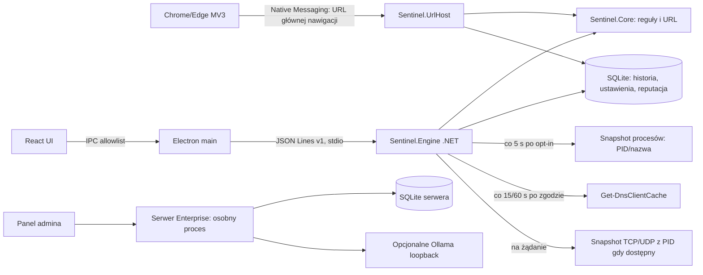

# Audyt luk i plan realizacji Sentinel AI

**Data audytu:** 2026-10-19  
**Audytowany stan:** prerelease `0.15.6`, w tym build/test/self-test instalatora Windows w GitHub Actions.
**Zakres:** opublikowane prerelease `0.15.1`, `0.15.3`–`0.15.6`, nieopublikowany kandydat `0.15.2`, osobny katalog `server/`, rozszerzenie MV3, instalator, witryna i dostępne testy Windows.
**Wniosek:** projekt jest działającym prototypem ochrony lokalnej, nie produkcyjnym antywirusem ani monitorem całego ruchu. Nie wykrywa wszystkich zagrożeń, nie filtruje ani nie blokuje ruchu.

## A. Stan i architektura

Aktywny produkt Windows to React/TypeScript w Electronie (`desktop/`), osobny proces .NET 10 (`src/Sentinel.Engine`) i biblioteka reguł/SQLite (`src/Sentinel.Core`). Electron przekazuje ograniczony zestaw metod przez sandboxowany preload i JSON Lines v1 po odziedziczonym stdio. Host Native Messaging (`src/Sentinel.UrlHost`) obsługuje rozszerzenie Chrome/Edge MV3 (`browser-extension/`). Osobny ASP.NET Core/SQLite w `server/` jest backendem Enterprise; aktywny klient Electron nie jest jego agentem. Pozostały klient WPF jest w `legacy/` i nie należy do wspieranego buildu.

Przepływ rzeczywiście działający: użytkownik wkleja tekst/URL → lokalne reguły domeny i tekstu → opcjonalne dopasowanie do świeżej lokalnej listy CERT → zapis metadanych zdarzenia do SQLite → UI/historia. Drugi przepływ: jawne włączenie obserwacji → Electron wywołuje `collect` według ustawionego odstępu → silnik uruchamia PowerShell i odczytuje do 2000 wpisów cache DNS → dokładne dopasowanie do lokalnej listy → deduplikacja i zapis ostrzeżenia. Błąd odczytu jest obecnie skracany do nazwy typu wyjątku w stanie DNS. TCP jest osobnym, ręcznym snapshotem.

## B. Macierz funkcjonalności

| ID / funkcja | Status | Dowód i brak | Zależności | Priorytet / złożoność | Kryteria akceptacji |
|---|---|---|---|---|---|
| F01 Build klienta i UI | `DONE_AND_VERIFIED` | `scripts/build-user.ps1`; React/Vite; testy typów i build przeszły 2026-10-19 | .NET 10, Node 24, sieć przy restore | P1 / S | Czysty build i testy na Windows |
| F02 Instalator per-user | `DONE_AND_VERIFIED` (build i self-test CI dla v0.15.6; pełny cykl czystej maszyny niezweryfikowany) | `installer/Sentinel.Setup/Program.cs`; GitHub prerelease [v0.15.6](https://github.com/Matyyyy68/asystent/releases/tag/v0.15.6) zawiera EXE 262481011 B, SHA-256 `c4c5b3bc34f5fd571269b586af214b5d7a771863165858473c69374a0a2f270d`; Windows CI przeszło build, testy, self-test, staging i ACL. Test pełnego GUI/update/rollback/uninstall po czystej instalacji pozostaje niezweryfikowany | Windows, icacls, interaktywne sesje | P1 / M | Czysta instalacja, aktualizacja, anulowanie, rollback i uninstall na maszynie testowej |
| F03 Ręczna analiza treści i URL | `DONE_AND_VERIFIED` | `ThreatAnalysisEngine`, `UrlAnalyzer`, `scripts/test-engine.cjs`; reguły deterministyczne, heurystyki ograniczone, bez sieciowego sprawdzania celu | lokalne reguły i PSL | P1 / M | Testy reguł, prywatności i URL; mierzone false positive/negative |
| F04 Feed CERT Polska | `DONE_AND_VERIFIED` | `DomainReputation`; import transakcyjny, IDN, duplikaty, rollback, 48 h; test Windows/network pobrał 125344 domeny | internet tylko po kliknięciu | P1 / M | Feed poprawny, atomowy, świeży; brak wysyłania analizowanego URL |
| F05 Cache DNS | `PARTIALLY_IMPLEMENTED` | `Sentinel.Engine/Program.cs`: okresowe `Get-DnsClientCache`, limit 2000, bez PID/czasu zapytania; pominięcia DoH/DoT/VPN/cache | Windows PowerShell, feed | P1 / L | Zmierzone opóźnienie/pominięcia, kontrolowane testowe domeny, degradacja widoczna |
| F06 TCP/UDP i przypisanie procesu | `PARTIALLY_IMPLEMENTED` | na żądanie PowerShell `Get-NetTCPConnection` (do 800) i `Get-NetUDPEndpoint` (do 200) z PID/nazwą procesu, jeśli dostępna; brak ciągłego strumienia, historii, reputacji i krótkich połączeń | Windows PowerShell, IP Helper/ETW dla zdarzeń | P1 / L | Stabilne snapshoty/zdarzenia i jawne ograniczenia; test bez ruchu blokującego |
| F07 Monitorowanie procesów/zdarzeń Windows | `PARTIALLY_IMPLEMENTED` | próbki `Process.GetProcesses()` co 5 s wykrywają PID/nazwę pojawiające się i znikające między próbkami; pauza, wykluczenia i limit 100 zdarzeń/próbkę. WMI `Win32_ProcessStartTrace` w bieżącym koncie zwróciło `Access denied`; brak ścieżki, podpisu, trwałości, krótkich procesów i gwarancji ciągłości | Windows; WMI/ETW wymagają oceny uprawnień | P1 / L | Bezpieczny test procesu, PID, start/stop, kontrola wydajności i jawna informacja o pominięciach |
| F08 Monitorowanie plików i reputacja | `PARTIALLY_IMPLEMENTED` | Na jawne żądanie UI wybiera pojedynczy plik ≤256 MiB; otwiera go tylko do odczytu, liczy SHA-256 i sprawdza Authenticode przez moduł Windows PowerShell Security. Zwraca status `Valid`/`NotSigned`/inny/`Unknown` i ewentualnego podpisującego; wynik nigdy nie jest werdyktem bezpieczeństwa. IPC sprawdza syntetyczny niepodpisany skrypt. Brak feedu reputacji, pobranych plików i monitoringu ścieżek | użytkownik wskazuje plik, Windows PowerShell Security | P2 / M | limit i błędy dostępu, podpisany fixture na czystym Windows, reputacja audytowanego źródła lub jawny `NO_RESULT` |
| F09 Browser URL | `PARTIALLY_IMPLEMENTED` | rozszerzenie `onBeforeNavigate` dla głównej nawigacji Chrome/Edge, Native Messaging i reguły; warning może pojawić się po rozpoczęciu ładowania; ręczna instalacja; test prawdziwej przeglądarki nie wykonany | Chrome/Edge, rozszerzenie ręczne | P1 / M | test kart na czystym profilu, wyłącznie domeny `.test`, brak claim blokowania |
| F10 Lokalne AI Ollama | `PARTIALLY_IMPLEMENTED` | `AIProviders.cs` jest podłączony do silnika i aktywnej analizy; UI pozwala pobrać listę modeli localhost oraz jawnie włączyć provider; brak weryfikacji z rzeczywistym serwerem/modelami na tej maszynie | Ollama zainstalowane, model zgodny | P2 / M | jawne opt-in, lista/test modelu, mock HTTP i test bez Ollama/fallback |
| F11 Baza wiedzy/RAG | `PARTIALLY_IMPLEMENTED` | `LocalKnowledgeBase`: FTS5, TXT/MD/DOCX; plik do 10 MB, ekstrakcja do 2 mln znaków na dokument, 100 dokumentów i 20 mln znaków łącznie. Import nadmiarowy jest odrzucany bez kasowania poprzednich danych; testy limitów i UI przechodzą. Brak embeddingów i użycia indeksu w analizie AI, więc brak semantycznego RAG | SQLite, jawny import plików | P2 / M | UI import/search/delete z cytowaniem; brak twierdzeń o semantycznym RAG |
| F12 Historia i wspólny model zdarzeń | `PARTIALLY_IMPLEMENTED` | lokalny model v1 zapisuje schemaVersion, GUID, źródło, wersję reguł oraz opcjonalny PID/nazwę procesu; confidence pozostaje null bez kalibracji. Migracja SQLite v6 zachowuje stare wpisy, odczyt/eksport przenosi pola, UI pokazuje pochodzenie i może oznaczyć false positive; API Enterprise nadal ma osobny kontrakt, korelacja nie istnieje | migracja SQLite i kontraktu API | P1 / M | wersjonowany kontrakt, migracja bez utraty danych, deduplikacja i test retencji |
| F13 Tray/autostart/ustawienia | `DONE_AND_VERIFIED` (kod/test smoke) | Electron ma tray, autostart, ukrywanie okna i jawne zakończenie; diagnostyka pokazuje working set, pamięć prywatną i skumulowany CPU silnika; realny restart Windows/autostart nie testowany | Windows shell | P1 / M | test po restartach na czystym profilu |
| F14 Ustawienia zdarzeń, eksport, status obsługi | `PARTIALLY_IMPLEMENTED` | Aktywne UI/IPC udostępnia redagowany eksport JSON; statusy i fałszywy alarm są widoczne, lecz brak CSV/diagnostyki obsługi | IPC i UI | P2 / M | eksport JSON dostępny i test prywatności; dalsze diagnostyki pozostają |
| F15 Lokalna baza danych | `PARTIALLY_IMPLEMENTED` | SQLite v6, migracje, retencja, backup/restore obu baz z walidacją integralności oraz zachowaniem profilu instalacji; 32 równoległe zapisy przetestowane. Diagnostyka pokazuje rozmiar DB/WAL/SHM, strony, freelist i rekordy. Baza wiedzy ma limity 100 dokumentów/20 mln znaków z testami; brak twardego limitu historii/dysku, testu disk-full i kontroli ACL ścieżek | SQLite, polityka retencji historii | P1 / M | kopie walidowane i możliwe do przywrócenia bez zmiany tożsamości instalacji, jawne limity i test awarii |
| F16 Enterprise API/panel | `DONE_AND_VERIFIED` (testy API i jednostkowe) | osobny backend ma HTTPS guard, RBAC, sesje, polityki, zaproszenia, wydarzenia, FTS5 i consent gate; klient aktywny nie łączy się z nim | serwer, certyfikat dla LAN | P2 / L | testy 19/19 + HTTP smoke; odrębna walidacja TLS/usługi Windows |
| F17 Agent Enterprise w aktywnym kliencie | `PARTIALLY_IMPLEMENTED` | Aktywny Electron/IPC udostępnia HTTPS invite pairing, jawny consent gate i jego odwołanie, token DPAPI CurrentUser, heartbeat, lokalne polityki (tryb local; odstęp 10–300 s), kolejkę offline ograniczoną do 10 000 rekordów i idempotentny batch. Po wyłączeniu zgody cała komunikacja z serwerem zostaje zatrzymana, kolejka jest kasowana, a przy odmowie klient nie wysyła kolejki przywróconej z backupu. Testy: mock klienta, zgoda wymagana przez IPC, profile gate/kolejka w SQLite, limit bez utraty oczekujących wpisów; DPAPI test przeszedł poza sandboxem w interaktywnej sesji. Brak live TLS E2E, obsługi zatwierdzenia/revoke/rotacji w UI, signed updates i bardziej złożonych polityk | certyfikat CA, serwer Enterprise, sesja Windows z profilem użytkownika | P1 / L | test end-to-end z zaproszeniem i serwerem TLS, test restart/offline/revoke, GUI admina |
| F18 Aktualizacje/naprawa | `MISSING` | release workflow buduje prerelease po tagu; klient nie ma autoupdate, podpisu ani naprawy instalacji | certyfikat podpisu, release pipeline | P1 / L | podpisane artefakty, hash, rollback i test przerwania |
| F19 Witryna publiczna | `DONE_AND_VERIFIED` (źródła/build i Pages workflow) | statyczna witryna przechodzi lokalne testy/lint/build; Pages workflow zakończył się sukcesem po wersji 0.15.6, a strona dołącza aktualny instalator i checksumę z release. Bezpośredni odczyt live URL z bieżącego środowiska nie był dostępny; pozostaje niezależny live-check | GitHub Pages/release | live URL, asset/hash, zgodność opisów; niezależny test po wdrożeniu |
| F20 Licencja i redystrybucja | `BLOCKED` | brak pliku LICENSE; ustalenie właściciela jest decyzją prawną, nie bezpieczną zmianą kodu | decyzja właściciela | P1 / S | licencja źródeł i sprawdzone licencje zależności |

`S/M/L` oznacza względną pracochłonność, nie obietnicę terminu. `DONE_AND_VERIFIED` odnosi się do wymienionych testów; nie rozszerza zakresu ponad nie.

## C. Macierz pokrycia monitorowania

| Źródło / ruch | Metoda teraz | Ciągłość | Uprawnienia | Ograniczenia i wynik | Status |
|---|---|---|---|---|---|
| TCP | Windows PowerShell `Get-NetTCPConnection`, do 800 wierszy, po kliknięciu | snapshot | odczyt tabeli w bieżącym koncie; PID/nazwa mogą być niedostępne | brak krótkich połączeń, reputacji i historii; nie pokazuje payloadu | `PARTIALLY_IMPLEMENTED` |
| UDP | `Get-NetUDPEndpoint`, do 200 punktów końcowych, po kliknięciu | snapshot punktów lokalnych, bez zdalnego endpointu | odczyt w bieżącym koncie; PID/nazwa mogą być niedostępne | nie śledzi datagramów ani ich zawartości; brak reputacji i historii | `PARTIALLY_IMPLEMENTED` |
| DNS cache | PowerShell `Get-DnsClientCache`, maks. 2000 wpisów | próbkowanie co 15/60 s po opt-in | zwykły użytkownik w przetestowanej sesji | nie jest strumieniem zapytań; cache, DoH/DoT, VPN, IP i krótki TTL pominięte; bez PID | `PARTIALLY_IMPLEMENTED` |
| DNS ETW / zdarzenia | kanał `Microsoft-Windows-DNS-Client/Operational` wyłączony na maszynie audytu | brak dostępnych zdarzeń do weryfikacji | włączenie kanału to zmiana konfiguracji Windows; wymaga testu na kontrolowanej maszynie | Microsoft opisuje Query Completed (3008); kanał nie został włączony ani nie zmieniano ustawień systemu; DoH/obcy resolver nadal ogranicza widoczność ([Microsoft WEF profile](https://learn.microsoft.com/en-au/windows/security/threat-protection/use-windows-event-forwarding-to-assist-intrusion-detection)) | `BLOCKED` dla weryfikacji w obecnym środowisku |
| HTTPS/TLS | brak przechwytywania payloadu | n/d | MITM wymaga oddzielnej zgody/architektury i zaufania CA | aplikacja nie zna treści request/response | `NOT_APPLICABLE` w obecnym, prywatnościowym modelu |
| Browser | MV3 `webNavigation.onBeforeNavigate` + lokalny host | zdarzenie głównej nawigacji | instalacja hosta per-user i ręczne rozszerzenie | nie obejmuje całego systemu/iframe/pobierania; warning nie jest twardą blokadą; brak testu real browser | `PARTIALLY_IMPLEMENTED` |
| Procesy | próbka `Process.GetProcesses()` co 5 s; zdarzenia pojawienia/zniknięcia PID w SQLite | polling, nie event-driven; może pominąć proces krótkotrwały | zwykłe konto dla widocznych procesów; WMI trace odmówiło dostępu w bieżącym koncie | brak ścieżki/podpisu; PID nie jest jeszcze korelowany z TCP/UDP event history | `PARTIALLY_IMPLEMENTED` |
| Pliki | wybrany plik → SHA-256 + status Authenticode | wyłącznie na żądanie | dostęp użytkownika do pliku; Windows PowerShell Security | brak reputacji/monitoru pobierania; podpis/hash nie oznacza bezpieczeństwa | `PARTIALLY_IMPLEMENTED` |
| VPN | brak punktu przechwytywania/rozpoznania | n/d | zależne od adaptera i endpointu | widoczność ograniczona do tego, co wystawi lokalny stos; zewnętrzny tunel ukrywa przepływy | `BLOCKED` dla pełnego pokrycia |

Nie należy reklamować „monitorowania całego ruchu”. Nie wdrożono ukrytego TLS MITM, przechwytywania sekretów, sterownika WFP ani automatycznego blokowania. Pełna widoczność zależy od źródła zdarzeń, wersji Windows, VPN, resolvera i procesu.

## D. Zależności i kolejność

Wspólny model zdarzeń i źródła danych poprzedzają korelację oraz centralną synchronizację. Najpierw należy ustabilizować jawne ograniczenia, schemat, retencję i diagnostykę; następnie dodać procesy i zdarzenia sieciowe w ograniczonym zakresie, bez bloku ruchu. Reputacja plików wymaga audytowanego źródła i zasad licencyjnych. Integracja lokalnego AI może być równoległa dopiero po podłączeniu istniejącego providera do aktywnego IPC/UI i zabezpieczeniu importu wiedzy. Enterprise wymaga aktywnego agenta, DPAPI, jawnej polityki i testów offline. Autoupdate wymaga decyzji o podpisywaniu kodu.

## E. Plany wdrożenia

| Plan | Zakres | Status 2026-10-19 |
|---|---|---|
| [PLAN-001: monitoring TCP/procesów](implementation-plans/PLAN-001-network-and-process-monitoring.md) | zdarzenia TCP/UDP i bezpieczna korelacja PID | `IN_PROGRESS` — snapshot TCP/UDP oraz start/zniknięcie procesu są testowane z kontrolowanymi loopback/child fixtures; krótkie zdarzenia, ciągłość i korelacja pozostają |
| [PLAN-002: DNS i reputacja](implementation-plans/PLAN-002-dns-and-threat-intelligence.md) | źródła DNS, freshness, diagnostyka i feed | `IN_PROGRESS` — polling/limit działają; ETW i testy integracyjne pozostają |
| [PLAN-003: pliki](implementation-plans/PLAN-003-file-monitoring.md) | weryfikacja i reputacja plików | `NOT_STARTED` |
| [PLAN-004: detection/event schema](implementation-plans/PLAN-004-event-schema-and-detection.md) | model, korelacja, confidence, false-positive workflow | `IN_PROGRESS` — migracja v6, process metadata, provenance i false-positive UI; adapter Enterprise i korelacja pozostają |
| [PLAN-005: AI/RAG](implementation-plans/PLAN-005-local-ai-and-knowledge.md) | aktywne UI/IPC dla obecnego providera i FTS5 | `IN_PROGRESS` — FTS5 i jawne Ollama opt-in dostępne w UI; rzeczywisty model i UI tests pozostają |
| [PLAN-006: klient Windows](implementation-plans/PLAN-006-windows-client-and-background.md) | niezawodność tray, diagnostyka, UI i start | `IN_PROGRESS` — tray/autostart w kodzie; czysty Windows wymagany |
| [PLAN-007: baza i prywatność](implementation-plans/PLAN-007-database-and-privacy.md) | limity, backup, szyfrowanie/ACL, retencja | `IN_PROGRESS` — eksport, kopie, walidowany restore, pomiar rozmiaru, testy współbieżności oraz limit KB 100 dokumentów/20 mln znaków z testami; limit historii, disk-full i ACL nadal wymagają pracy |
| [PLAN-008: instalator i aktualizacje](implementation-plans/PLAN-008-installer-updater.md) | naprawa, signed update, rollback i realne czyste Windows | `IN_PROGRESS` — build/self-test działa; test pełnego cyklu nie wykonany |
| [PLAN-009: publiczna witryna/dokumentacja](implementation-plans/PLAN-009-website-and-release.md) | zgodność claimów, live hosting, wersjonowanie i licencja | `IN_PROGRESS` — źródła/testy przechodzą, Pages workflow i release v0.15.6 PASS; bezpośredni live URL, licencja i czysty Windows pozostają |
| [PLAN-010: Enterprise](implementation-plans/PLAN-010-enterprise-client-and-server.md) | aktywny agent, serwer i testy operacyjne | `IN_PROGRESS` — klient Electron paruje, przechowuje DPAPI token, stosuje ograniczoną politykę i synchronizuje metadane po zgodzie; live TLS/revoke/restart pozostają |

## F. Ograniczenia i decyzje

- **Rozwiązywalne w kodzie:** wspólny schemat zdarzeń, PID/monitoring ograniczony do dostępnych API, diagnostyka i retencja, aktywne podłączenie AI/KB, eksport, agent Enterprise, aktualizator.
- **Windows/sprzęt:** rzeczywiste testy instalacji, startu po restarcie, zachowania Chrome/Edge, ETW i długotrwałych zasobów na czystych Windows. Obecny komputer potwierdził build/self-test, DNS, TCP/UDP, PID oraz polling start/stop procesu w bieżącym koncie.
- **Szyfrowanie:** zawartość HTTPS nie jest dostępna bez odrębnej, jawnej i ryzykownej architektury TLS; nie wolno wdrożyć po cichu.
- **Uprawnienia:** cache DNS oraz snapshot TCP/UDP i procesów testowano w koncie użytkownika. Próba `Win32_ProcessStartTrace` zakończyła się `Access denied`; ETW i pełna telemetria wymagają osobnej oceny. WFP/automatyczne blokowanie nie jest planowane bez rollbacku i podpisywania.
- **Zewnętrzne:** feed CERT wymaga Internetu tylko przy ręcznym pobraniu; Ollama/model wymagają osobnej instalacji; Enterprise zdalny wymaga certyfikatu CA; update wymaga certyfikatu podpisu.
- **Zależności npm:** `npm audit` znalazł 8 umiarkowanych alertów w łańcuchu build-time `electron-builder` → `sprintf-js` (CVE-2026-97058). W [GitHub Advisory](https://github.com/advisories/GHSA-hp3w-g68c-fv3c) obecnie brak wersji naprawionej; wymuszona propozycja npm cofa builder do 26.5.0. Nie wymuszałem downgrade'u niezgodnego z deklaracją projektu; ponowić audyt, gdy upstream wyda poprawkę.
- **Właściciel:** brak licencji i warunków redystrybucji wymaga decyzji właściciela; nie dopisuję licencji prawnej w jego imieniu.
- **Testy z audytu:** klient .NET 151/151 (32 równoległe zapisy SQLite, zalew 10 500 PID, limit 10 000/100 i dropped-event accounting, awaria/odzyskanie źródła, profile/consent gate, cap offline queue bez utraty oczekujących wpisów, odrzucenie niepełnego potwierdzenia batcha, cofnięcie zgody, restore obu baz i limity KB 100 dokumentów/20 mln znaków bez utraty danych); Windows DPAPI round-trip sprawdzony w interaktywnej sesji z profilem użytkownika. Engine IPC obejmuje redakcję eksportu, backup/restore baz, AI loopback, FTS5, proces potomny start/stop i Enterprise consent gate; benchmark 300 s/60 próbek PASS (CPU 0,057%, working set 43,4–53,8 MiB, `collect` mediana 5 ms/maks. 1 359,8 ms; pojedyncza sesja); feed CERT ponad 125 tys. domen; kontrolowane testy Windows DNS i TCP/UDP/PID PASS; 63 ilustracje, website test/lint/build, server testy 19/19 i API smoke PASS. Windows CI wydał [v0.15.6](https://github.com/Matyyyy68/asystent/releases/tag/v0.15.6): installer 262481011 B, SHA-256 `c4c5b3bc34f5fd571269b586af214b5d7a771863165858473c69374a0a2f270d`; `--self-test` PASS. Pełny GUI/update/uninstall na czystym Windows i bezpośredni live-check Pages pozostają niewykonane.

