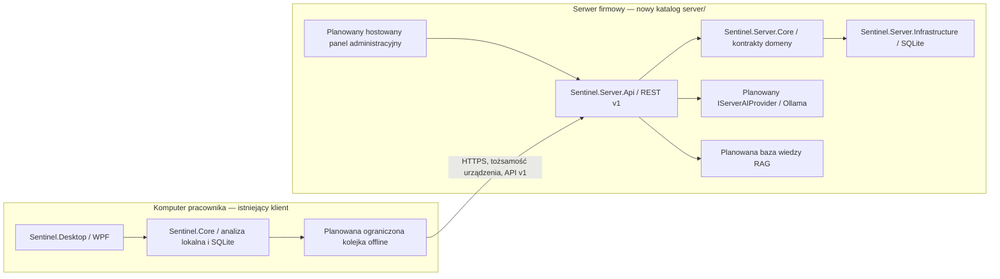

# Sentinel AI Server — architektura i plan migracji

## Wyniki audytu istniejącego repozytorium

Repozytorium przed etapem serwera zawiera istniejącego klienta WPF/MVVM na .NET 10 (`src/Sentinel.Desktop`) i bibliotekę platformowo neutralną (`src/Sentinel.Core`). Klient ma regułowy analizator URL i tekstu (`UrlAnalyzer`, `ThreatAnalysisEngine`), ograniczone zbieranie statycznych nazw dostępnych elementów UI Automation na żądanie, filtrowanie prywatności, lokalny magazyn SQLite (`LocalStore`) oraz testy jednostkowe z użyciem rzeczywistego SQLite. W historii są metadane oceny, nie treść analizowanych wiadomości.

W audytowanym kodzie nie znaleziono klient-serwerowego API, rejestracji urządzeń, zarządzania flotą, centralnych polityk, kont administratorów, dostawcy modelu AI, importu dokumentów ani wyszukiwania RAG. Tabela FTS5 istnieje lokalnie w schemacie klienta, ale nie ma procesu importu ani zapytań do bazy wiedzy. Klient nie ma ikony tray, autostartu, procesu działającego dyskretnie w tle ani synchronizacji z serwerem. Instalator istniejącego produktu instaluje wyłącznie klienta.

## Komponenty i granice



Kod serwera jest odseparowany od WPF. Na tym etapie nie ma uzasadnienia dla współdzielonego projektu: klient nie konsumuje jeszcze żadnych kontraktów API, a zależność od implementacji serwera byłaby niepożądana. Po ustabilizowaniu schematów można dodać mały projekt DTO/protokół lub generować klienta z OpenAPI, bez referencji klienta do `Server.Core`.

Serwer używa obecnego celu `net10.0`, zgodnego z istniejącym repozytorium i wspieranym wydaniem LTS .NET. `Sentinel.Server.Api` to ASP.NET Core Minimal API; `Sentinel.Server.Infrastructure` izoluje SQLite. SQLite jest jedynym działającym dostawcą danych w tym etapie. Nie deklarujemy obsługi PostgreSQL ani SQL Server.

## Decyzje bezpieczeństwa

- API ma wersję w ścieżce (`/api/v1`) oraz identyfikator korelacji w `X-Correlation-ID`. Maksymalny rozmiar żądania wynosi 64 KiB; rejestracja jest limitowana do 20 prób na minutę na adres IP.
- Domyślny adres nasłuchiwania to `127.0.0.1:5080`. Serwer odmawia startu dla zewnętrznego adresu HTTP; zdalne nasłuchiwanie wymaga jawnego adresu HTTPS i skonfigurowanego certyfikatu Kestrel. Walidacja TLS pozostaje w systemowym stosie HTTP klienta i nie ma trybu pomijania certyfikatu.
- Pierwsze konto tworzy się jawnie przez `Sentinel__BootstrapAdminUsername` i `Sentinel__BootstrapAdminPassword` przy pierwszym uruchomieniu. Konto otrzymuje rolę `SystemAdministrator`; po udanym bootstrapie proces usuwa hasło ze swojego środowiska. Administrator musi usunąć je również ze stałej konfiguracji usługi. Hasła są haszowane PBKDF2-HMAC-SHA256 z losową solą i 600 000 iteracji. Brak skonfigurowanego konta nie uruchamia domyślnego konta ani znanego hasła.
- Logowanie ma limit pięciu prób na 15 minut na adres IP. Sesje administratorów to losowe tokeny bearer ważne 12 godzin; serwer przechowuje wyłącznie ich SHA-256. Zmiana hasła i wyłączenie konta unieważnia aktywne sesje. Blokada nie może wyłączyć ani zdegradować ostatniego aktywnego administratora systemu.
- RBAC jest egzekwowany na API: Administrator systemu zarządza kontami i wszystkimi operacjami; Administrator bezpieczeństwa może tworzyć/unieważniać zaproszenia, odłączać urządzenia i czytać audyt; Operator i Odczyt mogą przeglądać urządzenia. Każda rola może zarządzać własną sesją i hasłem. Tożsamość użytkownika jest wymagana dla wszystkich endpointów administracyjnych.
- Operacje bootstrapu, logowania, zarządzania kontami, zaproszeniami, sesjami i odłączeniem urządzeń są zapisywane w tym samym magazynie SQLite co zmiana, w tabeli audytu bez haseł, tokenów i treści zdarzeń.
- Kod zaproszenia oraz poświadczenie każdego urządzenia są losowe, różne dla każdego użycia, zwracane tylko przy utworzeniu i przechowywane na serwerze wyłącznie jako SHA-256. Zaproszenie atomowo egzekwuje limit rejestracji i termin ważności. Odwołane urządzenie przestaje się uwierzytelniać. Nie ma wspólnego sekretu agentów.
- Zdarzenia bezpieczeństwa i prywatny kontekst nie są jeszcze przyjmowane przez API. Heartbeat przyjmuje wyłącznie ograniczony, opcjonalny opis ostatniego błędu. Nie wysyłamy ekranów, haseł, tokenów sesyjnych ani treści prywatnych wiadomości.
- `healthz` i `readyz` zwracają jedynie stan i wersję API; nie publikują ścieżki bazy ani sekretów. Dostępność modelu nie jest jeszcze częścią gotowości.
- Baza serwera jest w `C:\ProgramData\SentinelAI\Server` na Windows albo w systemowym katalogu danych na innych platformach; można ustawić `Sentinel__DataDirectory`. Nie jest trzymana w katalogu programu ani tymczasowym.

W produkcji trzeba uruchamiać usługę pod dedykowanym kontem o minimalnych uprawnieniach do jej katalogu danych i certyfikatu. Instalator usługi, ACL, rotacja logów, backup/restore, rotacja poświadczeń urządzeń, zatwierdzanie ryzykownych zmian polityk i odporniejsza na rozproszony brute force blokada kont są zaplanowane, ale nie są zaimplementowane w tym etapie.

## Plan migracji i etapowanie

1. **Etap A — audyt i projekt (ukończony):** inwentaryzacja klienta, diagram, uzasadnienie granic, plan migracji, decyzje prywatności i transportu.
2. **Etap B1 — fundament API i urządzeń (zaimplementowany):** host API, SQLite serwera, health/readiness, zaproszenia ograniczone limitem i czasem, rejestracja z unikalnym poświadczeniem, lista/odwołanie urządzeń, uwierzytelniony heartbeat oraz testy trwałości i unieważniania.
3. **Etap B2a — tożsamość administracyjna (zaimplementowany):** bootstrap administratora, PBKDF2, sesje, cztery role, limit logowania, unieważnianie sesji i audyt.
4. **Etap B2b — flota, polityki i historia zdarzeń (częściowo zaimplementowany):** zarządzane grupy, przypisywanie urządzeń, polityki globalne/grupowe/urządzeń, dziedziczenie, wersjonowanie, walidacja i audyt są zaimplementowane. Uwierzytelniony endpoint agenta zwraca efektywną konfigurację. API przyjmuje minimalne, idempotentne metadane zdarzeń, pozwala zmieniać status incydentu i usuwa stare dane zgodnie z retencją. Pozostają: bezpieczne zatwierdzanie urządzeń w trybie ręcznym oraz synchronizacja kolejki zdarzeń z klienta i stosowanie pobranej konfiguracji.
5. **Etap C — panel:** hostowany panel operacyjny z ochroną żądań przeglądarkowych; wyświetla tylko rzeczywisty stan z API.
6. **Etap D — klient-serwer:** klient rejestruje się zaproszeniem, chroni poświadczenia w Windows Credential Manager/DPAPI, pobiera walidowaną politykę, synchronizuje ograniczoną kolejkę z retry/backoff/jitter i działa lokalnie offline.
7. **Etap E — UX klienta:** tray, jednoznaczny stan modułów, opt-in autostart, ciche domyślne zachowanie, ograniczone i deduplikowane powiadomienia.
8. **Etap F — AI i wiedza:** `IServerAIProvider`, rzeczywiste testy Ollama, limity zasobów i timeouty; odseparowany import, walidacja typów/rozmiaru, wersjonowanie i wyszukiwanie RAG z cytowaniami. Niedostępny model nie zatrzymuje ochrony regułowej.
9. **Etap G — wdrożenie operacyjne:** kreator instalacji i konfiguracji, usługa Windows, TLS/CA, firewall, backup/restore, aktualizacje podpisane kryptograficznie i rollback; natywne testy Windows Server oraz testy klienta na Windows.

## Bieżący zakres i uruchomienie

Ten etap dostarcza audyt A, fundament B1, tożsamość B2a oraz część B2b, a nie całą architekturę docelową. Działają indywidualne konta administratorów, cztery role, sesje, bootstrap, limit logowania, audyt operacji, rejestracja, odwołanie zaproszeń/urządzeń, heartbeat, status online obliczany jako komunikacja w ostatnich dwóch minutach, health/readiness, trwała baza SQLite oraz API zarządzania grupami, politykami i historią zdarzeń. Polityka jest częściowa, dziedziczona w kolejności urządzenie → grupa → globalnie → bezpieczne wartości domyślne, wersjonowana, walidowana i audytowana; uwierzytelniony endpoint agenta udostępnia jej efektywną wersję. Włączenie trybu serwerowego/hybrydowego lub wysyłania kontekstu wymaga osobnego potwierdzenia administratora systemu. Historia przyjmuje tylko identyfikator reguły i kategorię/ryzyko, ma idempotencję i domyślną retencję 90 dni. Nie ma jeszcze panelu administracyjnego ani klienta stosującego pobraną politykę i synchronizującego kolejkę zdarzeń, a ręczna akceptacja urządzeń, AI/RAG, instalator usługi, backup/restore i rotacja poświadczeń urządzeń pozostają do implementacji.

Uruchomienie lokalne (domyślnie loopback):

```powershell
$env:Sentinel__DataDirectory = "$env:ProgramData\SentinelAI\Server"
dotnet run --project server/src/Sentinel.Server.Api/Sentinel.Server.Api.csproj
```

Przy pierwszym uruchomieniu ustaw `Sentinel__BootstrapAdminUsername` i `Sentinel__BootstrapAdminPassword` w środowisku procesu (hasło 14–128 znaków). Aplikacja tworzy konto systemowe tylko jeśli baza nie ma jeszcze administratora; usuń zmienne ze stałej konfiguracji usługi po pierwszym uruchomieniu. Logowanie: `POST /api/v1/admin/auth/login`; użyj zwróconego tokenu w `Authorization: Bearer …`. Sesja trwa 12 godzin. Administrator może zmienić hasło pod `PUT /api/v1/admin/auth/password`. Do LAN skonfiguruj `ASPNETCORE_URLS=https://0.0.0.0:5443` oraz certyfikat Kestrel przez chronioną konfigurację lub magazyn certyfikatów i rozdystrybuuj łańcuch zaufania na klientach. Nie otwieraj portu HTTP do sieci.

Testy: `dotnet test server/tests/Sentinel.Server.Tests/Sentinel.Server.Tests.csproj`. Testują działającą bazę SQLite, limit, wygaśnięcie, odwołanie i poświadczenia. Integracyjne testy HTTP, TLS na Windows, restartu usługi i instalatora serwera są przyszłą pracą.

## Wdrożeniowe systemy Windows

Docelowa rekomendacja to Windows Server 2022 lub 2025 x64 z aktualnymi poprawkami i .NET 10 Hosting Bundle dla framework-dependent deployment albo paczką self-contained. Server 2019, 2016 i starsze nie są objęte gwarancją tego etapu. Zgodność wersji systemu i runtime należy ponownie zweryfikować przed wydaniem i natywnym testem instalatora; kompilacja na Linux nie jest walidacją usługi Windows.
